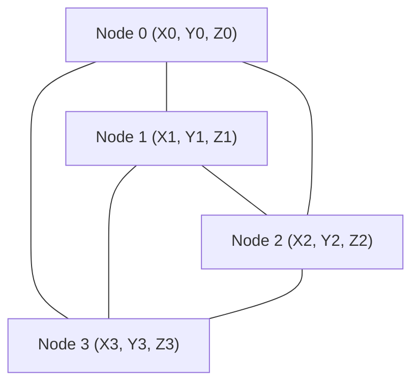

# 02. Solid Continua I: Linear Tetrahedral Elements (`Tet4`)

This document details the isoparametric formulation, shape function gradients, element matrix derivations, and **physical meaning** of the 4-node tetrahedral solid element (`Tet4`) implemented in `pSierra`.

---

## 1. Variational Principle of Virtual Work

The equilibrium of a deformable continuum body occupying reference volume $\Omega_0$ is governed by the Principle of Virtual Displacements:
$$\delta W = \delta W_{int} - \delta W_{ext} = 0, \quad \forall \delta \boldsymbol{u} \text{ kinematically admissible}$$

1. **Small-Strain Linear Equilibrium**:
   $$\int_{\Omega_0} \delta \boldsymbol{\varepsilon} : \boldsymbol{\sigma} \, d\Omega_0 = \int_{\Omega_0} \delta \boldsymbol{u} \cdot \boldsymbol{b} \, d\Omega_0 + \int_{\Gamma_t} \delta \boldsymbol{u} \cdot \boldsymbol{t} \, d\Gamma_0$$
2. **Total Lagrangian Non-linear Equilibrium**:
   $$\int_{\Omega_0} \delta \boldsymbol{E} : \boldsymbol{S} \, d\Omega_0 = \int_{\Omega_0} \delta \boldsymbol{u} \cdot \boldsymbol{b}_0 \, d\Omega_0 + \int_{\Gamma_{t0}} \delta \boldsymbol{u} \cdot \boldsymbol{t}_0 \, d\Gamma_0$$
   where $\boldsymbol{S}$ is the Second Piola-Kirchhoff stress, $\boldsymbol{E}$ is the Green-Lagrange strain, $\boldsymbol{b}_0$ is body force per unit reference volume, and $\boldsymbol{t}_0$ is reference traction.

#### Physical Meaning of the Principle of Virtual Work
- **Energy Balance under Virtual Perturbations**: The Principle of Virtual Work states that if a body is in true static equilibrium, the net virtual work performed by all internal stresses and external loads is identically zero for any arbitrary, infinitesimal "virtual" displacement perturbation $\delta \boldsymbol{u}$ that satisfies essential kinematic supports ($\delta \boldsymbol{u} = \boldsymbol{0}$ on $\Gamma_u$).
- **Weak Form vs. Strong Form**: The "strong form" (Newton's differential equation $\nabla \cdot \boldsymbol{\sigma} + \boldsymbol{b} = \boldsymbol{0}$) requires displacement fields to be twice differentiable ($C^1$ continuity). The "weak form" shifts one spatial derivative onto the test function $\delta \boldsymbol{u}$ via integration by parts (Green's theorem). This reduces continuity requirements to $C^0$ (piecewise linear displacements), making numerical approximations with simple tetrahedral meshes mathematically sound.

---

## 2. Geometry & Shape Function Gradients (`Tet4`)

The 4-node tetrahedron is defined by four reference vertices $\boldsymbol{X}_a = (X_a, Y_a, Z_a)$ for $a \in \{0, 1, 2, 3\}$.



Inside the element, the reference coordinates $\boldsymbol{X}$ and displacements $\boldsymbol{u}$ are interpolated using linear shape functions $N_a(\boldsymbol{X})$:
$$\boldsymbol{X} = \sum_{a=0}^3 N_a(\boldsymbol{X}) \boldsymbol{X}_a, \quad \boldsymbol{u}(\boldsymbol{X}) = \sum_{a=0}^3 N_a(\boldsymbol{X}) \boldsymbol{u}_a$$

### 2.1 Coordinate Matrix $\boldsymbol{A}$ and Volume $V_e$
We construct the coordinate matrix $\boldsymbol{A} \in \mathbb{R}^{4 \times 4}$:
$$\boldsymbol{A} = \begin{bmatrix}
1 & X_0 & Y_0 & Z_0 \\
1 & X_1 & Y_1 & Z_1 \\
1 & X_2 & Y_2 & Z_2 \\
1 & X_3 & Y_3 & Z_3
\end{bmatrix}$$

The reference volume $V_e$ of the tetrahedron is given by:
$$V_e = \frac{1}{6} \det(\boldsymbol{A})$$
A positive volume requires right-handed vertex ordering ($\det(\boldsymbol{A}) > 0$). If $\det(\boldsymbol{A}) \le 0$, `pSierra` raises a `ValueError` alerting to element inversion or incorrect vertex ordering.

### 2.2 Shape Function Gradient Matrix $\boldsymbol{H}$
The linear shape functions satisfy the linear system:
$$\begin{bmatrix} N_0 \\ N_1 \\ N_2 \\ N_3 \end{bmatrix} = \boldsymbol{A}^{-1} \begin{bmatrix} 1 \\ X \\ Y \\ Z \end{bmatrix}$$
Taking spatial derivatives with respect to $(X, Y, Z)$ yields the constant gradient matrix $\boldsymbol{H} \in \mathbb{R}^{4 \times 3}$:
$$\boldsymbol{H} = \nabla_{\boldsymbol{X}} \boldsymbol{N} = \begin{bmatrix}
\frac{\partial N_0}{\partial X} & \frac{\partial N_0}{\partial Y} & \frac{\partial N_0}{\partial Z} \\
\frac{\partial N_1}{\partial X} & \frac{\partial N_1}{\partial Y} & \frac{\partial N_1}{\partial Z} \\
\frac{\partial N_2}{\partial X} & \frac{\partial N_2}{\partial Y} & \frac{\partial N_2}{\partial Z} \\
\frac{\partial N_3}{\partial X} & \frac{\partial N_3}{\partial Y} & \frac{\partial N_3}{\partial Z}
\end{bmatrix} = \left( \boldsymbol{A}^{-1}[1:, :] \right)^T$$

#### Physical Meaning of Shape Functions & Gradients
- **Barycentric Volume Coordinates**: Each shape function $N_a(\boldsymbol{X})$ physically represents the **ratio of sub-volumes**:
  $$N_a(\boldsymbol{X}) = \frac{V_a(\boldsymbol{X})}{V_e}$$
  where $V_a(\boldsymbol{X})$ is the volume of the smaller sub-tetrahedron formed by point $\boldsymbol{X}$ and the face opposite to node $a$. At node $a$, $N_a = 1$, and on the opposite face, $N_a = 0$.
- **Partition of Unity ($\sum_{a=0}^3 N_a = 1$)**: Ensures rigid-body translation invariance. If all four nodes are translated by a constant vector $\boldsymbol{u}_0$, any internal point displaces by $\boldsymbol{u}(\boldsymbol{X}) = \sum N_a \boldsymbol{u}_0 = \boldsymbol{u}_0$ with zero artificial strain.
- **Constant Strain Property**: Because $N_a$ are linear polynomials in $(X, Y, Z)$, their gradients $\boldsymbol{H} = \nabla N_a$ are **spatially constant**. This means every `Tet4` element deforms homogeneously with constant strain and constant stress throughout its volume.

---

## 3. Small-Strain Linear Formulation

### 3.1 Linear Strain-Displacement Matrix $\boldsymbol{B}_L$
The 6x12 strain-displacement matrix $\boldsymbol{B}_L$ maps element nodal displacements $\boldsymbol{u}^e \in \mathbb{R}^{12}$ to the 6-component infinitesimal strain vector $\boldsymbol{\varepsilon}_{voigt} = \boldsymbol{B}_L \boldsymbol{u}^e$:
$$\boldsymbol{B}_L = \begin{bmatrix} \boldsymbol{B}_0 & \boldsymbol{B}_1 & \boldsymbol{B}_2 & \boldsymbol{B}_3 \end{bmatrix}$$
where each 6x3 nodal submatrix $\boldsymbol{B}_a$ is formed directly from row $a$ of $\boldsymbol{H} = [b_a, c_a, d_a]$:
$$\boldsymbol{B}_a = \begin{bmatrix}
b_a & 0 & 0 \\
0 & c_a & 0 \\
0 & 0 & d_a \\
c_a & b_a & 0 \\
0 & d_a & c_a \\
d_a & 0 & b_a
\end{bmatrix}$$

### 3.2 Linear Element Stiffness Matrix $\boldsymbol{k}_e$
Since $\boldsymbol{B}_L$ and $\boldsymbol{C}$ are constant inside the element, the volume integral evaluates analytically without numerical quadrature:
$$\boldsymbol{k}_e = \int_{\Omega_e} \boldsymbol{B}_L^T \boldsymbol{C} \boldsymbol{B}_L \, d\Omega_e = \left( \boldsymbol{B}_L^T \boldsymbol{C} \boldsymbol{B}_L \right) V_e \in \mathbb{R}^{12 \times 12}$$

#### Physical Meaning of the Element Stiffness Matrix $\boldsymbol{k}_e$
- **Generalized Spring Network**: Entry $k_{ij}$ physically represents the **reaction force exerted at DOF $i$ when DOF $j$ undergoes a unit displacement**, with all other DOFs held fixed at zero:
  $$f_i = k_{ij} \cdot 1.0$$
- **Symmetry & Reciprocity (Betti's Theorem)**: $\boldsymbol{k}_e = \boldsymbol{k}_e^T$ reflects Maxwell-Betti reciprocal work: the work done by a unit force at DOF $i$ moving through the displacement caused by DOF $j$ equals the work done in reverse.
- **Zero Energy Modes (Rigid-Body Nullspace)**: A 3D solid element in free space has exactly 6 zero eigenvalues corresponding to the 6 rigid-body modes (3 translations, 3 rotations). Thus, $\operatorname{rank}(\boldsymbol{k}_e) = 12 - 6 = 6$.

### 3.3 Consistent Element Mass Matrix $\boldsymbol{m}_e$
The consistent mass matrix integrates the shape function products weighted by mass density $\rho$:
$$(\boldsymbol{m}_e)_{ab} = \int_{\Omega_e} \rho N_a(\boldsymbol{X}) N_b(\boldsymbol{X}) \boldsymbol{I}_3 \, d\Omega_e$$
For a 4-node tetrahedron, the exact volume integral gives:
$$\boldsymbol{m}_e = \frac{\rho V_e}{20} \begin{bmatrix}
2 \boldsymbol{I}_3 & \boldsymbol{I}_3 & \boldsymbol{I}_3 & \boldsymbol{I}_3 \\
\boldsymbol{I}_3 & 2 \boldsymbol{I}_3 & \boldsymbol{I}_3 & \boldsymbol{I}_3 \\
\boldsymbol{I}_3 & \boldsymbol{I}_3 & 2 \boldsymbol{I}_3 & \boldsymbol{I}_3 \\
\boldsymbol{I}_3 & \boldsymbol{I}_3 & \boldsymbol{I}_3 & 2 \boldsymbol{I}_3
\end{bmatrix} \in \mathbb{R}^{12 \times 12}$$

#### Physical Meaning of Consistent vs. Lumped Mass
- **Consistent Inertial Coupling**: The off-diagonal block entries ($\frac{1}{20} \rho V_e \boldsymbol{I}_3$) represent dynamic inertial coupling across vertices. When node $a$ accelerates, the continuum mass surrounding it transmits kinetic inertia to adjacent nodes $b$.
- **Preservation of Angular Momentum**: Consistent mass matrices preserve the exact rotational inertia and kinetic energy of the tetrahedral body:
  $$T = \frac{1}{2} (\dot{\boldsymbol{u}}^e)^T \boldsymbol{m}_e \dot{\boldsymbol{u}}^e = \frac{1}{2} \int_{\Omega_e} \rho \|\dot{\boldsymbol{u}}(\boldsymbol{X})\|^2 \, d\Omega_e$$
  In contrast, simple diagonal lumped mass matrices ($m_{aa} = \frac{1}{4} \rho V_e$) underestimate rotational frequencies and fail to capture high-frequency wave dispersion.

---

## 4. Total Lagrangian (TL) Non-linear Formulation

Under finite rotations and deformations, the deformation gradient $\boldsymbol{F}$ varies with displacement $\boldsymbol{u}$.

### 4.1 Deformation Gradient Evaluation
Let $\boldsymbol{x} = \boldsymbol{X} + \boldsymbol{u}$ be the 4x3 current nodal coordinate matrix:
$$\boldsymbol{F} = \frac{\partial \boldsymbol{x}}{\partial \boldsymbol{X}} = \boldsymbol{x}^T \boldsymbol{H} \in \mathbb{R}^{3 \times 3}$$

### 4.2 Non-linear Strain-Displacement Matrix $\boldsymbol{B}(\boldsymbol{u})$
The virtual variation of the Green-Lagrange strain tensor is:
$$\delta \boldsymbol{E} = \frac{1}{2} \left( \boldsymbol{F}^T \delta \boldsymbol{F} + \delta \boldsymbol{F}^T \boldsymbol{F} \right) = \boldsymbol{B}(\boldsymbol{u}) \delta \boldsymbol{u}^e$$
where:
$$\boldsymbol{B}(\boldsymbol{u}) = \boldsymbol{B}_L + \boldsymbol{B}_{NL}(\boldsymbol{u})$$
The displacement gradient $\boldsymbol{l} = \nabla_{\boldsymbol{X}} \boldsymbol{u} = \boldsymbol{u}^T \boldsymbol{H} \in \mathbb{R}^{3 \times 3}$ defines $\boldsymbol{B}_{NL}(\boldsymbol{u})$.

### 4.3 Tangent Stiffness Matrix $\boldsymbol{k}_{tan} = \boldsymbol{k}_{mat} + \boldsymbol{k}_{geo}$
Linearizing the virtual internal work $\delta W_{int} = \int_{\Omega_e} \delta \boldsymbol{E} : \boldsymbol{S} \, d\Omega_e$ with respect to nodal displacement increments $\Delta \boldsymbol{u}^e$ yields two fundamentally distinct physical contributions:
$$\boldsymbol{k}_{tan} = \boldsymbol{k}_{mat} + \boldsymbol{k}_{geo}$$

1. **Material Tangent Stiffness $\boldsymbol{k}_{mat}$**:
   $$\boldsymbol{k}_{mat} = \int_{\Omega_e} \boldsymbol{B}^T \boldsymbol{C} \boldsymbol{B} \, d\Omega_e = \left( \boldsymbol{B}^T \boldsymbol{C} \boldsymbol{B} \right) V_e$$
2. **Geometric (Initial-Stress) Tangent Stiffness $\boldsymbol{k}_{geo}$**:
   $$\boldsymbol{k}_{geo} = \int_{\Omega_e} \boldsymbol{G}^T \hat{\boldsymbol{S}} \boldsymbol{G} \, d\Omega_e = \left( \boldsymbol{G}^T \hat{\boldsymbol{S}} \boldsymbol{G} \right) V_e$$
   where $\boldsymbol{G} \in \mathbb{R}^{9 \times 12}$ maps nodal displacements to the 9-element displacement gradient vector, and $\hat{\boldsymbol{S}} = \boldsymbol{I}_3 \otimes \boldsymbol{S} \in \mathbb{R}^{9 \times 9}$ is the Kronecker product of the 2nd Piola-Kirchhoff stress tensor.

#### Deep Physical Meaning of Material vs. Geometric Stiffness
- **Material Stiffness $\boldsymbol{k}_{mat}$ (Constitutive Resistance)**:
  Represents the resistance of the internal atomic bonds and polymer chains against incremental stretching, shearing, and volumetric change. It depends strictly on the constitutive tangent tensor $\boldsymbol{C}$.
- **Geometric Stiffness $\boldsymbol{k}_{geo}$ (Stress-Stiffening & Buckling)**:
  Arises purely because **pre-existing internal stresses $\boldsymbol{S}$ rotate as the geometry deforms**:
  - **Tensile Pre-stress ($\boldsymbol{S} > 0 \implies \boldsymbol{k}_{geo} > 0$)**: Produces **stress-stiffening**. Think of a guitar string or trampoline membrane: the higher the tension, the stiffer the structure becomes against lateral deflection, and the higher its natural vibration frequency.
  - **Compressive Pre-stress ($\boldsymbol{S} < 0 \implies \boldsymbol{k}_{geo} < 0$)**: Produces **stress-softening**. As compressive load increases, $\boldsymbol{k}_{geo}$ becomes negative, reducing the total tangent stiffness $\boldsymbol{k}_{tan} = \boldsymbol{k}_{mat} - |\boldsymbol{k}_{geo}|$. When the negative geometric stiffness completely cancels the material stiffness ($\det(\boldsymbol{k}_{tan}) = 0$), the structure loses stability and **structural buckling** occurs!

### 4.4 Internal Force Vector $\boldsymbol{f}_{int}$
The element internal restoring force is:
$$\boldsymbol{f}_{int} = \int_{\Omega_e} \boldsymbol{B}^T \boldsymbol{S}_{voigt} \, d\Omega_e = \left( \boldsymbol{B}^T \boldsymbol{S}_{voigt} \right) V_e \in \mathbb{R}^{12}$$
- **Physical Meaning**: $\boldsymbol{f}_{int}$ represents the net elastic forces that the deformed material fibers exert back onto the 4 vertices to return to the undeformed reference state. In static equilibrium, the sum of internal forces at every free node must exactly balance the applied external loads ($\boldsymbol{f}_{int} = \boldsymbol{f}_{ext}$).

---

## 5. Computational & Algorithmic Notes

1. **Constant Strain Tetrahedra (CST) Advantage**:
   Because $\boldsymbol{H}$, $\boldsymbol{F}$, $\boldsymbol{B}$, and $\boldsymbol{S}$ are spatially constant inside a 4-node tetrahedron, all volume integrals reduce to a single evaluation multiplied by $V_e$. No multi-point Gauss integration loops are required, making `Tet4` extremely fast.
2. **Kronecker Structure in Geometric Stiffness**:
   Instead of looping over nodes, `pSierra` constructs $\hat{\boldsymbol{S}}$ using `np.kron(np.identity(3), S)` and evaluates:
   ```python
   S_hat = np.kron(np.identity(3, dtype=np.float64), S)
   k_geo = (G.T @ S_hat @ G) * V
   ```

---

## 6. Code Implementation Map

| Mathematical Quantity | Formula | Source File | Method |
|---|---|---|---|
| Volume & Gradients | $V_e = \frac{\det(\boldsymbol{A})}{6}, \boldsymbol{H}$ | [`tet4.py`](../src/psierra/element/tet4.py) | `Tet4.compute_volume_and_gradients()` |
| Linear $\boldsymbol{B}_L$ Matrix | $\boldsymbol{B}_L \in \mathbb{R}^{6 \times 12}$ | [`tet4.py`](../src/psierra/element/tet4.py) | `Tet4.compute_linear_B_matrix()` |
| Non-linear $\boldsymbol{B}(\boldsymbol{u})$ | $\boldsymbol{B}_L + \boldsymbol{B}_{NL}(\boldsymbol{u})$ | [`tet4.py`](../src/psierra/element/tet4.py) | `Tet4.compute_nonlinear_B_matrix()` |
| Geometric Matrix $\boldsymbol{G}$ | $\boldsymbol{G} \in \mathbb{R}^{9 \times 12}$ | [`tet4.py`](../src/psierra/element/tet4.py) | `Tet4.compute_geometric_matrix()` |
| Linear Stiffness $\boldsymbol{k}_e$ | $(\boldsymbol{B}_L^T \boldsymbol{C} \boldsymbol{B}_L) V_e$ | [`tet4.py`](../src/psierra/element/tet4.py) | `Tet4.compute_linear_stiffness_matrix()` |
| Consistent Mass $\boldsymbol{m}_e$ | $\frac{\rho V_e}{20} [\dots]$ | [`tet4.py`](../src/psierra/element/tet4.py) | `Tet4.compute_mass_matrix()` |
| Tangent Stiffness $\boldsymbol{k}_{tan}$ | $\boldsymbol{k}_{mat} + \boldsymbol{k}_{geo}$ | [`tet4.py`](../src/psierra/element/tet4.py) | `Tet4.compute_nonlinear_force_and_tangent_stiffness()` |
| Internal Force $\boldsymbol{f}_{int}$ | $(\boldsymbol{B}^T \boldsymbol{S}_{voigt}) V_e$ | [`tet4.py`](../src/psierra/element/tet4.py) | `Tet4.compute_nonlinear_force_and_tangent_stiffness()` |

---

## 7. References & Further Reading

- **K.J. Bathe**, *Finite Element Procedures*, Chapter 5: Inelastic and Large Deformation Analysis.
- **T. Belytschko et al.**, *Nonlinear Finite Elements for Continua and Structures*, Chapter 4: Continuum Elements.
- **O.C. Zienkiewicz et al.**, *The Finite Element Method*, Chapter 6: Tetrahedral Elements.

---

### Next Step in the Pedagogical Path
While `Tet4` provides the foundational building block for 3D continua, its constant-strain nature causes severe **artificial shear locking** under bending and **volumetric locking** in incompressible tissues. 
- Proceed to **[03. Solid Continua II: Higher-Order Elements & Quadrature (`Tet10`)](03_solid_continua_quadratic_tet10_and_quadrature.md)** to explore quadratic serendipity shape functions, simplex numerical cubature, and locking alleviation.
