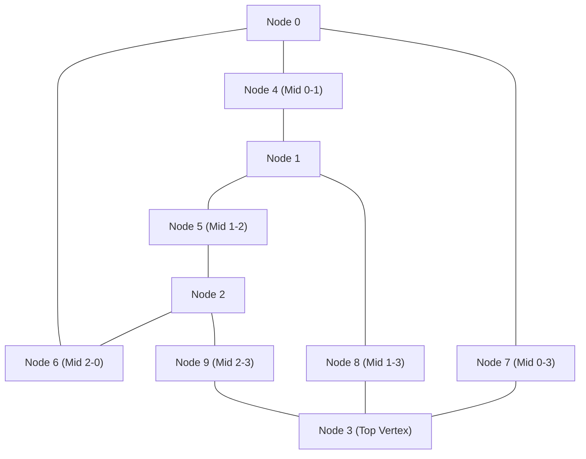

# 03. Solid Continua II: Higher-Order Elements & Simplex Quadrature (`Tet10`)

This document presents the theoretical foundation, isoparametric formulation, numerical quadrature infrastructure, and **physical mechanics** of the 10-node quadratic tetrahedral solid element (`Tet10`) implemented in `pSierra`.

---

## 1. The Locking Phenomenon in Simplex Continua

Linear tetrahedral elements (`Tet4`) possess constant strain and stress states throughout their volume. While robust and computationally inexpensive, they suffer from severe numerical pathologies in practical biomechanical engineering:

### 1.1 Artificial Shear Locking in Bending
When a prismatic body (such as a soft tissue organ or cantilever beam) is subjected to pure flexure, the physical deformation induces linearly varying normal strains across the cross-section ($\varepsilon_{xx} = -\kappa y$) with **identically zero shear strain** ($\gamma_{xy} = 0$).

Because a linear tetrahedron can only produce a spatially constant strain tensor, it cannot simultaneously satisfy the linear bending curvature along its edges without generating spurious, parasitic shear strains. These artificial shear stresses consume strain energy, causing the element to behave as though it were artificially rigid—a pathology known as **shear locking**.

### 1.2 Volumetric Locking in Incompressible Tissue
Biological tissues (e.g., brain parenchyma, liver, cartilage) are nearly incompressible, characterized by Poisson's ratios approaching the physical limit ($\nu \to 0.50$, bulk modulus $K \to \infty$). In low-order simplices, the kinematic incompressibility constraint $\nabla \cdot \boldsymbol{u} = 0$ imposes an excessive number of algebraic constraints on the nodal degrees of freedom, leading to numerical locking and non-convergent solutions.

### 1.3 The Remedy: Quadratic Interpolation
By elevating the polynomial degree from linear ($p = 1$) to quadratic ($p = 2$), the 10-node tetrahedron (`Tet10`):
1. Captures **linear strain and stress gradients** within each individual element.
2. Represents parabolic bending modes without generating parasitic shear strains.
3. Drastically increases displacement compliance and energy capture in bending-dominated regimes.

---

## 2. Geometry & Topology of the 10-Node Tetrahedron

The `Tet10` element consists of **10 nodes**:
- 4 primary corner vertices: nodes $0, 1, 2, 3$.
- 6 mid-edge nodes: nodes $4, 5, 6, 7, 8, 9$.

The node numbering follows the standard VTK / Gmsh convention:
- **Vertices**: $0, 1, 2, 3$
- **Base edges**: Edge $0-1 \to 4$, Edge $1-2 \to 5$, Edge $2-0 \to 6$
- **Vertical edges**: Edge $0-3 \to 7$, Edge $1-3 \to 8$, Edge $2-3 \to 9$

### 2.1 Barycentric Area Coordinates
Let $(L_1, L_2, L_3, L_4)$ denote the volume (barycentric) coordinates of any point inside the tetrahedron, satisfying:
$$L_1 + L_2 + L_3 + L_4 = 1, \quad L_i \in [0, 1]$$
In terms of natural master coordinates $(\xi, \eta, \zeta)$:
$$L_1 = 1 - \xi - \eta - \zeta, \quad L_2 = \xi, \quad L_3 = \eta, \quad L_4 = \zeta$$

### 2.2 Quadratic Serendipity Shape Functions
The 10 shape functions $N_a(\boldsymbol{\xi})$ are:

1. **Corner Vertex Nodes ($a \in \{0, 1, 2, 3\}$)**:
   $$N_a = L_a (2 L_a - 1)$$
2. **Mid-Edge Nodes ($a \in \{4, \dots, 9\}$)**:
   $$\begin{aligned}
   N_4 &= 4 L_1 L_2 = 4 (1 - \xi - \eta - \zeta) \xi \\
   N_5 &= 4 L_2 L_3 = 4 \xi \eta \\
   N_6 &= 4 L_3 L_1 = 4 \eta (1 - \xi - \eta - \zeta) \\
   N_7 &= 4 L_1 L_4 = 4 (1 - \xi - \eta - \zeta) \zeta \\
   N_8 &= 4 L_2 L_4 = 4 \xi \zeta \\
   N_9 &= 4 L_3 L_4 = 4 \eta \zeta
   \end{aligned}$$

These shape functions satisfy the **partition of unity** and **Kronecker delta** interpolation properties:
$$\sum_{a=0}^9 N_a(\boldsymbol{\xi}) = 1, \quad N_a(\boldsymbol{\xi}_b) = \delta_{ab}$$

---

## 3. Isoparametric Mapping & Shape Function Gradients

Within each element, the reference position $\boldsymbol{X}$ and displacement $\boldsymbol{u}$ are interpolated using the same quadratic basis:
$$\boldsymbol{X}(\boldsymbol{\xi}) = \sum_{a=0}^9 N_a(\boldsymbol{\xi}) \boldsymbol{X}_a, \quad \boldsymbol{u}(\boldsymbol{\xi}) = \sum_{a=0}^9 N_a(\boldsymbol{\xi}) \boldsymbol{u}_a$$

### 3.1 The Jacobian Matrix
The coordinate Jacobian matrix $\boldsymbol{J} \in \mathbb{R}^{3 \times 3}$ maps infinitesimal natural tangent vectors to physical reference configurations:
$$\boldsymbol{J}(\boldsymbol{\xi}) = \frac{\partial \boldsymbol{X}}{\partial \boldsymbol{\xi}} = \begin{bmatrix}
\frac{\partial X}{\partial \xi} & \frac{\partial Y}{\partial \xi} & \frac{\partial Z}{\partial \xi} \\
\frac{\partial X}{\partial \eta} & \frac{\partial Y}{\partial \eta} & \frac{\partial Z}{\partial \eta} \\
\frac{\partial X}{\partial \zeta} & \frac{\partial Y}{\partial \zeta} & \frac{\partial Z}{\partial \zeta}
\end{bmatrix} = \sum_{a=0}^9 \begin{bmatrix}
\frac{\partial N_a}{\partial \xi} \\
\frac{\partial N_a}{\partial \eta} \\
\frac{\partial N_a}{\partial \zeta}
\end{bmatrix} \begin{bmatrix} X_a & Y_a & Z_a \end{bmatrix}$$

The physical differential volume element is given by:
$$d\Omega_0 = \det(\boldsymbol{J}(\boldsymbol{\xi})) \, d\xi \, d\eta \, d\zeta$$
For straight-edged tetrahedra with mid-side nodes positioned exactly at edge midpoints, $\det(\boldsymbol{J}) = 6 V_e$ is constant. For curved elements (e.g. conforming to anatomical boundary curvature), $\det(\boldsymbol{J}(\boldsymbol{\xi}))$ varies spatially.

### 3.2 Physical Spatial Gradients
By application of the multivariate chain rule:
$$\begin{bmatrix}
\frac{\partial N_a}{\partial X} \\
\frac{\partial N_a}{\partial Y} \\
\frac{\partial N_a}{\partial Z}
\end{bmatrix} = \boldsymbol{J}(\boldsymbol{\xi})^{-1} \begin{bmatrix}
\frac{\partial N_a}{\partial \xi} \\
\frac{\partial N_a}{\partial \eta} \\
\frac{\partial N_a}{\partial \zeta}
\end{bmatrix}$$

### 3.3 The Strain-Displacement Matrix $\boldsymbol{B}(\boldsymbol{\xi})$
For the 30 element degrees of freedom ($10 \text{ nodes} \times 3 \text{ DOFs}$), the linear strain-displacement matrix $\boldsymbol{B}_L(\boldsymbol{\xi}) \in \mathbb{R}^{6 \times 30}$ is formed by concatenating the $6 \times 3$ submatrices $\boldsymbol{B}_a$:
$$\boldsymbol{B}_a(\boldsymbol{\xi}) = \begin{bmatrix}
\frac{\partial N_a}{\partial X} & 0 & 0 \\
0 & \frac{\partial N_a}{\partial Y} & 0 \\
0 & 0 & \frac{\partial N_a}{\partial Z} \\
\frac{\partial N_a}{\partial Y} & \frac{\partial N_a}{\partial X} & 0 \\
0 & \frac{\partial N_a}{\partial Z} & \frac{\partial N_a}{\partial Y} \\
\frac{\partial N_a}{\partial Z} & 0 & \frac{\partial N_a}{\partial X}
\end{bmatrix}, \quad a = 0, \dots, 9$$

---

## 4. Numerical Quadrature on Tetrahedral Simplex Domains

Because the integrand $\boldsymbol{B}^T \mathbb{C} \boldsymbol{B}$ contains quadratic rational polynomials, analytical integration across arbitrary curved 3D tetrahedra is intractable. We employ **numerical quadrature** over the standard reference master simplex:
$$\Omega_{\text{tet}} = \left\{ (\xi, \eta, \zeta) \in \mathbb{R}^3 : \xi \ge 0, \, \eta \ge 0, \, \zeta \ge 0, \, \xi + \eta + \zeta \le 1 \right\}$$
The volume integral of any tensor-valued function $\boldsymbol{\Phi}(\boldsymbol{X})$ is evaluated as:
$$\int_{\Omega_e} \boldsymbol{\Phi}(\boldsymbol{X}) \, d\Omega_e = \int_{\Omega_{\text{tet}}} \boldsymbol{\Phi}(\boldsymbol{\xi}) \det(\boldsymbol{J}(\boldsymbol{\xi})) \, d\Omega_{\boldsymbol{\xi}} \approx \sum_{q=1}^{N_q} w_q \det(\boldsymbol{J}(\boldsymbol{\xi}_q)) \boldsymbol{\Phi}(\boldsymbol{\xi}_q)$$
where $\boldsymbol{\xi}_q = (\xi_q, \eta_q, \zeta_q)$ are the integration sampling points and $w_q$ are the quadrature weights normalized such that $\sum_{q=1}^{N_q} w_q = \frac{1}{6}$ (the volume of the unit simplex).

### 4.1 Quadrature Schemes in `pSierra`

| Rule Name | Points ($N_q$) | Degree of Exactness ($p$) | Usage / Application |
| :--- | :---: | :---: | :--- |
| **Centroid (1-Point)** | 1 | $p = 1$ | Fast approximate integration; under-integrated |
| **Keast / Hammer (4-Point)** | 4 | $p = 2$ | **Default for linear elasticity**: exact for quadratic polynomials |
| **Hammer (5-Point)** | 5 | $p = 3$ | **Default for nonlinear Total Lagrangian**: exact for cubic strain energy |

#### 4-Point Symmetric Rule ($p = 2$)
$$\alpha = \frac{5 - \sqrt{5}}{20} \approx 0.1381966, \quad \beta = \frac{5 + 3\sqrt{5}}{20} \approx 0.5854102, \quad w_q = \frac{1}{24}$$
Integration points:
$$\boldsymbol{\xi}_1 = (\alpha, \alpha, \alpha), \quad \boldsymbol{\xi}_2 = (\beta, \alpha, \alpha), \quad \boldsymbol{\xi}_3 = (\alpha, \beta, \alpha), \quad \boldsymbol{\xi}_4 = (\alpha, \alpha, \beta)$$

#### 5-Point Symmetric Rule ($p = 3$)
- 1 centroid point: $\boldsymbol{\xi}_0 = \left(\frac{1}{4}, \frac{1}{4}, \frac{1}{4}\right)$ with weight $w_0 = -\frac{2}{15} \times \frac{1}{6} = -\frac{1}{45}$.
- 4 off-centroid points with coordinate permutations of $(a, a, a)$ and $(b, a, a)$ where $a = \frac{1}{6}, b = \frac{1}{2}$, each with weight $w_i = \frac{9}{80}$.

---

## 5. Element Stiffness & Total Lagrangian Formulations

### 5.1 Linear Elastic Stiffness Matrix $\boldsymbol{k}_e$
Under small-strain linear elasticity, the $30 \times 30$ element stiffness matrix is computed via numerical quadrature:
$$\boldsymbol{k}_e = \sum_{q=1}^{N_q} w_q \det(\boldsymbol{J}_q) \boldsymbol{B}_L(\boldsymbol{\xi}_q)^T \boldsymbol{C} \boldsymbol{B}_L(\boldsymbol{\xi}_q)$$
where $\boldsymbol{C} \in \mathbb{R}^{6 \times 6}$ is the constitutive elasticity matrix in Voigt notation.

### 5.2 Total Lagrangian Non-linear Tangent Stiffness
For large deformations, the kinematic deformation gradient at integration point $\boldsymbol{\xi}_q$ is:
$$\boldsymbol{F}(\boldsymbol{\xi}_q) = \boldsymbol{I} + \sum_{a=0}^9 \boldsymbol{u}_a \otimes \nabla_{\boldsymbol{X}} N_a(\boldsymbol{\xi}_q)$$
The Green-Lagrange strain $\boldsymbol{E} = \frac{1}{2}(\boldsymbol{F}^T \boldsymbol{F} - \boldsymbol{I})$ and Second Piola-Kirchhoff stress $\boldsymbol{S}$ are evaluated at each Gauss point.

The tangent stiffness matrix decomposes into material and geometric contributions:
$$\boldsymbol{k}_{tan} = \boldsymbol{k}_{mat} + \boldsymbol{k}_{geo}$$
1. **Material Tangent Stiffness**:
   $$\boldsymbol{k}_{mat} = \sum_{q=1}^{N_q} w_q \det(\boldsymbol{J}_q) \boldsymbol{B}(\boldsymbol{u}, \boldsymbol{\xi}_q)^T \mathbb{C}(\boldsymbol{E}_q) \boldsymbol{B}(\boldsymbol{u}, \boldsymbol{\xi}_q)$$
2. **Geometric Initial-Stress Stiffness**:
   $$\boldsymbol{k}_{geo} = \sum_{q=1}^{N_q} w_q \det(\boldsymbol{J}_q) \boldsymbol{G}(\boldsymbol{\xi}_q)^T \hat{\boldsymbol{S}}_q \boldsymbol{G}(\boldsymbol{\xi}_q)$$
   where $\boldsymbol{G}$ contains the shape function spatial gradients and $\hat{\boldsymbol{S}} = \boldsymbol{S} \otimes \boldsymbol{I}_3$ acts as an initial stress stiffening matrix.
3. **Internal Force Vector**:
   $$\boldsymbol{f}_{int} = \sum_{q=1}^{N_q} w_q \det(\boldsymbol{J}_q) \boldsymbol{B}(\boldsymbol{u}, \boldsymbol{\xi}_q)^T \boldsymbol{S}_{voigt}(\boldsymbol{\xi}_q)$$

---

## 6. Analytical Consistent Mass Matrix Integration

Unlike stiffness integration (which depends on constitutive tensors), the consistent mass matrix involves the integral of shape function products over the reference volume:
$$\boldsymbol{m}_{e, ab} = \rho \left( \int_{\Omega_e} N_a(\boldsymbol{X}) N_b(\boldsymbol{X}) \, d\Omega \right) \boldsymbol{I}_3$$
For straight-edged tetrahedra, this integral can be evaluated **analytically and exactly** without numerical quadrature using the classical factorial formula for barycentric polynomials:
$$\int_{\Omega_e} L_1^{\alpha_1} L_2^{\alpha_2} L_3^{\alpha_3} L_4^{\alpha_4} \, d\Omega = 6 V_e \frac{\alpha_1! \alpha_2! \alpha_3! \alpha_4!}{(\alpha_1 + \alpha_2 + \alpha_3 + \alpha_4 + 3)!}$$

Applying this formula yields the analytical $10 \times 10$ scalar mass coefficient matrix $\boldsymbol{M}_{scal}$ (Eisenhower/Hammer formula):
- Vertex-Vertex self-terms ($a=b \in \{0, 1, 2, 3\}$): $\frac{6 V_e}{2520} \times 6 = \frac{V_e}{70}$
- Mid-Mid self-terms ($a=b \in \{4, \dots, 9\}$): $\frac{6 V_e}{2520} \times 32 = \frac{16 V_e}{105}$
- Vertex-Mid adjacent terms: $\frac{6 V_e}{2520} \times (-4) = -\frac{V_e}{105}$
- Mid-Mid shared-vertex terms: $\frac{6 V_e}{2520} \times 16 = \frac{8 V_e}{105}$

Expanding each block by Kronecker product with $\boldsymbol{I}_3$:
$$\boldsymbol{m}_e = \rho (\boldsymbol{M}_{scal} \otimes \boldsymbol{I}_3) \in \mathbb{R}^{30 \times 30}$$
This guarantees exact total element mass $\sum_{a,b} m_{e,ab} = \rho V_e \boldsymbol{I}_3$, zero spurious inertia modes, and machine-precision rotational conservation.

---

## 7. Verification & Implementation Map

| Component | Source File | Key Methods / Functions |
| :--- | :--- | :--- |
| **Quadrature Infrastructure** | [`psierra/element/quadrature.py`](../src/psierra/element/quadrature.py) | `TetrahedronQuadrature`, `TriangleQuadrature` |
| **Tet10 Formulation** | [`psierra/element/tet10.py`](../src/psierra/element/tet10.py) | `compute_shape_functions`, `compute_linear_stiffness_matrix`, `compute_mass_matrix`, `compute_internal_force_and_tangent` |
| **Mesh Refinement** | [`psierra/mesh/volumetric.py`](../src/psierra/mesh/volumetric.py) | `VolumetricMesh.to_quadratic()` |
| **Test Suite** | [`tests/test_element_tet10.py`](../tests/test_element_tet10.py) | 13 automated tests (partition of unity, B-matrix, patch test $< 10^{-14}$, tangent derivative consistency $< 10^{-9}$) |
| **Simulation Benchmark** | [`examples/05_simulation/sim08_tet10_vs_tet4_cantilever.py`](../examples/05_simulation/sim08_tet10_vs_tet4_cantilever.py) | $1.87\times$ flexibility recovery over Tet4 in bending |

---

### Next Step in the Pedagogical Path
While quadratic solid continua accurately capture 3D volumetric behavior without shear locking, discretizing ultra-thin membranes (such as the brain's dura mater or cranial bone layers) with 3D elements causes severe ill-conditioning ($\kappa > 10^{14}$) and excessive degrees of freedom.
- Proceed to **[04. Structural Continua: Thin & Moderately Thick Shell Elements (`Shell3`, `Shell6`)](04_structural_shells_thin_and_thick.md)** to study 2D dimensional reduction, Discrete Kirchhoff Triangles (DKT), and Reissner-Mindlin plate bending.

