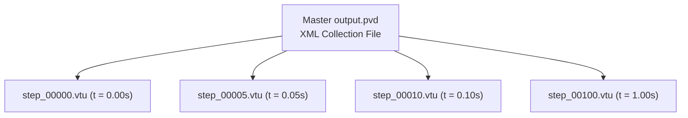

# 04. Structural Analysis Solvers & Computational Pipelines

This document details the numerical algorithms, time integration schemes, equilibrium solvers, and their **underlying physical meanings** implemented in `pSierra`:
1. **Linear Static Analysis** (Direct Sparse Factorization)
2. **Linear Dynamic Analysis** (Implicit Newmark-$\beta$ with Rayleigh Damping)
3. **Nonlinear Static Analysis** (Incremental Newton-Raphson with Backtracking Line Search)
4. **Nonlinear Dynamic Analysis** (Implicit Non-linear Newmark-$\beta$)
5. **ParaView Data Exchange Pipeline** (`.pvd` & `.vtu`)

---

## 1. Linear Static Analysis (`LinearStaticAnalysis`)

### 1.1 Mathematical Formulation
Linear static equilibrium represents the balance of internal elastic restoring forces and external loads:
$$\boldsymbol{K}_{ff} \boldsymbol{u}_f = \boldsymbol{f}_f - \boldsymbol{K}_{fp} \boldsymbol{u}_p$$

### 1.2 Solution Algorithm
Because $\boldsymbol{K}_{ff}$ is symmetric and positive definite (for well-constrained physical systems), `pSierra` leverages **SuperLU** direct sparse LU decomposition with column approximate minimum degree (COLAMD) permutation:
$$\boldsymbol{P} \boldsymbol{K}_{ff} \boldsymbol{Q} = \boldsymbol{L} \boldsymbol{U}$$
The solution is evaluated via triangular forward and backward substitutions:
$$\boldsymbol{u}_f = \boldsymbol{U}^{-1} \left( \boldsymbol{L}^{-1} (\boldsymbol{P} \boldsymbol{f}_{eff}) \right)$$

### 1.3 Post-Processing Quantities
1. **Reaction Forces**: $\boldsymbol{R} = \boldsymbol{K} \boldsymbol{u} - \boldsymbol{f}_{ext}$.
2. **Elastic Strain Energy**: $U = \frac{1}{2} \boldsymbol{u}^T \boldsymbol{K} \boldsymbol{u}$.

#### Physical Meaning of Linear Static Equilibrium
- **Minimum Total Potential Energy**: Linear static equilibrium corresponds physically to the state of **minimum total potential energy** $\Pi(\boldsymbol{u}) = U(\boldsymbol{u}) - W_{ext}(\boldsymbol{u})$. The gradient $\frac{\partial \Pi}{\partial \boldsymbol{u}} = \boldsymbol{K}\boldsymbol{u} - \boldsymbol{f} = \boldsymbol{0}$ defines this stationary equilibrium point.
- **Physical Meaning of Strain Energy $U$**: Represents the internal potential energy stored in the stretched and sheared interatomic bonds of the material. By conservation of energy, the work performed by external forces during gradual loading ($W_{ext} = \frac{1}{2} \boldsymbol{f}_{ext}^T \boldsymbol{u}$) is entirely converted into elastic strain energy ($U$).

---

## 2. Linear Dynamic Analysis (`LinearDynamicAnalysis`)

### 2.1 Equations of Motion
The discretized linear equations of motion in the time domain are governed by D'Alembert's dynamic principle:
$$\boldsymbol{M} \ddot{\boldsymbol{u}}(t) + \boldsymbol{C} \dot{\boldsymbol{u}}(t) + \boldsymbol{K} \boldsymbol{u}(t) = \boldsymbol{f}_{ext}(t)$$

#### Physical Meaning of Dynamic Equilibrium Forces
At every instant in time, four physical force mechanisms maintain dynamic equilibrium:
1. **Inertial Force ($\boldsymbol{M} \ddot{\boldsymbol{u}}$)**: The resistance of the body's mass to changes in velocity ($F = ma$). Acts to maintain current momentum.
2. **Damping Force ($\boldsymbol{C} \dot{\boldsymbol{u}}$)**: Viscous dissipation that converts mechanical kinetic and strain energy into microscopic thermal heat, attenuating oscillations.
3. **Internal Restoring Force ($\boldsymbol{K} \boldsymbol{u}$)**: Elastic forces striving to restore the structure back to its undeformed state.
4. **External Excitation ($\boldsymbol{f}_{ext}(t)$)**: Time-varying external loads, boundary motions, or body forces driving the motion.

### 2.2 Rayleigh Proportional Damping
Physical dissipation is modeled through Rayleigh proportional damping:
$$\boldsymbol{C} = \alpha \boldsymbol{M} + \beta \boldsymbol{K}$$
where $\alpha \ge 0$ is the mass-proportional damping factor and $\beta \ge 0$ is the stiffness-proportional damping factor. The modal damping ratio $\xi_n$ at natural circular frequency $\omega_n$ is:
$$\xi_n = \frac{\alpha}{2 \omega_n} + \frac{\beta \omega_n}{2}$$

#### Physical Meaning of Rayleigh Damping Parameters ($\alpha$ and $\beta$)
- **Mass Damping ($\alpha \boldsymbol{M}$ - Ambient Medium Resistance)**:
  - Dominates at low frequencies ($\xi \propto 1/\omega$).
  - Physically represents resistance against an external medium (such as air resistance, surrounding fluid drag, or surrounding soft connective tissue). It damps rigid-body motion and fundamental low-frequency structural swaying.
- **Stiffness Damping ($\beta \boldsymbol{K}$ - Internal Material Hysteresis)**:
  - Dominates at high frequencies ($\xi \propto \omega$).
  - Physically represents internal viscoelastic friction between polymer chains, crystal dislocation glide, and thermoelastic relaxation within the material. It filters out non-physical high-frequency numerical noise and acoustic vibrations.

### 2.3 Implicit Newmark-$\beta$ Integration Scheme
`pSierra` employs the classical implicit Newmark-$\beta$ scheme with standard unconditionally stable parameters:
$$\beta = \frac{1}{4}, \quad \gamma = \frac{1}{2} \quad \text{(Average Acceleration Method)}$$

The kinematic relations between time $t_n$ and $t_{n+1} = t_n + \Delta t$ are:
$$\boldsymbol{u}_{n+1} = \boldsymbol{u}_n + \Delta t \dot{\boldsymbol{u}}_n + \Delta t^2 \left[ \left(\frac{1}{2} - \beta\right) \ddot{\boldsymbol{u}}_n + \beta \ddot{\boldsymbol{u}}_{n+1} \right]$$
$$\dot{\boldsymbol{u}}_{n+1} = \dot{\boldsymbol{u}}_n + \Delta t \left[ (1 - \gamma) \ddot{\boldsymbol{u}}_n + \gamma \ddot{\boldsymbol{u}}_{n+1} \right]$$

### 2.4 Newmark Integration Constants
$$a_0 = \frac{1}{\beta \Delta t^2}, \quad a_1 = \frac{\gamma}{\beta \Delta t}, \quad a_2 = \frac{1}{\beta \Delta t}, \quad a_3 = \frac{1}{2\beta} - 1, \quad a_4 = \frac{\gamma}{\beta} - 1, \quad a_5 = \frac{\Delta t}{2}\left(\frac{\gamma}{\beta} - 2\right)$$

Substituting the kinematic updates into the partitioned equations of motion yields the effective linear algebraic system for $\boldsymbol{u}_{f, n+1}$:
$$\boldsymbol{K}_{eff} \boldsymbol{u}_{f, n+1} = \boldsymbol{f}_{eff, n+1}$$
where:
$$\boldsymbol{K}_{eff} = \boldsymbol{K}_{ff} + a_0 \boldsymbol{M}_{ff} + a_1 \boldsymbol{C}_{ff}$$
$$\boldsymbol{f}_{eff, n+1} = \boldsymbol{f}_{ext, f} + \boldsymbol{M}_{ff} \left( a_0 \boldsymbol{u}_n + a_2 \dot{\boldsymbol{u}}_n + a_3 \ddot{\boldsymbol{u}}_n \right) + \boldsymbol{C}_{ff} \left( a_1 \boldsymbol{u}_n + a_4 \dot{\boldsymbol{u}}_n + a_5 \ddot{\boldsymbol{u}}_n \right)$$

#### Physical Meaning of the Effective Dynamic Matrix $\boldsymbol{K}_{eff}$
- In dynamics, the effective stiffness $\boldsymbol{K}_{eff} = \boldsymbol{K}_{ff} + \frac{4}{\Delta t^2} \boldsymbol{M}_{ff} + \frac{2}{\Delta t} \boldsymbol{C}_{ff}$ combines elastic stiffness with **inertial resistance** ($\frac{4}{\Delta t^2} \boldsymbol{M}$) and **viscous resistance** ($\frac{2}{\Delta t} \boldsymbol{C}$).
- For very small time steps $\Delta t \to 0$, the inertial term $\frac{4}{\Delta t^2} \boldsymbol{M}$ dominates, reflecting the physical reality that sudden, instantaneous forces are initially resisted by inertia ($F = ma$) before strain has time to propagate across the structure.
- **Zero Numerical Dissipation ($\gamma = 0.5$)**: Setting $\gamma = 0.5$ guarantees that the time integrator introduces no artificial numerical damping; the decay of the oscillation is governed entirely by the physical Rayleigh damping matrix $\boldsymbol{C}$.

### 2.5 Computational Acceleration: Single Factorization
In linear dynamics, $\boldsymbol{M}_{ff}$, $\boldsymbol{C}_{ff}$, and $\boldsymbol{K}_{ff}$ are **constant over time**. Therefore, $\boldsymbol{K}_{eff}$ is factorized **only once** at the beginning of the simulation:
```python
solve_step = spla.factorized(K_eff)
```
Each time step then requires only $\mathcal{O}(N)$ back-substitution, enabling hundreds of dynamic time steps to run in seconds.

---

## 3. Nonlinear Static Analysis (`NonlinearStaticAnalysis`)

### 3.1 Incremental Newton-Raphson Iteration
In finite-deformation mechanics, equilibrium between external loads and internal resisting forces $\boldsymbol{f}_{int}(\boldsymbol{u})$ is non-linear:
$$\boldsymbol{R}(\boldsymbol{u}) = \lambda \boldsymbol{f}_{ext} - \boldsymbol{f}_{int}(\boldsymbol{u}) = \boldsymbol{0}$$
where $\lambda \in [0, 1]$ is the incremental load parameter across $N_{steps}$ load increments.

Linearizing $\boldsymbol{f}_{int}(\boldsymbol{u} + \Delta \boldsymbol{u}) \approx \boldsymbol{f}_{int}(\boldsymbol{u}) + \boldsymbol{K}_{tan}(\boldsymbol{u}) \Delta \boldsymbol{u}$ yields the Newton-Raphson system:
$$\boldsymbol{K}_{tan}(\boldsymbol{u}_k) \Delta \boldsymbol{u}_k = \boldsymbol{R}(\boldsymbol{u}_k)$$
$$\boldsymbol{u}_{k+1} = \boldsymbol{u}_k + \Delta \boldsymbol{u}_k$$

Convergence is reached when the relative residual drops below the specified tolerance:
$$\frac{\|\boldsymbol{R}_{free}\|}{\max(\|\boldsymbol{f}_{ext, free}\|, 1.0)} < \text{tol}$$

#### Physical Meaning of the Residual Vector $\boldsymbol{R}$ & Load Stepping
- **The Out-of-Balance Residual $\boldsymbol{R}$**: Physically represents the **unbalanced net external force** acting on each free node. If $\boldsymbol{R} \neq \boldsymbol{0}$, the internal stresses do not yet balance the applied load, causing a virtual acceleration. Newton-Raphson iteratively adjusts the deformed shape until the internal elastic restoring force perfectly counterbalances the applied load.
- **Physical Necessity of Load Stepping ($\lambda = 0.1 \dots 1.0$)**: In non-linear mechanics, applying 100% of the load in a single step often causes convergence failure because the initial tangent $\boldsymbol{K}_0$ points in the wrong direction for large rotations. Incrementally ramping up $\lambda$ traces the quasi-static equilibrium path step-by-step, capturing large non-linear geometric changes (like beam axial pull-in and progressive bending).

### 3.2 Backtracking Line Search & Inversion Guard
During large steps or localized instabilities, an unconstrained Newton increment $\Delta \boldsymbol{u}$ may deform elements beyond physical limits, causing negative volume ratios ($J = \det(\boldsymbol{F}) \le 0$).

To prevent numerical divergence, `pSierra` incorporates a backtracking line search:
```python
alpha = 1.0
for _ in range(8):
    u_candidate = u_current.copy()
    u_candidate[free_dofs] += alpha * du_free
    self.domain.update_state(u=u_candidate)
    try:
        self.domain.assemble_internal_forces()
        u_current = u_candidate
        break
    except ValueError:
        alpha *= 0.5  # Halve step size when det(F) <= 0
```
- **Physical Meaning**: When a full Newton step ($\alpha = 1.0$) would pinch or invert a tetrahedral element, the line search scales down the displacement increment ($\alpha \leftarrow 0.5 \alpha$), guiding the mesh along a physically valid deformation path where all elements maintain positive volume ($J > 0$).

---

## 4. Nonlinear Dynamic Analysis (`NonlinearDynamicAnalysis`)

### 4.1 Governing System
Non-linear dynamic equilibrium at time $t_{n+1}$ satisfies:
$$\boldsymbol{R}(\boldsymbol{u}_{n+1}) = \boldsymbol{f}_{ext, n+1} - \boldsymbol{M} \ddot{\boldsymbol{u}}_{n+1} - \boldsymbol{C} \dot{\boldsymbol{u}}_{n+1} - \boldsymbol{f}_{int}(\boldsymbol{u}_{n+1}) = \boldsymbol{0}$$

### 4.2 Dynamic Tangent Stiffness Matrix
Expressing acceleration and velocity increments in terms of displacement increments:
$$\ddot{\boldsymbol{u}}_{n+1}^{(i+1)} = \ddot{\boldsymbol{u}}_n + a_0 (\boldsymbol{u}_{n+1}^{(i+1)} - \boldsymbol{u}_n) - a_2 \dot{\boldsymbol{u}}_n - a_3 \ddot{\boldsymbol{u}}_n$$
$$\dot{\boldsymbol{u}}_{n+1}^{(i+1)} = \dot{\boldsymbol{u}}_n + a_1 (\boldsymbol{u}_{n+1}^{(i+1)} - \boldsymbol{u}_n) - a_4 \dot{\boldsymbol{u}}_n - a_5 \ddot{\boldsymbol{u}}_n$$

The dynamic tangent stiffness matrix assembled at each Newton iteration is:
$$\boldsymbol{K}_{dyn} = \boldsymbol{K}_{tan}(\boldsymbol{u}_{n+1}^{(i)}) + a_0 \boldsymbol{M} + a_1 \boldsymbol{C}$$
The displacement correction $\delta \boldsymbol{u}$ satisfies:
$$\boldsymbol{K}_{dyn, ff} \delta \boldsymbol{u}_f = \boldsymbol{R}_f^{(i)}$$
$$\boldsymbol{u}_{f, n+1}^{(i+1)} = \boldsymbol{u}_{f, n+1}^{(i)} + \delta \boldsymbol{u}_f$$

#### Physical Meaning of Non-linear Dynamic Coupling
- Non-linear dynamics captures the physical interplay between **kinetic energy, large geometric rotations, and material non-linearity**.
- As a beam swings dynamically under gravity, its orientation changes continuously, which rotates its mass distribution and internal stresses. The dynamic tangent $\boldsymbol{K}_{dyn}$ accounts for both the **instantaneous material stiffness**, the **geometric stress-stiffening from tension**, and the **effective inertial resistance**, enabling realistic simulations of soft organ kinematics, beating hearts, and flexible robotic arms.

---

## 5. ParaView Data Exchange Pipeline (`.pvd` & `.vtu`)

For time-series dynamic simulations and incremental non-linear analyses, `pSierra` generates native ParaView Data (`.pvd`) XML collection files referencing individual unstructured VTK (`.vtu`) mesh files.



The [`PvdCollectionWriter`](../src/psierra/exchange/pvd.py) outputs standard VTK XML:
```xml
<?xml version="1.0"?>
<VTKFile type="Collection" version="0.1" byte_order="LittleEndian">
  <Collection>
    <DataSet timestep="0.000000e+00" group="" part="0" file="step_00000.vtu"/>
    <DataSet timestep="2.500000e-02" group="" part="0" file="step_00005.vtu"/>
  </Collection>
</VTKFile>
```
Opening `output.pvd` in ParaView provides an interactive animation time slider allowing scrubbing through the dynamic response or non-linear loading ramp.

---

## 6. Code Implementation Map

| Solver / Concept | Formulation | Source File | Class & Method |
|---|---|---|---|
| Linear Static Solver | $\boldsymbol{K}_{ff}\boldsymbol{u}_f = \boldsymbol{f}_{eff}$ | [`linear_static.py`](../src/psierra/analysis/linear_static.py) | `LinearStaticAnalysis.solve()` |
| Linear Dynamic Solver | Implicit Newmark-$\beta$ | [`linear_dynamic.py`](../src/psierra/analysis/linear_dynamic.py) | `LinearDynamicAnalysis.solve()` |
| Rayleigh Damping | $\boldsymbol{C} = \alpha \boldsymbol{M} + \beta \boldsymbol{K}$ | [`rayleigh.py`](../src/psierra/damping/rayleigh.py) | `RayleighDamping.assemble_damping_matrix()` |
| Nonlinear Static Solver | Incremental Newton-Raphson | [`nonlinear_static.py`](../src/psierra/analysis/nonlinear_static.py) | `NonlinearStaticAnalysis.solve()` |
| Nonlinear Dynamic Solver | Dynamic Newton-Newmark | [`nonlinear_dynamic.py`](../src/psierra/analysis/nonlinear_dynamic.py) | `NonlinearDynamicAnalysis.solve()` |
| ParaView PVD Exporter | XML Collection Builder | [`pvd.py`](../src/psierra/exchange/pvd.py) | `PvdCollectionWriter` |

---

## 7. References & Further Reading

- **N.M. Newmark**, *A Method of Computation for Structural Dynamics*, Journal of the Engineering Mechanics Division, ASCE, 85:67-94, 1959.
- **K.J. Bathe**, *Finite Element Procedures*, Chapter 9: Dynamic Analysis and Time Integration.
- **T. Belytschko et al.**, *Nonlinear Finite Elements for Continua and Structures*, Chapter 6: Nonlinear Dynamic Solutions.
