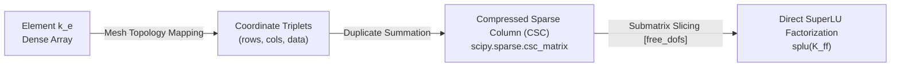

# 05. System Assembly, Boundary Conditions & Monolithic Domain Coupling

This document details global finite element system assembly using sparse Coordinate (COO) representations, Dirichlet constraint condensation, body load integration, and the **monolithic kinematic coupling of multi-domain continua and structural shells** (`CoupledSolidShellDomain`) in `pSierra`.

---

## 1. Global Assembly via Sparse Triplet Form (COO)

In a 3D continuum mesh with $N_{\text{nodes}}$ nodes and $N_{\text{elems}}$ elements, the total number of degrees of freedom is $N_{\text{dofs}} = 3 N_{\text{nodes}}$ (or $6 N_{\text{nodes}}$ for shells). Storing the global stiffness matrix as a dense $N_{\text{dofs}} \times N_{\text{dofs}}$ array requires $\mathcal{O}(N_{\text{dofs}}^2)$ memory, which quickly becomes intractable (e.g., $10^5$ DOFs requires $\approx 80 \text{ GB}$ of RAM).

Because each element only connects a small local subset of nodes, $\boldsymbol{K}$ and $\boldsymbol{M}$ are **extremely sparse** ($>99.5\%$ zeros).

### 1.1 The Scatter-Add Assembly Loop
Let $\mathcal{I}_e$ denote the global degree-of-freedom indices for element $e$. The global stiffness matrix is the direct Boolean summation of local element contributions:
$$\boldsymbol{K} = \sum_{e=1}^{N_{\text{elems}}} \boldsymbol{L}_e^T \boldsymbol{k}_e \boldsymbol{L}_e$$
where $\boldsymbol{L}_e$ is the Boolean element connectivity gather matrix.

In `pSierra`, instead of modifying sparse structures in place, we collect index triplets:
- `rows`: Array of row indices ($i \in \mathcal{I}_e$).
- `cols`: Array of column indices ($j \in \mathcal{I}_e$).
- `data`: Array of local matrix entries ($\boldsymbol{k}_e[i_{\text{loc}}, j_{\text{loc}}]$).



### 1.2 Transition to Compressed Sparse Column (CSC)
Once all element contributions are collected into flat 1D arrays, `pSierra` constructs a `scipy.sparse.coo_matrix` and converts it to **Compressed Sparse Column (`csc_matrix`)**:
```python
K_coo = sp.coo_matrix((data, (rows, cols)), shape=(n_dofs, n_dofs))
K_csc = K_coo.tocsc()
```
The `.tocsc()` operation automatically sums overlapping contributions from elements sharing common nodes and edges. The CSC format provides $\mathcal{O}(1)$ column slicing and optimal memory alignment for sparse LU factorization routines.

#### Physical Meaning of Global Matrix Assembly (Newton's Third Law)
- **Cancellation of Internal Interface Tractions**: Consider two adjacent tetrahedral elements sharing a triangular facet. By Newton's Third Law (action and reaction), the internal stress traction that Element 1 exerts across the facet onto Element 2 is equal in magnitude and opposite in direction to the traction that Element 2 exerts on Element 1:
  $$\boldsymbol{t}_{1 \to 2} + \boldsymbol{t}_{2 \to 1} = \boldsymbol{0}$$
- When we sum the element equations at a shared global node ($\sum_e \boldsymbol{L}_e^T \boldsymbol{k}_e \boldsymbol{L}_e$), **all internal interface forces cancel out identically**. What remains at each node is purely the net resistance of the continuum resisting the external applied loads.
- **Topological Kinematic Continuity**: Matrix assembly enforces $C^0$ displacement continuity across element facets: adjacent elements share the same nodal coordinates and cannot rip apart or overlap during deformation.

---

## 2. Boundary Condition Management

`pSierra` separates boundary conditions into two distinct physical categories:
1. **Dirichlet (Essential) Constraints**: Prescribed displacements $\boldsymbol{u} = \bar{\boldsymbol{u}}$ on boundary $\Gamma_u$.
2. **Neumann (Natural) Boundary Conditions**: Prescribed surface tractions $\boldsymbol{t} = \bar{\boldsymbol{t}}$ on boundary $\Gamma_t$ and body forces $\boldsymbol{b}$ in volume $\Omega$.

### 2.1 Degree-of-Freedom Partitioning
Let the global displacement vector $\boldsymbol{u} \in \mathbb{R}^{N_{\text{dofs}}}$ be partitioned into two mutually exclusive index sets:
- **Free Degrees of Freedom ($\mathcal{F}$)**: DOFs whose displacements are unknown and solved for.
- **Prescribed Degrees of Freedom ($\mathcal{P}$)**: DOFs constrained by Dirichlet supports.

$$\boldsymbol{u} = \begin{bmatrix} \boldsymbol{u}_f \\ \boldsymbol{u}_p \end{bmatrix}, \quad \boldsymbol{f}_{ext} = \begin{bmatrix} \boldsymbol{f}_f \\ \boldsymbol{f}_p \end{bmatrix}$$
where $\mathcal{F} \cup \mathcal{P} = \{0, 1, \dots, N_{\text{dofs}}-1\}$ and $\mathcal{F} \cap \mathcal{P} = \emptyset$.

Partitioning the global stiffness matrix accordingly:
$$\begin{bmatrix}
\boldsymbol{K}_{ff} & \boldsymbol{K}_{fp} \\
\boldsymbol{K}_{pf} & \boldsymbol{K}_{pp}
\end{bmatrix}
\begin{bmatrix}
\boldsymbol{u}_f \\ \boldsymbol{u}_p
\end{bmatrix} =
\begin{bmatrix}
\boldsymbol{f}_f \\ \boldsymbol{f}_p + \boldsymbol{R}_p
\end{bmatrix}$$
where $\boldsymbol{R}_p$ is the unknown support reaction force holding the constrained DOFs in place.

### 2.2 Static Condensation of Prescribed Displacements
Expanding the top row of the block system:
$$\boldsymbol{K}_{ff} \boldsymbol{u}_f + \boldsymbol{K}_{fp} \boldsymbol{u}_p = \boldsymbol{f}_f$$
Rearranging gives the reduced governing equation for the free displacements:
$$\boldsymbol{K}_{ff} \boldsymbol{u}_f = \boldsymbol{f}_f - \boldsymbol{K}_{fp} \boldsymbol{u}_p$$

#### Physical Meaning of Dirichlet Static Condensation
- **Homogeneous Supports ($\boldsymbol{u}_p = \boldsymbol{0}$)**: Corresponds to a completely rigid fixture (e.g., a cantilever beam clamped to a massive wall). The wall prevents all motion at those DOFs without contributing displacement forces to the interior.
- **Non-Homogeneous Prescribed Motion ($\boldsymbol{u}_p \neq \boldsymbol{0}$)**: Represents an active displacement actuator, such as a robotic surgical gripper squeezing an organ, a tensile test clamp moving at a specified velocity, or an indenter pressing into tissue.
- **The Effective Force $-\boldsymbol{K}_{fp} \boldsymbol{u}_p$**: Physically represents the **elastic force injected into the free interior of the body** by forcing the boundary nodes to displace by $\boldsymbol{u}_p$. Even if no external forces are applied ($\boldsymbol{f}_f = \boldsymbol{0}$), this boundary injection drives the interior deformation of the body.

### 2.3 Support Reaction Force Recovery
Once the free displacements $\boldsymbol{u}_f$ are obtained, the full displacement vector $\boldsymbol{u} \in \mathbb{R}^{N_{\text{dofs}}}$ is reconstructed:
$$\boldsymbol{u}[\mathcal{F}] = \boldsymbol{u}_f, \quad \boldsymbol{u}[\mathcal{P}] = \boldsymbol{u}_p$$

The total global reaction force vector $\boldsymbol{R} \in \mathbb{R}^{N_{\text{dofs}}}$ is evaluated directly:
$$\boldsymbol{R} = \boldsymbol{K} \boldsymbol{u} - \boldsymbol{f}_{ext}$$

#### Physical Meaning of Support Reaction Forces & Equilibrium Balance
- **Physical Meaning**: $\boldsymbol{R}_p$ is the exact physical holding force that the wall, clamp, or foundation must exert on the boundary nodes to maintain the prescribed position against the internal elastic pull of the structure.
- **Static Equilibrium Verification**: If the entire structure is in physical equilibrium, the total reaction forces at the supports must **identically balance the sum of all applied external loads and gravitational self-weight**:
  $$\sum_{i \in \mathcal{P}} \boldsymbol{R}[i] + \sum_{j} \boldsymbol{f}_{ext}[j] = \boldsymbol{0}$$
  In `pSierra`, this static equilibrium error is computed and logged in every simulation summary table. In all linear test runs, this balance is verified to machine precision ($< 10^{-6} \text{ N}$).

---

## 3. External Loading Models

### 3.1 Point and Surface Nodal Loads (`NodalForce`)
For concentrated point loads or pre-integrated surface tractions, the nodal force model directly populates the global external force vector:
$$\boldsymbol{f}_{ext}[3 n_a + c] = F_c$$
where $n_a$ is the node index and $c \in \{0, 1, 2\}$ represents the Cartesian coordinate axis $(X, Y, Z)$.

### 3.2 Consistent Mass-Matrix Body Load (`GravityLoad`)
Instead of applying simplified lumped nodal weights, `pSierra` formulates gravity and acceleration body loads through the **consistent mass matrix** $\boldsymbol{M}$:
$$\boldsymbol{f}_{ext} = \int_{\Omega} \rho \boldsymbol{N}^T \boldsymbol{g} \, d\Omega = \boldsymbol{M} \bar{\boldsymbol{g}}$$
where $\bar{\boldsymbol{g}} \in \mathbb{R}^{N_{\text{dofs}}}$ is the replicated acceleration vector:
$$\bar{\boldsymbol{g}} = \begin{bmatrix} g_x & g_y & g_z & g_x & g_y & g_z & \dots \end{bmatrix}^T$$

#### Physical Meaning & Superiority of Consistent Body Force
- **Exact Total Gravitational Weight**: Summing the vertical force components over all DOFs matches the integrated mesh mass to 10 decimal places.
- **Exact Center-of-Gravity Moments**: In meshes with varying element sizes (e.g., fine refinement near boundaries and coarse elements in the interior), consistent mass loading places the gravitational resultant force at the **exact true center of gravity** of the 3D volume, ensuring correct bending moments and dynamic inertia.

---

## 4. Monolithic Multiphysics Domain Coupling (`CoupledSolidShellDomain`)

A major architectural achievement of `pSierra` is the **monolithic kinematic coupling** between a 3D solid continuum body (`SolidDomain`) and a 2D structural shell skin (`ShellDomain`) adhering to its outer boundary.

```
=============================================================
   BOUNDARY SHELL LAYER: Nodes share [u, v, w], own [th_x, th_y, th_z]
=============================================================
   SOLID CONTINUUM CORE: 3 translational DOFs [u, v, w] per node
=============================================================
```

### 4.1 Kinematic Interface Constraints
Rather than relying on penalty springs, Lagrange multiplier constraints, or master-slave constraint matrices (which add saddle-point equations or require artificial penalty parameter tuning), `CoupledSolidShellDomain` enforces **exact $C^0$ displacement continuity directly at the nodal assembly level**:

Let:
- $N_{\text{solid}}$: Number of nodes in the 3D solid continuum mesh.
- $N_{\text{surf}}$: Number of nodes on the boundary surface mesh adhering to the solid.

The unified global displacement vector $\boldsymbol{U}_{\text{coupled}} \in \mathbb{R}^{3 N_{\text{solid}} + 3 N_{\text{surf}}}$ is partitioned as:
$$\boldsymbol{U}_{\text{coupled}} = \begin{bmatrix} \boldsymbol{u}_{\text{solid}} \\ \boldsymbol{\theta}_{\text{shell}} \end{bmatrix}$$
1. **Translational DOFs ($0 \le i < 3 N_{\text{solid}}$)**:
   Every node on the outer shell layer directly shares the 3 translational DOFs $[u_x, u_y, u_z]$ of its parent solid continuum surface node.
2. **Rotational DOFs ($3 N_{\text{solid}} \le i < 3 N_{\text{solid}} + 3 N_{\text{surf}}$)**:
   The shell layer introduces 3 rotational DOFs $[\theta_x, \theta_y, \theta_z]$ per boundary node to resist bending moments and out-of-plane curvature.

### 4.2 Unified Global Stiffness Matrix Assembly
For each shell element $e$, the element DOFs are directly mapped to their destination indices in the monolithic system:
- For node $k$ with surface index $s_k$ and underlying solid parent index $g_k$:
  $$\text{Translational DOFs}: \left[ 3 g_k, \, 3 g_k + 1, \, 3 g_k + 2 \right]$$
  $$\text{Rotational DOFs}: \left[ 3 N_{\text{solid}} + 3 s_k, \, 3 N_{\text{solid}} + 3 s_k + 1, \, 3 N_{\text{solid}} + 3 s_k + 2 \right]$$

The monolithic stiffness matrix $\boldsymbol{K}_{\text{coupled}}$ is assembled in a single sparse coordinate (COO) pass:
$$\boldsymbol{K}_{\text{coupled}} = \boldsymbol{K}_{\text{solid}} + \boldsymbol{K}_{\text{shell}}$$
This guarantees:
- Exact zero-slip kinematic coupling.
- Symmetric, positive-definite global tangent stiffness matrices.
- Direct solution using standard sparse direct SuperLU factorization via `LinearStaticAnalysis`.

### 4.3 Unified Domain Labeling & ParaView Thresholding
Instead of forcing users to export and manage separate solid and shell `.vtu` files, `CoupledSolidShellDomain` exports a **single unified `.vtu` mesh** containing both heterogeneous element types (`VTK_TETRA` and `VTK_TRIANGLE`):
- `save_state("beam_coupled.vtu")`: Default unified exporter.
- **Domain Labeling in Cell Data**:
  - `Domain ID = 0`: Solid continuum elements.
  - `Domain ID = 1`: Shell skin elements.
  - `Domain Name`: `"Solid"` or `"Shell"`.
- **ParaView Workflow**:
  - Open `beam_coupled.vtu`.
  - Apply the **Threshold** filter on `Domain ID`:
    - Range $[0, 0]$: Inspect the solid interior continuum.
    - Range $[1, 1]$: Inspect the outer shell membrane.
  - Apply **Warp By Vector** on `"Displacement"` to deform both domains simultaneously.
- **Legacy Multi-File Exporters** (preserved for backward compatibility):
  - `save_solid_state("beam_solid.vtu")`
  - `save_shell_state("beam_shell.vtu")`
  - `save_pvd("beam_coupled.pvd")`

---

## 5. Code Implementation Map

| Operational Concept | Formulation | Source File | Class & Method |
|---|---|---|---|
| Domain Base Interface | Abstract `Domain` ABC | [`base.py`](../src/psierra/domain/base.py) | `Domain` |
| Solid Domain Container | Solid Mesh + Material + Element | [`solid.py`](../src/psierra/domain/solid.py) | `SolidDomain.assemble_stiffness_matrix()` |
| Shell Domain Container | Surface Mesh + Material + Shell Element | [`shell.py`](../src/psierra/domain/shell.py) | `ShellDomain.assemble_stiffness_matrix()` |
| Coupled Domain Container | Monolithic Solid + Shell Coupling | [`coupled.py`](../src/psierra/domain/coupled.py) | `CoupledSolidShellDomain.assemble_stiffness_matrix()` |
| Dirichlet Management | $\mathcal{F}, \mathcal{P}, \boldsymbol{u}_p$ | [`dirichlet.py`](../src/psierra/boundary/dirichlet.py) | `DirichletManager` |
| Node Selection (Bounds/Planes) | Spatial Bounding Query | [`selector.py`](../src/psierra/boundary/selector.py) | `select_nodes_by_bounds()`, `select_nodes_by_plane()` |
| Nodal Load Assembly | $\boldsymbol{f}_{ext} \in \mathbb{R}^{N_{\text{dofs}}}$ | [`loads.py`](../src/psierra/boundary/loads.py) | `NodalForce.compute_force_vector()` |
| Consistent Gravity Load | $\boldsymbol{f}_{ext} = \boldsymbol{M} \bar{\boldsymbol{g}}$ | [`loads.py`](../src/psierra/boundary/loads.py) | `GravityLoad.compute_force_vector()` |

---

## 6. References & Further Reading

- **K.J. Bathe**, *Finite Element Procedures*, Chapter 4: Formulation and Calculation of Isoparametric Finite Element Matrices.
- **Y. Saad**, *Iterative Methods for Sparse Linear Systems*, SIAM, 2nd Edition, 2003 (Sparse Matrix Storage Formats).
- **O.C. Zienkiewicz & R.L. Taylor**, *The Finite Element Method for Solid and Structural Mechanics*, Chapter 2.

---

### Next Step in the Pedagogical Path
Now that our single and coupled finite element domains are fully assembled with boundary conditions and loads, how do we solve the resulting algebraic linear and nonlinear equations of motion?
- Proceed to **[06. Structural Analysis Solvers & Computational Pipelines](06_solvers_and_analysis_pipelines.md)**.

