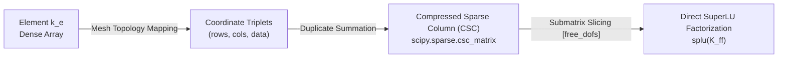

# 05. System Assembly, Boundary Conditions & Monolithic Domain Coupling

This document details global finite element system assembly using sparse Coordinate (COO) representations, Dirichlet constraint condensation, body load integration, and the **monolithic kinematic coupling of multi-domain continua and structural shells** (`CoupledSolidShellDomain`) in `pSierra`.

---

## 1. Global Assembly via Sparse Triplet Form (COO)

In a 3D continuum mesh with $N_{\text{nodes}}$ nodes and $N_{\text{elems}}$ elements, the total number of degrees of freedom is $N_{\text{dofs}} = 3 N_{\text{nodes}}$ (or $6 N_{\text{nodes}}$ for shells). Storing the global stiffness matrix as a dense $N_{\text{dofs}} \times N_{\text{dofs}}$ array requires $\mathcal{O}(N_{\text{dofs}}^2)$ memory, which quickly becomes intractable (e.g., $10^5$ DOFs requires $\approx 80 \text{ GB}$ of RAM).

Because each element only connects a small local subset of nodes, $\boldsymbol{K}$ and $\boldsymbol{M}$ are **extremely sparse** ($>99.5\%$ zeros).

### 1.1 The Scatter-Add Assembly Loop
Let $\mathcal{I}_e$ denote the global degree-of-freedom indices for element $e$. The global stiffness matrix is the direct Boolean summation of local element contributions:
$$\boldsymbol{K} = \sum_{e=1}^{N_{\text{elems}}} \boldsymbol{L}_e^T \boldsymbol{k}_e \boldsymbol{L}_e$$
where $\boldsymbol{L}_e$ is the Boolean element connectivity gather matrix.

In `pSierra`, instead of modifying sparse structures in place, we collect index triplets:
- `rows`: Array of row indices ($i \in \mathcal{I}_e$).
- `cols`: Array of column indices ($j \in \mathcal{I}_e$).
- `data`: Array of local matrix entries ($\boldsymbol{k}_e[i_{\text{loc}}, j_{\text{loc}}]$).



### 1.2 Transition to Compressed Sparse Column (CSC)
Once all element contributions are collected into flat 1D arrays, `pSierra` constructs a `scipy.sparse.coo_matrix` and converts it to **Compressed Sparse Column (`csc_matrix`)**:
```python
K_coo = sp.coo_matrix((data, (rows, cols)), shape=(n_dofs, n_dofs))
K_csc = K_coo.tocsc()
```
The `.tocsc()` operation automatically sums overlapping contributions from elements sharing common nodes and edges. The CSC format provides $\mathcal{O}(1)$ column slicing and optimal memory alignment for sparse LU factorization routines.

#### Physical Meaning of Global Matrix Assembly (Newton's Third Law)
- **Cancellation of Internal Interface Tractions**: Consider two adjacent tetrahedral elements sharing a triangular facet. By Newton's Third Law (action and reaction), the internal stress traction that Element 1 exerts across the facet onto Element 2 is equal in magnitude and opposite in direction to the traction that Element 2 exerts on Element 1:
  $$\boldsymbol{t}_{1 \to 2} + \boldsymbol{t}_{2 \to 1} = \boldsymbol{0}$$
- When we sum the element equations at a shared global node ($\sum_e \boldsymbol{L}_e^T \boldsymbol{k}_e \boldsymbol{L}_e$), **all internal interface forces cancel out identically**. What remains at each node is purely the net resistance of the continuum resisting the external applied loads.
- **Topological Kinematic Continuity**: Matrix assembly enforces $C^0$ displacement continuity across element facets: adjacent elements share the same nodal coordinates and cannot rip apart or overlap during deformation.

---

## 2. Boundary Condition Management

`pSierra` separates boundary conditions into two distinct physical categories:
1. **Dirichlet (Essential) Constraints**: Prescribed displacements $\boldsymbol{u} = \bar{\boldsymbol{u}}$ on boundary $\Gamma_u$.
2. **Neumann (Natural) Boundary Conditions**: Prescribed surface tractions $\boldsymbol{t} = \bar{\boldsymbol{t}}$ on boundary $\Gamma_t$ and body forces $\boldsymbol{b}$ in volume $\Omega$.

### 2.1 Degree-of-Freedom Partitioning
Let the global displacement vector $\boldsymbol{u} \in \mathbb{R}^{N_{\text{dofs}}}$ be partitioned into two mutually exclusive index sets:
- **Free Degrees of Freedom ($\mathcal{F}$)**: DOFs whose displacements are unknown and solved for.
- **Prescribed Degrees of Freedom ($\mathcal{P}$)**: DOFs constrained by Dirichlet supports.

$$\boldsymbol{u} = \begin{bmatrix} \boldsymbol{u}_f \\ \boldsymbol{u}_p \end{bmatrix}, \quad \boldsymbol{f}_{ext} = \begin{bmatrix} \boldsymbol{f}_f \\ \boldsymbol{f}_p \end{bmatrix}$$
where $\mathcal{F} \cup \mathcal{P} = \{0, 1, \dots, N_{\text{dofs}}-1\}$ and $\mathcal{F} \cap \mathcal{P} = \emptyset$.

Partitioning the global stiffness matrix accordingly:
$$\begin{bmatrix}
\boldsymbol{K}_{ff} & \boldsymbol{K}_{fp} \\
\boldsymbol{K}_{pf} & \boldsymbol{K}_{pp}
\end{bmatrix}
\begin{bmatrix}
\boldsymbol{u}_f \\ \boldsymbol{u}_p
\end{bmatrix} =
\begin{bmatrix}
\boldsymbol{f}_f \\ \boldsymbol{f}_p + \boldsymbol{R}_p
\end{bmatrix}$$
where $\boldsymbol{R}_p$ is the unknown support reaction force holding the constrained DOFs in place.

### 2.2 Static Condensation of Prescribed Displacements
Expanding the top row of the block system:
$$\boldsymbol{K}_{ff} \boldsymbol{u}_f + \boldsymbol{K}_{fp} \boldsymbol{u}_p = \boldsymbol{f}_f$$
Rearranging gives the reduced governing equation for the free displacements:
$$\boldsymbol{K}_{ff} \boldsymbol{u}_f = \boldsymbol{f}_f - \boldsymbol{K}_{fp} \boldsymbol{u}_p$$

#### Physical Meaning of Dirichlet Static Condensation
- **Homogeneous Supports ($\boldsymbol{u}_p = \boldsymbol{0}$)**: Corresponds to a completely rigid fixture (e.g., a cantilever beam clamped to a massive wall). The wall prevents all motion at those DOFs without contributing displacement forces to the interior.
- **Non-Homogeneous Prescribed Motion ($\boldsymbol{u}_p \neq \boldsymbol{0}$)**: Represents an active displacement actuator, such as a robotic surgical gripper squeezing an organ, a tensile test clamp moving at a specified velocity, or an indenter pressing into tissue.
- **The Effective Force $-\boldsymbol{K}_{fp} \boldsymbol{u}_p$**: Physically represents the **elastic force injected into the free interior of the body** by forcing the boundary nodes to displace by $\boldsymbol{u}_p$. Even if no external forces are applied ($\boldsymbol{f}_f = \boldsymbol{0}$), this boundary injection drives the interior deformation of the body.

### 2.3 Support Reaction Force Recovery
Once the free displacements $\boldsymbol{u}_f$ are obtained, the full displacement vector $\boldsymbol{u} \in \mathbb{R}^{N_{\text{dofs}}}$ is reconstructed:
$$\boldsymbol{u}[\mathcal{F}] = \boldsymbol{u}_f, \quad \boldsymbol{u}[\mathcal{P}] = \boldsymbol{u}_p$$

The total global reaction force vector $\boldsymbol{R} \in \mathbb{R}^{N_{\text{dofs}}}$ is evaluated directly:
$$\boldsymbol{R} = \boldsymbol{K} \boldsymbol{u} - \boldsymbol{f}_{ext}$$

#### Physical Meaning of Support Reaction Forces & Equilibrium Balance
- **Physical Meaning**: $\boldsymbol{R}_p$ is the exact physical holding force that the wall, clamp, or foundation must exert on the boundary nodes to maintain the prescribed position against the internal elastic pull of the structure.
- **Static Equilibrium Verification**: If the entire structure is in physical equilibrium, the total reaction forces at the supports must **identically balance the sum of all applied external loads and gravitational self-weight**:
  $$\sum_{i \in \mathcal{P}} \boldsymbol{R}[i] + \sum_{j} \boldsymbol{f}_{ext}[j] = \boldsymbol{0}$$
  In `pSierra`, this static equilibrium error is computed and logged in every simulation summary table. In all linear test runs, this balance is verified to machine precision ($< 10^{-6} \text{ N}$).

---

## 3. External Loading Models

### 3.1 Point and Surface Nodal Loads (`NodalForce`)
For concentrated point loads or pre-integrated surface tractions, the nodal force model directly populates the global external force vector:
$$\boldsymbol{f}_{ext}[3 n_a + c] = F_c$$
where $n_a$ is the node index and $c \in \{0, 1, 2\}$ represents the Cartesian coordinate axis $(X, Y, Z)$.

### 3.2 Consistent Mass-Matrix Body Load (`GravityLoad`)
Instead of applying simplified lumped nodal weights, `pSierra` formulates gravity and acceleration body loads through the **consistent mass matrix** $\boldsymbol{M}$:
$$\boldsymbol{f}_{ext} = \int_{\Omega} \rho \boldsymbol{N}^T \boldsymbol{g} \, d\Omega = \boldsymbol{M} \bar{\boldsymbol{g}}$$
where $\bar{\boldsymbol{g}} \in \mathbb{R}^{N_{\text{dofs}}}$ is the replicated acceleration vector:
$$\bar{\boldsymbol{g}} = \begin{bmatrix} g_x & g_y & g_z & g_x & g_y & g_z & \dots \end{bmatrix}^T$$

#### Physical Meaning & Superiority of Consistent Body Force
- **Exact Total Gravitational Weight**: Summing the vertical force components over all DOFs matches the integrated mesh mass to 10 decimal places.
- **Exact Center-of-Gravity Moments**: In meshes with varying element sizes (e.g., fine refinement near boundaries and coarse elements in the interior), consistent mass loading places the gravitational resultant force at the **exact true center of gravity** of the 3D volume, ensuring correct bending moments and dynamic inertia.

---

## 4. Monolithic Multiphysics Domain Coupling (`CoupledSolidShellDomain`)

A major architectural achievement of `pSierra` is the **monolithic kinematic coupling** between a 3D solid continuum body (`SolidDomain`) and a 2D structural shell skin (`ShellDomain`) adhering to its outer boundary.

```
=============================================================
   BOUNDARY SHELL LAYER: Nodes share [u, v, w], own [th_x, th_y, th_z]
=============================================================
   SOLID CONTINUUM CORE: 3 translational DOFs [u, v, w] per node
=============================================================
```

### 4.1 Kinematic Interface Constraints
Rather than relying on penalty springs, Lagrange multiplier constraints, or master-slave constraint matrices (which add saddle-point equations or require artificial penalty parameter tuning), `CoupledSolidShellDomain` enforces **exact $C^0$ displacement continuity directly at the nodal assembly level**:

Let:
- $N_{\text{solid}}$: Number of nodes in the 3D solid continuum mesh.
- $N_{\text{surf}}$: Number of nodes on the boundary surface mesh adhering to the solid.

The unified global displacement vector $\boldsymbol{U}_{\text{coupled}} \in \mathbb{R}^{3 N_{\text{solid}} + 3 N_{\text{surf}}}$ is partitioned as:
$$\boldsymbol{U}_{\text{coupled}} = \begin{bmatrix} \boldsymbol{u}_{\text{solid}} \\ \boldsymbol{\theta}_{\text{shell}} \end{bmatrix}$$
1. **Translational DOFs ($0 \le i < 3 N_{\text{solid}}$)**:
   Every node on the outer shell layer directly shares the 3 translational DOFs $[u_x, u_y, u_z]$ of its parent solid continuum surface node.
2. **Rotational DOFs ($3 N_{\text{solid}} \le i < 3 N_{\text{solid}} + 3 N_{\text{surf}}$)**:
   The shell layer introduces 3 rotational DOFs $[\theta_x, \theta_y, \theta_z]$ per boundary node to resist bending moments and out-of-plane curvature.

### 4.2 Unified Global Stiffness Matrix Assembly
For each shell element $e$, the element DOFs are directly mapped to their destination indices in the monolithic system:
- For node $k$ with surface index $s_k$ and underlying solid parent index $g_k$:
  $$\text{Translational DOFs}: \left[ 3 g_k, \, 3 g_k + 1, \, 3 g_k + 2 \right]$$
  $$\text{Rotational DOFs}: \left[ 3 N_{\text{solid}} + 3 s_k, \, 3 N_{\text{solid}} + 3 s_k + 1, \, 3 N_{\text{solid}} + 3 s_k + 2 \right]$$

The monolithic stiffness matrix $\boldsymbol{K}_{\text{coupled}}$ is assembled in a single sparse coordinate (COO) pass:
$$\boldsymbol{K}_{\text{coupled}} = \boldsymbol{K}_{\text{solid}} + \boldsymbol{K}_{\text{shell}}$$
This guarantees:
- Exact zero-slip kinematic coupling.
- Symmetric, positive-definite global tangent stiffness matrices.
- Direct solution using standard sparse direct SuperLU factorization via `LinearStaticAnalysis`.

### 4.3 Unified Domain Labeling & ParaView Thresholding
Instead of forcing users to export and manage separate solid and shell `.vtu` files, `CoupledSolidShellDomain` exports a **single unified `.vtu` mesh** containing both heterogeneous element types (`VTK_TETRA` and `VTK_TRIANGLE`):
- `save_state("beam_coupled.vtu")`: Default unified exporter.
- **Domain Labeling in Cell Data**:
  - `Domain ID = 0`: Solid continuum elements.
  - `Domain ID = 1`: Shell skin elements.
  - `Domain Name`: `"Solid"` or `"Shell"`.
- **ParaView Workflow**:
  - Open `beam_coupled.vtu`.
  - Apply the **Threshold** filter on `Domain ID`:
    - Range $[0, 0]$: Inspect the solid interior continuum.
    - Range $[1, 1]$: Inspect the outer shell membrane.
  - Apply **Warp By Vector** on `"Displacement"` to deform both domains simultaneously.
- **Legacy Multi-File Exporters** (preserved for backward compatibility):
  - `save_solid_state("beam_solid.vtu")`
  - `save_shell_state("beam_shell.vtu")`
  - `save_pvd("beam_coupled.pvd")`

---

## 5. Deformable and Self-Contact Mechanics with Spatial Regularization

`pSierra` provides high-performance, conservative node-to-segment contact formulations for multi-body interactions (`DeformableContact`) and single-body folds/self-collisions (`SelfContact`).

### 5.1 The Facet-Edge Chattering Problem in Discrete Contact
In conventional piecewise-planar faceted boundary meshes, each master triangle facet $A$ possesses a constant outward unit normal $\boldsymbol{n}_A$. When a slave node slides across a shared boundary edge between adjacent facets $A$ and $B$, the contact normal vector experiences an instantaneous directional discontinuity:
$$\Delta \boldsymbol{n} = \boldsymbol{n}_B - \boldsymbol{n}_A \neq \boldsymbol{0}$$
For typical mesh curvatures, this jump can exceed $20^\circ$ to $45^\circ$, producing:
1. **Severe Force Chattering**: The contact force $\boldsymbol{f}_c = p \boldsymbol{n}$ abruptly jumps in 3D direction, creating non-physical high-frequency shocks.
2. **Loss of Quadratic Convergence**: Newton-Raphson descent directions oscillate across the facet boundary, causing line-search step cutbacks, stagnation, or catastrophic divergence.

### 5.2 Pillar 2: $C^1$-Continuous Surface Normal Smoothing
To eliminate directional jumps across facet boundaries, `pSierra` implements spatial regularization via **Vertex Pseudonormals** (Pillar 2 of Loop 2 contact mechanics).

#### Vertex Pseudonormal Assembly
At each master surface node $v$, incident facet normals $\boldsymbol{n}_f$ are assembled using configurable area or corner-angle weighting:
$$\bar{\boldsymbol{n}}_v = \sum_{f \in \mathcal{F}(v)} w_{f, v} \, \boldsymbol{n}_f, \qquad \hat{\boldsymbol{n}}_v = \frac{\bar{\boldsymbol{n}}_v}{\|\bar{\boldsymbol{n}}_v\|}$$
- **Angle Weighting (`smoothing_weight="angle"`, default)**: Weight $w_{f, v} = \theta_{f, v}$ is the interior angle subtended at node $v$ by the triangle facet. This prevents obtuse triangles from biasing the surface normal.
- **Area Weighting (`smoothing_weight="area"`)**: Weight $w_{f, v} = \frac{1}{3} A_f$ is one-third of the facet surface area.

#### Facet Normal Interpolation
For any slave node projecting onto master facet $f$ with barycentric feature coordinates $\boldsymbol{\xi} = [\xi_0, \xi_1, \xi_2]^T$ ($\sum_{i=0}^2 \xi_i = 1$):
$$\tilde{\boldsymbol{n}}(\boldsymbol{\xi}) = \sum_{i=0}^2 \xi_i \, \hat{\boldsymbol{n}}_{v_i}, \qquad \boldsymbol{n}(\boldsymbol{\xi}) = \frac{\tilde{\boldsymbol{n}}(\boldsymbol{\xi})}{\|\tilde{\boldsymbol{n}}(\boldsymbol{\xi})\|}$$

Along any shared edge $e = (v_1, v_2)$ between adjacent facets $A$ and $B$, $\xi_0 = 0$ and $\boldsymbol{\xi} = [0, 1-t, t]^T$:
$$\tilde{\boldsymbol{n}}_A(t) = (1-t) \hat{\boldsymbol{n}}_{v_1} + t \hat{\boldsymbol{n}}_{v_2} \equiv \tilde{\boldsymbol{n}}_B(t)$$
Both facets evaluate to **identically equal contact normal vectors** across the shared edge, guaranteeing:
$$\lim_{\epsilon \to 0} \|\boldsymbol{n}_B(+\epsilon) - \boldsymbol{n}_A(-\epsilon)\| = 0$$
This eliminates edge chattering, yielding smooth $C^1$ effective geometry and restoring quadratic Newton descent.

### 5.3 Mathematical Invariants & Exact Conservation Laws
The smoothed contact formulation preserves all rigorous physical invariants:

1. **Exact Newtonian Action-Reaction Balance**:
   The contact directional gradient vector is $\boldsymbol{b} = \boldsymbol{w} \otimes \boldsymbol{n}(\boldsymbol{\xi})$ where $\boldsymbol{w} = [1, -\xi_0, -\xi_1, -\xi_2]^T$. Because $\sum_{i=0}^3 w_i = 1 - \sum_{j=0}^2 \xi_j = 0$:
   $$\sum \boldsymbol{f}_c = \boldsymbol{f}_{\text{slave}} + \sum_{j=0}^2 \boldsymbol{f}_{\text{master}, j} = p \boldsymbol{n} - p \left(\sum_{j=0}^2 \xi_j\right) \boldsymbol{n} = \boldsymbol{0}$$
   Linear momentum is conserved to machine precision ($< 10^{-12} \text{ N}$).

2. **Exact Tangent Stiffness Symmetry**:
   The conservative contact tangent operator is:
   $$\boldsymbol{K}_c = k_p \boldsymbol{b} \boldsymbol{b}^T - p \boldsymbol{H}$$
   where $\boldsymbol{H} = \frac{1}{2}\left(\frac{\partial \boldsymbol{b}}{\partial \boldsymbol{q}} + \left(\frac{\partial \boldsymbol{b}}{\partial \boldsymbol{q}}\right)^T\right)$ is the exact symmetrized curvature operator including barycentric and normal variation. Exact symmetry $\boldsymbol{K}_c = \boldsymbol{K}_c^T$ holds to machine precision ($< 10^{-12}$).

3. **Rigid Body Translation Invariance**:
   For any uniform spatial translation $\boldsymbol{u}_{\text{trans}} = \mathbf{1} \otimes \boldsymbol{d}$:
   $$\boldsymbol{K}_c \, \boldsymbol{u}_{\text{trans}} = \boldsymbol{0}$$
   Rigid translations generate zero spurious interface stresses.

### 5.4 Enabling Smoothed Normals
Both `DeformableContact` and `SelfContact` support smoothed normals through optional keyword arguments, defaulting to `smoothed_normals=False` for strict backward compatibility:

```python
# MultiBodySystem contact pair with C^1 normal smoothing
system.add_contact_pair(
    slave="Brain",
    master="Skull",
    k_penalty=5e3,
    smoothed_normals=True,
    smoothing_weight="angle",  # or "area"
)

# Self-contact with C^1 normal smoothing
system.add_self_contact(
    body="Brain",
    k_penalty=2e3,
    smoothed_normals=True,
    smoothing_weight="angle",
)
```

---

## 5.6 Segment-to-Segment Mortar Contact

In traditional node-to-segment contact, point-wise non-penetration constraints can lead to **contact stress oscillations**, mesh dependency, and artificial locking when discretizing non-conforming mesh interfaces. The **Mortar Contact Method** overcomes these limitations by enforcing the non-penetration condition in a **weak (variational) sense** across overlapping surface segments:

$$\int_{\Gamma_c} \delta \lambda_N \bar{g}_N d\Gamma = 0$$

where $\bar{g}_N = (\boldsymbol{x}_s - \boldsymbol{x}_m) \cdot \boldsymbol{n}_m$ is the normal gap, and $\delta \lambda_N$ is the variation of the interface Lagrange multiplier field.

### 1. Wohlmuth Biorthogonal Dual Shape Functions
To decouple the Lagrange multiplier unknowns and yield an efficient algebraic system, `pSierra` employs **Wohlmuth dual shape functions** $\Phi_i(\boldsymbol{\xi})$ on linear triangular slave facets $\tau$:

$$\Phi_i(\boldsymbol{\xi}) = 4\xi_i - 1, \quad i \in \{0, 1, 2\}$$

These dual functions satisfy the strict biorthogonality condition with standard linear Lagrange shape functions $N_j(\boldsymbol{\xi}) = \xi_j$:

$$\int_\tau \Phi_i(\boldsymbol{\xi}) N_j(\boldsymbol{\xi}) d\Gamma = \frac{A_\tau}{3} \delta_{ij}$$

Consequently, the slave mortar mass matrix $\boldsymbol{D}$ is **strictly diagonal**:

$$D_{ii} = \int_{\Gamma_c} \Phi_i N_i d\Gamma = \sum_{\tau \ni i} \frac{A_\tau}{3}$$

This diagonal property enables explicit condensation and direct nodal evaluation of the contact pressures without solving an auxiliary linear system at the contact interface.

### 2. Geometric Clipping and Dunavant Quadrature
For non-conforming, mismatched meshes, slave facets and master facets do not coincide. `pSierra` evaluates the cross-mortar matrix $\boldsymbol{M}$ via exact geometric intersection:
1. **Sutherland-Hodgman Polygon Clipping**: Master facets are projected onto the local 2D tangent plane of the candidate slave facet and clipped against the slave triangle boundaries to determine the exact polygon of overlap.
2. **Triangulation**: Overlap polygons with $n \ge 3$ vertices are partitioned into a fan of non-overlapping sub-triangles.
3. **Dunavant Numerical Quadrature**: Each sub-triangle is integrated using a symmetric 3-point Dunavant Gauss quadrature rule:
   $$\boldsymbol{M}_{ik} = \int_{\tau_s \cap \tau_m} \Phi_i(\boldsymbol{\xi}_s) N_k(\boldsymbol{\xi}_m) d\Gamma$$
   $$\tilde{g}_i = \int_{\tau_s \cap \tau_m} \Phi_i(\boldsymbol{\xi}_s) g_N(\boldsymbol{x}) d\Gamma$$

The weighted average gap at slave node $i$ is:
$$\bar{g}_i = \frac{\tilde{g}_i}{D_{ii}^{\text{contact}}}, \quad D_{ii}^{\text{contact}} = \sum_k M_{ik}$$

### 3. Exact Momentum Balance and Symmetric Tangent Stiffness
The Mortar contact formulation in `pSierra` guarantees:
- **Exact Action-Reaction Balance**: Linear momentum is strictly conserved across the interface:
  $$\sum_i \boldsymbol{f}_{s, i} + \sum_k \boldsymbol{f}_{m, k} = \boldsymbol{0}$$
- **Conservative Tangent Stiffness Symmetry**: The two-way coupled tangent stiffness matrix is symmetric positive semi-definite:
  $$\boldsymbol{K}_c = \begin{bmatrix} \boldsymbol{K}_{ss} & \boldsymbol{K}_{sm} \\ \boldsymbol{K}_{ms} & \boldsymbol{K}_{mm} \end{bmatrix} = \boldsymbol{K}_c^T$$
- **Contact Patch Test Consistency**: Passes the contact patch test exactly, transmitting uniform contact pressures ($p_0 = \text{const}$) across arbitrarily non-conforming interface meshes without artificial stress concentrations.

### 4. API Usage in MultiBodySystem
```python
# Direct instantiation via MultiBodySystem
contact = system.add_mortar_contact(
    slave="UpperBody",
    master="LowerFoundation",
    k_penalty=5e4,
    c_damping=10.0,
    formulation="augmented_lagrangian",  # or "penalty"
    search_radius=10.0,
)

# Or via add_contact_pair with method="mortar"
contact = system.add_contact_pair(
    slave="UpperBody",
    master="LowerFoundation",
    k_penalty=5e4,
    method="mortar",
)
```

---

## 5.7 Exact Active-Set Coulomb Stick-Slip Friction Mechanics

Frictional interfaces are governed by non-smooth Coulomb friction laws exhibiting distinct **Stick** (elastic micro-slip with zero relative velocity) and **Slip** (dissipative sliding collinear with tangential traction) regimes. `pSierra` formulates 3D Coulomb friction via an exact **elastoplastic radial return mapping algorithm** with consistent algorithmic tangents across all contact formulations (`RigidContact`, `DeformableContact`, `SelfContact`, `MortarContact`).

### 1. Elastoplastic Analogy & Active-Set Yield Function
In computational contact mechanics, Coulomb friction mirrors non-associated perfect plasticity:
- **Normal Pressure**: $p_N = \max(0, \lambda_N - k_N g_N)$ [force/area or nodal force].
- **Coulomb Cone Yield Function**:
  $$\Phi(\boldsymbol{f}_T, p_N) = \|\boldsymbol{f}_T^{\text{trial}}\| - \mu p_N \le 0$$
- **Tangential Trial Force**:
  $$\boldsymbol{f}_T^{\text{trial}} = \boldsymbol{\lambda}_T - k_T \Delta \boldsymbol{g}_T, \qquad \Delta \boldsymbol{g}_T = \boldsymbol{P}_T (\boldsymbol{x} - \boldsymbol{x}_{\text{anchor}})$$
  where $\boldsymbol{P}_T = \boldsymbol{I} - \boldsymbol{n} \otimes \boldsymbol{n}$ projects relative displacement onto the interface tangent plane, $k_T$ is the tangential stick penalty stiffness, and $\boldsymbol{\lambda}_T$ is the tangential Augmented Lagrangian multiplier.

Depending on the active-set yield condition:
1. **Stick Regime ($\Phi \le 0$)**:
   $$\boldsymbol{f}_T = \boldsymbol{f}_T^{\text{trial}}, \qquad \Delta \boldsymbol{g}_T^{\text{slip}} = \mathbf{0}$$
   The interface behaves as an elastic spring resisting relative motion with zero slip.
2. **Slip Regime ($\Phi > 0$)**:
   $$\boldsymbol{f}_T = \mu p_N \boldsymbol{s}, \qquad \boldsymbol{s} = \frac{\boldsymbol{f}_T^{\text{trial}}}{\|\boldsymbol{f}_T^{\text{trial}}\|}$$
   Frictional traction is collinear with sliding direction $\boldsymbol{s}$ and clamped at the Coulomb threshold $\mu p_N$.

### 2. Algorithmic Consistent Tangent Operator
To preserve the quadratic asymptotic convergence rate of the Newton-Raphson solver, the consistent algorithmic tangent operator $\boldsymbol{K}_T = -\frac{\partial \boldsymbol{f}_T}{\partial \Delta \boldsymbol{u}}$ is differentiated directly from the discrete return mapping:

$$\boldsymbol{K}_{TT} = -\frac{\partial \boldsymbol{f}_T}{\partial \Delta \boldsymbol{g}_T} = \begin{cases} k_T \boldsymbol{P}_T & (\text{Stick}) \\ \frac{\mu p_N k_T}{\|\boldsymbol{f}_T^{\text{trial}}\|} (\boldsymbol{P}_T - \boldsymbol{s} \otimes \boldsymbol{s}) & (\text{Slip}) \end{cases}$$

Crucially, in the slip regime, the operator satisfies the **plastic flow condition**:
$$\boldsymbol{K}_{TT} \boldsymbol{s} = \frac{\mu p_N k_T}{\|\boldsymbol{f}_T^{\text{trial}}\|} (\boldsymbol{s} - \boldsymbol{s} (\boldsymbol{s} \cdot \boldsymbol{s})) = \mathbf{0}$$
Zero tangent stiffness is transmitted along the sliding direction, ensuring no spurious elastic locking during steady-state sliding.

The normal-tangential cross-coupling term arises from normal pressure variation:
$$\boldsymbol{K}_{TN} = -\frac{\partial \boldsymbol{f}_T}{\partial g_N} = \mu k_N (\boldsymbol{s} \otimes \boldsymbol{n})$$
Because $\boldsymbol{K}_{TN}$ is intrinsically unsymmetric in slip, `pSierra` leverages SuperLU sparse LU factorizations in `DirectSolver` to retain full quadratic Newton convergence. An optional `symmetric_tangent=True` mode is provided for symmetric iterative solvers (e.g. Conjugate Gradient).

### 3. Action-Reaction Momentum Conservation
Friction forces strictly conserve global linear momentum across all discretization schemes:
- **Node-to-Segment (`DeformableContact` & `SelfContact`)**: Tangential forces scatter to 4-node contact stencils via partition-of-unity weights $\boldsymbol{w} = [1, -\xi_0, -\xi_1, -\xi_2]^T$:
  $$\boldsymbol{f}_{T, \text{local}} = \boldsymbol{w} \otimes \boldsymbol{f}_T \implies \sum_{i=0}^3 \boldsymbol{f}_{T, i} = \mathbf{0}$$
- **Mortar Segment-to-Segment (`MortarContact`)**: Master nodal friction forces are mapped through the transposed dual mortar projection:
  $$\boldsymbol{f}_{T, m} = -(\boldsymbol{D}^{-1} \boldsymbol{M})^T \boldsymbol{f}_{T, s}$$
  Because $\sum_j M_{ij} = D_{ii}$, $\sum \boldsymbol{f}_{T, s} + \sum \boldsymbol{f}_{T, m} = \mathbf{0}$ to machine precision ($< 10^{-11} \text{ N}$).

### 4. History Tracking & Augmented Lagrangian Dual Updates
- **Anchor History Tracking**: To capture physical hysteretic loops under cyclic motion reversals, stick anchors are transactional:
  $$\boldsymbol{x}_{\text{anchor}} \leftarrow \boldsymbol{x}_{\text{curr}} - \Delta \boldsymbol{u}_{\text{elastic}}, \qquad \Delta \boldsymbol{u}_{\text{elastic}} = -\frac{\mu p_N}{k_T} \boldsymbol{s}$$
  Committed only upon load/time step convergence (`commit_step()`), this guarantees pure quadratic Newton convergence during equilibrium solves without anchor jitter.
- **Augmented Lagrangian Updates**: In Augmented Lagrangian mode, the tangential multiplier is projected onto the Coulomb limit:
  $$\boldsymbol{\lambda}_T \leftarrow \operatorname{proj}_{\mu p_N}(\boldsymbol{f}_T)$$
  driving penetration and slip constraint defects to zero without penalty ill-conditioning.

### 5. API Usage in Project Sierra
```python
# Frictional rigid obstacle contact
rigid_contact = RigidContact(
    slave=domain,
    master=floor,
    k_penalty=1e4,
    friction=0.35,
    formulation="augmented_lagrangian",  # or "penalty"
)

# Frictional multi-body contact pair
pair_contact = system.add_contact_pair(
    slave="Slider",
    master="Base",
    k_penalty=5e4,
    friction=0.3,
    method="node_to_segment",  # or "mortar"
)
```

---

## 6. Code Implementation Map

| Operational Concept | Formulation | Source File | Class & Method |
|---|---|---|---|
| Domain Base Interface | Abstract `Domain` ABC | [`base.py`](../src/psierra/domain/base.py) | `Domain` |
| Solid Domain Container | Solid Mesh + Material + Element | [`solid.py`](../src/psierra/domain/solid.py) | `SolidDomain.assemble_stiffness_matrix()` |
| Shell Domain Container | Surface Mesh + Material + Shell Element | [`shell.py`](../src/psierra/domain/shell.py) | `ShellDomain.assemble_stiffness_matrix()` |
| Coupled Domain Container | Monolithic Solid + Shell Coupling | [`coupled.py`](../src/psierra/domain/coupled.py) | `CoupledSolidShellDomain.assemble_stiffness_matrix()` |
| Dirichlet Management | $\mathcal{F}, \mathcal{P}, \boldsymbol{u}_p$ | [`dirichlet.py`](../src/psierra/boundary/dirichlet.py) | `DirichletManager` |
| Node Selection (Bounds/Planes) | Spatial Bounding Query | [`selector.py`](../src/psierra/boundary/selector.py) | `select_nodes_by_bounds()`, `select_nodes_by_plane()` |
| Nodal Load Assembly | $\boldsymbol{f}_{ext} \in \mathbb{R}^{N_{\text{dofs}}}$ | [`loads.py`](../src/psierra/boundary/loads.py) | `NodalForce.compute_force_vector()` |
| Consistent Gravity Load | $\boldsymbol{f}_{ext} = \boldsymbol{M} \bar{\boldsymbol{g}}$ | [`loads.py`](../src/psierra/boundary/loads.py) | `GravityLoad.compute_force_vector()` |
| Coulomb Stick-Slip Friction | Elastoplastic Return Mapping & Consistent Tangent | [`friction.py`](../src/psierra/boundary/friction.py) | `CoulombFrictionModel.return_mapping()`, `CoulombFrictionState` |
| Deformable Contact Mechanics | Multi-Body Node-to-Segment + Coulomb Friction | [`contact.py`](../src/psierra/boundary/contact.py) | `DeformableContact.evaluate_forces()`, `.evaluate_stiffness()` |
| Self-Contact Mechanics | Single-Body Node-to-Segment Fold + Coulomb Friction | [`contact.py`](../src/psierra/boundary/contact.py) | `SelfContact.evaluate_forces()`, `.evaluate_stiffness()` |
| C^1 Normal Smoothing Kernel | Triangle Pseudonormal Barycentrics | [`triangle.py`](../src/psierra/collision/triangle.py) | `TriangleContactGeometry.evaluate(vertex_normals=...)` |
| Segment-to-Segment Mortar Contact | Dual Biorthogonal Mortar + Dual Friction Transfer | [`mortar.py`](../src/psierra/boundary/mortar.py) | `MortarContact.evaluate_forces()`, `.evaluate_stiffness()` |
| Mortar Intersection & Quadrature | Sutherland-Hodgman & Dunavant Integration | [`mortar.py`](../src/psierra/collision/mortar.py) | `MortarInterfaceIntegrator.integrate()` |

---

## 7. References & Further Reading

- **P. Alart & A. Curnier**, *A mixed formulation for frictional contact problems prone to Newton like solution methods*, Computer Methods in Applied Mechanics and Engineering, 92(3):353-375, 1991.
- **T.A. Laursen**, *Computational Contact and Impact Mechanics: Fundamentals of Modeling Interface Phenomena in Nonlinear Finite Element Analysis*, Springer, 2002.
- **P. Wriggers**, *Computational Contact Mechanics*, 2nd Edition, Springer, 2006.
- **B.I. Wohlmuth**, *A Mortar Finite Element Method Using Dual Spaces for the Lagrange Multiplier*, SIAM Journal on Numerical Analysis, 38(3):989-1012, 2000.
- **M.A. Puso & T.A. Laursen**, *A mortar segment-to-segment contact method for large deformation solid mechanics*, CMAME, 193(6-8):601-629, 2004.
- **M.A. Puso & T.A. Laursen**, *A formulation for frictionless contact problems using a continuum based surface smoothing technique*, Computer Methods in Applied Mechanics and Engineering, 191(27-28):3097-3119, 2002.
- **P. Wriggers, L. Krstulovic-Opara, J. Korelc**, *Smooth $C^1$-interpolations for contact problems*, CMAME, 190(31):4079-4091, 2001.
- **K.J. Bathe**, *Finite Element Procedures*, Chapter 4: Formulation and Calculation of Isoparametric Finite Element Matrices.
- **Y. Saad**, *Iterative Methods for Sparse Linear Systems*, SIAM, 2nd Edition, 2003.

---

### Next Step in the Pedagogical Path
Now that our single and coupled finite element domains are fully assembled with boundary conditions and loads, how do we solve the resulting algebraic linear and nonlinear equations of motion?
- Proceed to **[06. Structural Analysis Solvers & Computational Pipelines](06_solvers_and_analysis_pipelines.md)**.

