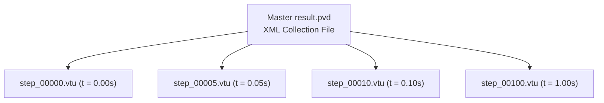

# 06. Structural Analysis Solvers & Computational Pipelines

This document details the numerical algorithms, time integration schemes, equilibrium solvers, and their **underlying physical meanings** implemented in `pSierra`:

1. **Linear Static Analysis** (Direct Sparse Factorization)
2. **Linear Dynamic Analysis** (Implicit Newmark-$\beta$ with Rayleigh Damping)
3. **Nonlinear Static Analysis** (Incremental Newton-Raphson with Backtracking Line Search)
4. **Nonlinear Dynamic Analysis** (Implicit Non-linear Newmark-$\beta$)
5. **ParaView Data Exchange Pipeline** (`.pvd` & `.vtu`)

---

## 1. Linear Static Analysis (`LinearStaticAnalysis`)

### 1.1 Mathematical Formulation

Linear static equilibrium represents the balance of internal elastic restoring forces and external loads:
$$\boldsymbol{K}_{ff} \boldsymbol{u}_f = \boldsymbol{f}_f - \boldsymbol{K}_{fp} \boldsymbol{u}_p$$

### 1.2 Solution Algorithm

Because $\boldsymbol{K}_{ff}$ is symmetric and positive definite (for well-constrained physical systems), `pSierra` leverages **SuperLU** direct sparse LU decomposition with column approximate minimum degree (COLAMD) permutation:
$$\boldsymbol{P} \boldsymbol{K}_{ff} \boldsymbol{Q} = \boldsymbol{L} \boldsymbol{U}$$
The solution is evaluated via triangular forward and backward substitutions:
$$\boldsymbol{u}_f = \boldsymbol{U}^{-1} \left( \boldsymbol{L}^{-1} (\boldsymbol{P} \boldsymbol{f}_{eff}) \right)$$

### 1.3 Post-Processing Quantities

1. **Reaction Forces**: $\boldsymbol{R} = \boldsymbol{K} \boldsymbol{u} - \boldsymbol{f}_{ext}$.
2. **Elastic Strain Energy**: $U = \frac{1}{2} \boldsymbol{u}^T \boldsymbol{K} \boldsymbol{u}$.

#### Physical Meaning of Linear Static Equilibrium

- **Minimum Total Potential Energy**: Linear static equilibrium corresponds physically to the state of **minimum total potential energy** $\Pi(\boldsymbol{u}) = U(\boldsymbol{u}) - W_{ext}(\boldsymbol{u})$. The gradient $\frac{\partial \Pi}{\partial \boldsymbol{u}} = \boldsymbol{K}\boldsymbol{u} - \boldsymbol{f} = \boldsymbol{0}$ defines this stationary equilibrium point.
- **Physical Meaning of Strain Energy $U$**: Represents the internal potential energy stored in the stretched and sheared interatomic bonds of the material. By conservation of energy, the work performed by external forces during gradual loading ($W_{ext} = \frac{1}{2} \boldsymbol{f}_{ext}^T \boldsymbol{u}$) is entirely converted into elastic strain energy ($U$).

---

## 2. Linear Dynamic Analysis (`LinearDynamicAnalysis`)

### 2.1 Equations of Motion

The discretized linear equations of motion in the time domain are governed by D'Alembert's dynamic principle:
$$\boldsymbol{M} \ddot{\boldsymbol{u}}(t) + \boldsymbol{C} \dot{\boldsymbol{u}}(t) + \boldsymbol{K} \boldsymbol{u}(t) = \boldsymbol{f}_{ext}(t)$$

#### Physical Meaning of Dynamic Equilibrium Forces

At every instant in time, four physical force mechanisms maintain dynamic equilibrium:

1. **Inertial Force ($\boldsymbol{M} \ddot{\boldsymbol{u}}$)**: The resistance of the body's mass to changes in velocity ($F = ma$). Acts to maintain current momentum.
2. **Damping Force ($\boldsymbol{C} \dot{\boldsymbol{u}}$)**: Viscous dissipation that converts mechanical kinetic and strain energy into microscopic thermal heat, attenuating oscillations.
3. **Internal Restoring Force ($\boldsymbol{K} \boldsymbol{u}$)**: Elastic forces striving to restore the structure back to its undeformed state.
4. **External Excitation ($\boldsymbol{f}_{ext}(t)$)**: Time-varying external loads, boundary motions, or body forces driving the motion.

### 2.2 Rayleigh Proportional Damping

Physical dissipation is modeled through Rayleigh proportional damping:
$$\boldsymbol{C} = \alpha \boldsymbol{M} + \beta \boldsymbol{K}$$
where $\alpha \ge 0$ is the mass-proportional damping factor and $\beta \ge 0$ is the stiffness-proportional damping factor. The modal damping ratio $\xi_n$ at natural circular frequency $\omega_n$ is:
$$\xi_n = \frac{\alpha}{2 \omega_n} + \frac{\beta \omega_n}{2}$$

#### Physical Meaning of Rayleigh Damping Parameters ($\alpha$ and $\beta$)

- **Mass Damping ($\alpha \boldsymbol{M}$ - Ambient Medium Resistance)**:
  - Dominates at low frequencies ($\xi \propto 1/\omega$).
  - Physically represents resistance against an external medium (such as air resistance, surrounding fluid drag, or surrounding soft connective tissue). It damps rigid-body motion and fundamental low-frequency structural swaying.
- **Stiffness Damping ($\beta \boldsymbol{K}$ - Internal Material Hysteresis)**:
  - Dominates at high frequencies ($\xi \propto \omega$).
  - Physically represents internal viscoelastic friction between polymer chains, crystal dislocation glide, and thermoelastic relaxation within the material. It filters out non-physical high-frequency numerical noise and acoustic vibrations.

### 2.3 Implicit Generalized-$\alpha$ Time Integration Scheme

`pSierra` employs the **Generalized-$\alpha$ method** (Chung & Hulbert, 1993) for both linear and non-linear implicit structural dynamics. The method evaluates dynamic balance at generalized midpoints $t_{n+1-\alpha_m}$ and $t_{n+1-\alpha_f}$:

$$\boldsymbol{M} \ddot{\boldsymbol{u}}_{n+1-\alpha_m} + \boldsymbol{C} \dot{\boldsymbol{u}}_{n+1-\alpha_f} + \boldsymbol{K} \boldsymbol{u}_{n+1-\alpha_f} = \boldsymbol{f}_{ext}(t_{n+1-\alpha_f})$$

where the generalized midpoint quantities are:
$$\begin{aligned}
\boldsymbol{u}_{n+1-\alpha_f} &= (1 - \alpha_f) \boldsymbol{u}_{n+1} + \alpha_f \boldsymbol{u}_n \\
\dot{\boldsymbol{u}}_{n+1-\alpha_f} &= (1 - \alpha_f) \dot{\boldsymbol{u}}_{n+1} + \alpha_f \dot{\boldsymbol{u}}_n \\
\ddot{\boldsymbol{u}}_{n+1-\alpha_m} &= (1 - \alpha_m) \ddot{\boldsymbol{u}}_{n+1} + \alpha_m \ddot{\boldsymbol{u}}_n
\end{aligned}$$

The kinematic relations between time $t_n$ and endpoint $t_{n+1} = t_n + \Delta t$ follow the Newmark predictor-corrector equations:
$$\boldsymbol{u}_{n+1} = \boldsymbol{u}_n + \Delta t \dot{\boldsymbol{u}}_n + \Delta t^2 \left[ \left(\frac{1}{2} - \beta\right) \ddot{\boldsymbol{u}}_n + \beta \ddot{\boldsymbol{u}}_{n+1} \right]$$
$$\dot{\boldsymbol{u}}_{n+1} = \dot{\boldsymbol{u}}_n + \Delta t \left[ (1 - \gamma) \ddot{\boldsymbol{u}}_n + \gamma \ddot{\boldsymbol{u}}_{n+1} \right]$$

### 2.4 Control via High-Frequency Spectral Radius ($\rho_\infty$)

Instead of exposing arbitrary, error-prone coefficients $(\alpha_m, \alpha_f, \gamma, \beta)$ to the user, `pSierra` controls the entire time integration behavior via a single physical parameter: the **high-frequency spectral radius $\rho_\infty \in [0.0, 1.0]$** (`spectral_radius`).

#### Why Spectral Radius?
The spectral radius $\rho_\infty$ represents the magnitude of the largest eigenvalue of the dynamic amplification matrix $\boldsymbol{A}$ in the infinite-frequency limit ($\Delta t \to \infty$ or $\omega \Delta t \to \infty$):
$$\rho_\infty = \max_{i} |\lambda_i(\boldsymbol{A}_\infty)|$$

- It provides an intuitive, physically meaningful dial: $\rho_\infty = 1.0$ means $0\%$ damping of high frequencies, while $\rho_\infty = 0.0$ means $100\%$ annihilation of high-frequency components in a single time step.
- Chung and Hulbert proved that by tying all four parameters algebraically to $\rho_\infty$:
  $$\alpha_m = \frac{2\rho_\infty - 1}{\rho_\infty + 1}, \quad \alpha_f = \frac{\rho_\infty}{\rho_\infty + 1}$$
  $$\gamma = \frac{1}{2} - \alpha_m + \alpha_f = \frac{1}{2} + \frac{1 - \rho_\infty}{\rho_\infty + 1}$$
  $$\beta = \frac{1}{4}(1 - \alpha_m + \alpha_f)^2 = \frac{1}{(1 + \rho_\infty)^2}$$
  the algorithm **strictly guarantees unconditional linear stability and second-order time accuracy $\mathcal{O}(\Delta t^2)$ for all $\rho_\infty \in [0, 1]$**. Unlike classical Newmark (where adding numerical damping $\gamma > 0.5$ degrades accuracy to 1st-order $\mathcal{O}(\Delta t)$), Generalized-$\alpha$ maintains optimal high-frequency filtering with zero order degradation.

#### Mapping to Classic Schemes:
| Spectral Radius | Scheme Equivalent | Parameters $(\alpha_m, \alpha_f, \gamma, \beta)$ | Physical Character & Recommended Use Case |
|:---:|:---|:---:|:---|
| **$\rho_\infty = 1.0$** | **Undamped Newmark / Midpoint Rule** | $(0.5, 0.5, 0.5, 0.25)$ | **Zero Numerical Dissipation**: Total mechanical energy is preserved indefinitely. Best for ideal linear vibration tests, acoustic resonances, and celestial mechanics. |
| **$\rho_\infty = 0.8$** | **Optimal Generalized-$\alpha$ (Default)** | $(0.333, 0.444, 0.611, 0.309)$ | **Optimal High-Frequency Damping**: Selectively filters out spurious mesh discretization chatter ($\omega_h \sim c/h_{elem}$) while leaving gross physical structural motion undamped. Standard in Abaqus, FEBio, and COMSOL. |
| **$\rho_\infty = 0.5$** | **HHT-$\alpha$** (Hilber-Hughes-Taylor) | $(0.0, 0.333, 0.833, 0.444)$ | **Moderate Damping**: Reconstructs HHT-$\alpha$ with $\alpha_{HHT} = -1/3$. Effective for stiff structural frames under sudden shock loads. |
| **$\rho_\infty = 0.0$** | **Asymptotic Annihilation** | $(-1.0, 0.0, 1.5, 1.0)$ | **Maximum Damping**: Completely annihilates the highest frequency mode in 1 step. Essential for suppressing contact impact chatter and boundary constraint shock. |

### 2.5 Integration Constants & Effective Dynamic Matrix

The kinematic relations express endpoint acceleration $\ddot{\boldsymbol{u}}_{n+1}$ and velocity $\dot{\boldsymbol{u}}_{n+1}$ in terms of displacement:
$$a_0 = \frac{1}{\beta \Delta t^2}, \quad a_1 = \frac{\gamma}{\beta \Delta t}, \quad a_2 = \frac{1}{\beta \Delta t}, \quad a_3 = \frac{1}{2\beta} - 1, \quad a_4 = \frac{\gamma}{\beta} - 1, \quad a_5 = \frac{\Delta t}{2}\left(\frac{\gamma}{\beta} - 2\right)$$
$$\ddot{\boldsymbol{u}}_{n+1} = a_0 (\boldsymbol{u}_{n+1} - \boldsymbol{u}_n) - a_2 \dot{\boldsymbol{u}}_n - a_3 \ddot{\boldsymbol{u}}_n$$
$$\dot{\boldsymbol{u}}_{n+1} = a_1 (\boldsymbol{u}_{n+1} - \boldsymbol{u}_n) - a_4 \dot{\boldsymbol{u}}_n - a_5 \ddot{\boldsymbol{u}}_n$$

Substituting into the generalized midpoint balance yields the effective linear algebraic system for $\boldsymbol{u}_{f, n+1}$:
$$\boldsymbol{K}_{eff} \boldsymbol{u}_{f, n+1} = \boldsymbol{f}_{eff, n+1}$$
where:
$$\boldsymbol{K}_{eff} = (1 - \alpha_f) \boldsymbol{K}_{ff} + (1 - \alpha_m) a_0 \boldsymbol{M}_{ff} + (1 - \alpha_f) a_1 \boldsymbol{C}_{ff}$$
$$\begin{aligned}
\boldsymbol{f}_{eff, n+1} &= \boldsymbol{f}_{ext, f} - \alpha_f \boldsymbol{K}_{ff} \boldsymbol{u}_n \\
&\quad + \boldsymbol{M}_{ff} \left[ (1 - \alpha_m)(a_0 \boldsymbol{u}_n + a_2 \dot{\boldsymbol{u}}_n + a_3 \ddot{\boldsymbol{u}}_n) - \alpha_m \ddot{\boldsymbol{u}}_n \right] \\
&\quad + \boldsymbol{C}_{ff} \left[ (1 - \alpha_f)(a_1 \boldsymbol{u}_n + a_4 \dot{\boldsymbol{u}}_n + a_5 \ddot{\boldsymbol{u}}_n) - \alpha_f \dot{\boldsymbol{u}}_n \right]
\end{aligned}$$

#### Computational Acceleration: Single Factorization
In linear dynamics, $\boldsymbol{K}_{eff}$ is **constant over time**. Therefore, $\boldsymbol{K}_{eff}$ is factorized **only once** at step 0 via SuperLU:
```python
solve_step = spspla.factorized(K_eff)
```
Each subsequent time step requires only an $\mathcal{O}(N)$ back-substitution.

---

## 3. Nonlinear Static Analysis (`NonlinearStaticAnalysis`)

### 3.1 Incremental Newton-Raphson Iteration

In finite-deformation mechanics, equilibrium between external loads and internal resisting forces $\boldsymbol{f}_{int}(\boldsymbol{u})$ is non-linear:
$$\boldsymbol{R}(\boldsymbol{u}) = \lambda \boldsymbol{f}_{ext} - \boldsymbol{f}_{int}(\boldsymbol{u}) = \boldsymbol{0}$$
where $\lambda \in [0, 1]$ is the incremental load parameter across $N_{steps}$ load increments.

Linearizing $\boldsymbol{f}_{int}(\boldsymbol{u} + \Delta \boldsymbol{u}) \approx \boldsymbol{f}_{int}(\boldsymbol{u}) + \boldsymbol{K}_{tan}(\boldsymbol{u}) \Delta \boldsymbol{u}$ yields the Newton-Raphson system:
$$\boldsymbol{K}_{tan}(\boldsymbol{u}_k) \Delta \boldsymbol{u}_k = \boldsymbol{R}(\boldsymbol{u}_k)$$
$$\boldsymbol{u}_{k+1} = \boldsymbol{u}_k + \Delta \boldsymbol{u}_k$$

Convergence is reached when the relative residual drops below the specified tolerance:
$$\frac{\|\boldsymbol{R}_{free}\|}{\max(\|\boldsymbol{f}_{ext, free}\|, 1.0)} < \text{tol}$$

#### Physical Meaning of the Residual Vector $\boldsymbol{R}$ & Load Stepping

- **The Out-of-Balance Residual $\boldsymbol{R}$**: Physically represents the **unbalanced net external force** acting on each free node. If $\boldsymbol{R} \neq \boldsymbol{0}$, the internal stresses do not yet balance the applied load, causing a virtual acceleration. Newton-Raphson iteratively adjusts the deformed shape until the internal elastic restoring force perfectly counterbalances the applied load.
- **Physical Necessity of Load Stepping ($\lambda = 0.1 \dots 1.0$)**: In non-linear mechanics, applying 100% of the load in a single step often causes convergence failure because the initial tangent $\boldsymbol{K}_0$ points in the wrong direction for large rotations. Incrementally ramping up $\lambda$ traces the quasi-static equilibrium path step-by-step, capturing large non-linear geometric changes (like beam axial pull-in and progressive bending).

### 3.2 Backtracking Line Search & Inversion Guard

During large steps or localized instabilities, an unconstrained Newton increment $\Delta \boldsymbol{u}$ may deform elements beyond physical limits, causing negative volume ratios ($J = \det(\boldsymbol{F}) \le 0$).

To prevent numerical divergence, `pSierra` incorporates a backtracking line search:

```python
alpha = 1.0
for _ in range(8):
    u_candidate = u_current.copy()
    u_candidate[free_dofs] += alpha * du_free
    self.domain.update_state(u=u_candidate)
    try:
        self.domain.assemble_internal_forces()
        u_current = u_candidate
        break
    except ValueError:
        alpha *= 0.5  # Halve step size when det(F) <= 0
```

- **Physical Meaning**: When a full Newton step ($\alpha = 1.0$) would pinch or invert a tetrahedral element, the line search scales down the displacement increment ($\alpha \leftarrow 0.5 \alpha$), guiding the mesh along a physically valid deformation path where all elements maintain positive volume ($J > 0$).

---

## 4. Nonlinear Dynamic Analysis (`NonlinearDynamicAnalysis`)

### 4.1 Governing System: Generalized-$\alpha$ Midpoint Equilibrium

In non-linear finite deformation dynamics, dynamic equilibrium is enforced at the generalized midpoint:
$$\boldsymbol{R}_{mid} = \boldsymbol{f}_{ext}(t_{n+1-\alpha_f}) - \boldsymbol{M} \ddot{\boldsymbol{u}}_{n+1-\alpha_m} - \boldsymbol{C} \dot{\boldsymbol{u}}_{n+1-\alpha_f} - \boldsymbol{f}_{int}(\boldsymbol{u}_{n+1-\alpha_f}) = \boldsymbol{0}$$
where:
$$\begin{aligned}
\boldsymbol{u}_{n+1-\alpha_f} &= (1 - \alpha_f) \boldsymbol{u}_{n+1} + \alpha_f \boldsymbol{u}_n \\
\dot{\boldsymbol{u}}_{n+1-\alpha_f} &= (1 - \alpha_f) \dot{\boldsymbol{u}}_{n+1} + \alpha_f \dot{\boldsymbol{u}}_n \\
\ddot{\boldsymbol{u}}_{n+1-\alpha_m} &= (1 - \alpha_m) \ddot{\boldsymbol{u}}_{n+1} + \alpha_m \ddot{\boldsymbol{u}}_n
\end{aligned}$$

### 4.2 Dynamic Tangent Stiffness Matrix

Taking the derivative of the midpoint residual with respect to the endpoint displacement $\boldsymbol{u}_{n+1}$:
$$\boldsymbol{K}_{eff} = -\frac{\partial \boldsymbol{R}_{mid}}{\partial \boldsymbol{u}_{n+1}} = (1 - \alpha_f) \boldsymbol{K}_{tan}(\boldsymbol{u}_{n+1-\alpha_f}) + (1 - \alpha_m) a_0 \boldsymbol{M} + (1 - \alpha_f) a_1 \boldsymbol{C}$$

At each Newton-Raphson iteration $k$, the displacement increment $\delta \boldsymbol{u}$ satisfies:
$$\boldsymbol{K}_{eff, ff} \delta \boldsymbol{u}_f = \boldsymbol{R}_{mid, f}^{(k)}$$
$$\boldsymbol{u}_{f, n+1}^{(k+1)} = \boldsymbol{u}_{f, n+1}^{(k)} + \delta \boldsymbol{u}_f$$

#### Physical Meaning of Non-linear Dynamic Coupling & Algorithmic Damping

- **Energy-Conserving vs. Chatter-Suppressed Dynamics**:
  - Setting `spectral_radius=1.0` preserves total mechanical energy in undamped systems.
  - Setting `spectral_radius=0.8` (default) introduces optimal algorithmic dissipation specifically targeted at the highest spatial discretization frequencies of the tetrahedral mesh without attenuating gross low-frequency structural deformation.
  - In contact mechanics (Phase 3), slave node impacts and contact constraint transitions generate sharp high-frequency momentum shocks. Generalized-$\alpha$ damps out these non-physical impact oscillations, preventing Newton-Raphson diverged iterations while preserving strict 2nd-order accuracy $\mathcal{O}(\Delta t^2)$.

---

## 5. ParaView Data Exchange Pipeline (`.pvd` & `.vtu`)

For time-series dynamic simulations and incremental non-linear analyses, `pSierra` generates native ParaView Data (`.pvd`) XML collection files referencing individual unstructured VTK (`.vtu`) mesh files.



The [`PvdCollectionWriter`](../src/psierra/exchange/pvd.py) outputs standard VTK XML:

```xml
<?xml version="1.0"?>
<VTKFile type="Collection" version="0.1" byte_order="LittleEndian">
  <Collection>
    <DataSet timestep="0.000000e+00" group="" part="0" file="step_00000.vtu"/>
    <DataSet timestep="2.500000e-02" group="" part="0" file="step_00005.vtu"/>
  </Collection>
</VTKFile>
```

Opening `result.pvd` in ParaView provides an interactive animation time slider allowing scrubbing through the dynamic response or non-linear loading ramp.

---

## 6. Code Implementation Map

| Solver / Concept | Formulation | Source File | Class & Method |
| --- | --- | --- | --- |
| Linear Static Solver | $\boldsymbol{K}_{ff}\boldsymbol{u}_f = \boldsymbol{f}_{eff}$ | [`linear_static.py`](../src/psierra/analysis/linear_static.py) | `LinearStaticAnalysis.solve()` |
| Linear Dynamic Solver | Implicit Generalized-$\alpha$ | [`linear_dynamic.py`](../src/psierra/analysis/linear_dynamic.py) | `LinearDynamicAnalysis.solve()` |
| Rayleigh Damping | $\boldsymbol{C} = \alpha \boldsymbol{M} + \beta \boldsymbol{K}$ | [`rayleigh.py`](../src/psierra/damping/rayleigh.py) | `RayleighDamping.assemble_damping_matrix()` |
| Nonlinear Static Solver | Incremental Newton-Raphson | [`nonlinear_static.py`](../src/psierra/analysis/nonlinear_static.py) | `NonlinearStaticAnalysis.solve()` |
| Nonlinear Dynamic Solver | Dynamic Newton Generalized-$\alpha$ | [`nonlinear_dynamic.py`](../src/psierra/analysis/nonlinear_dynamic.py) | `NonlinearDynamicAnalysis.solve()` |
| ParaView PVD Exporter | XML Collection Builder | [`pvd.py`](../src/psierra/exchange/pvd.py) | `PvdCollectionWriter` |

---

## 7. References & Further Reading

- **J. Chung and G.M. Hulbert**, *A Time Integration Algorithm for Structural Dynamics with Improved Numerical Dissipation: The Generalized-$\alpha$ Method*, Journal of Applied Mechanics, 60(2):371-375, 1993.
- **H.M. Hilber, T.J.R. Hughes, and R.L. Taylor**, *Improved Numerical Dissipation for Time Integration Algorithms in Structural Dynamics*, Earthquake Engineering & Structural Dynamics, 5(3):283-292, 1977.
- **W.L. Wood, M. Bossak, and O.C. Zienkiewicz**, *An Alpha Modification of Newmark's Method*, International Journal for Numerical Methods in Engineering, 15(10):1562-1566, 1980.
- **N.M. Newmark**, *A Method of Computation for Structural Dynamics*, Journal of the Engineering Mechanics Division, ASCE, 85:67-94, 1959.
- **K.J. Bathe**, *Finite Element Procedures*, Chapter 9: Dynamic Analysis and Time Integration.
- **T. Belytschko et al.**, *Nonlinear Finite Elements for Continua and Structures*, Chapter 6: Nonlinear Dynamic Solutions.

---

### Next Step in the Pedagogical Path: The Grand Synthesis

Now that the entire simulation pipeline is complete—from constitutive continuum laws and spatial element discretizations to monolithic multi-domain coupling and sparse numerical solvers—we put everything to the test across canonical benchmarks and biomechanical case studies!

- Proceed to **[07. Simulation Tutorials, Analytical Verification & Benchmarks](07_simulation_tutorials_and_verification.md)**.
