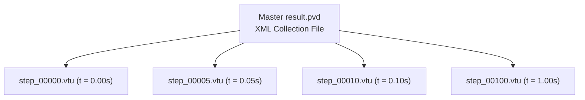
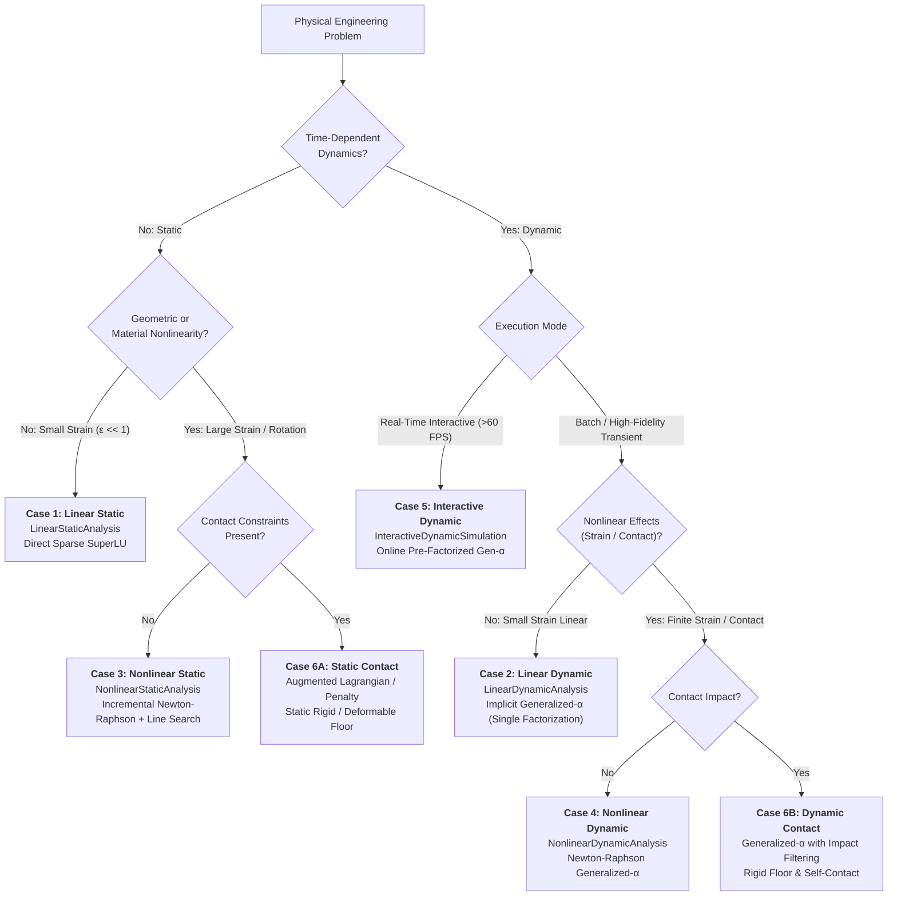
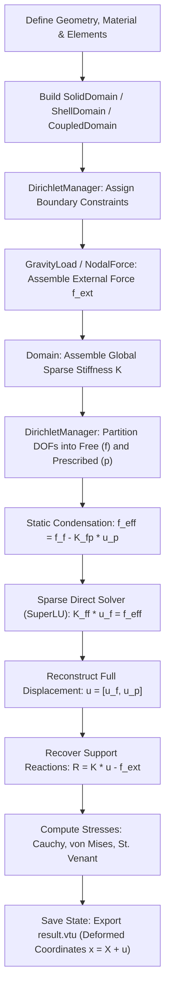
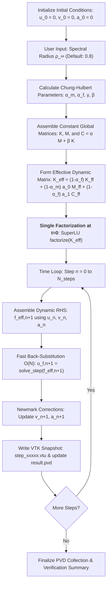
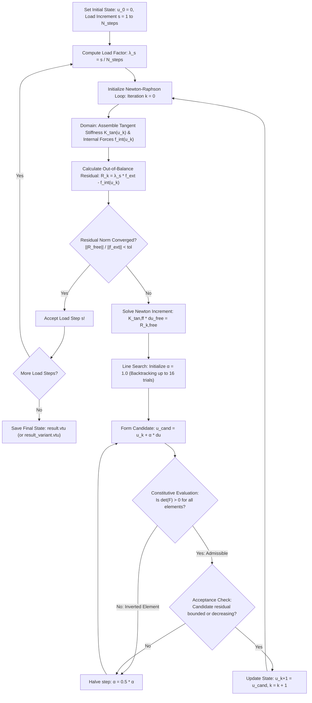
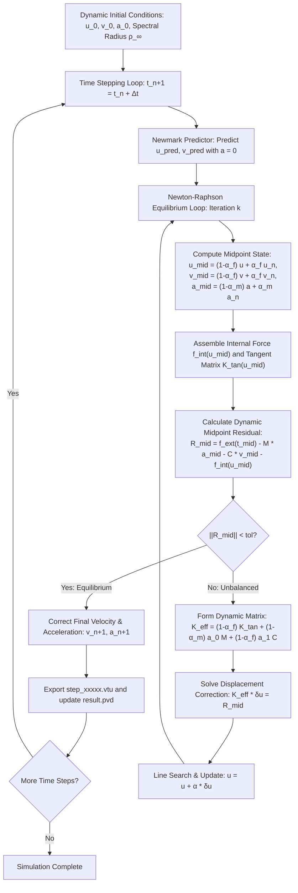

# 06. Structural Analysis Solvers & Computational Pipelines

This document details the numerical algorithms, time integration schemes, equilibrium solvers, and their **underlying physical meanings** implemented in `pSierra`:

1. **Linear Static Analysis** (Direct Sparse Factorization)
2. **Linear Dynamic Analysis** (Implicit Generalized-$\alpha$ with Rayleigh Damping)
3. **Nonlinear Static Analysis** (Incremental Newton-Raphson with Backtracking Line Search)
4. **Nonlinear Dynamic Analysis** (Implicit Non-linear Generalized-$\alpha$)
5. **ParaView Data Exchange Pipeline** (`.pvd` & `.vtu`)

---

## 1. Linear Static Analysis (`LinearStaticAnalysis`)

### 1.1 Mathematical Formulation

Linear static equilibrium represents the balance of internal elastic restoring forces and external loads:
$$\boldsymbol{K}_{ff} \boldsymbol{u}_f = \boldsymbol{f}_f - \boldsymbol{K}_{fp} \boldsymbol{u}_p$$

### 1.2 Solution Algorithm

Because $\boldsymbol{K}_{ff}$ is symmetric and positive definite (for well-constrained physical systems), `pSierra` leverages **SuperLU** direct sparse LU decomposition with column approximate minimum degree (COLAMD) permutation:
$$\boldsymbol{P} \boldsymbol{K}_{ff} \boldsymbol{Q} = \boldsymbol{L} \boldsymbol{U}$$
The solution is evaluated via triangular forward and backward substitutions:
$$\boldsymbol{u}_f = \boldsymbol{U}^{-1} \left( \boldsymbol{L}^{-1} (\boldsymbol{P} \boldsymbol{f}_{eff}) \right)$$

### 1.3 Post-Processing Quantities

1. **Reaction Forces**: $\boldsymbol{R} = \boldsymbol{K} \boldsymbol{u} - \boldsymbol{f}_{ext}$.
2. **Elastic Strain Energy**: $U = \frac{1}{2} \boldsymbol{u}^T \boldsymbol{K} \boldsymbol{u}$.

#### Physical Meaning of Linear Static Equilibrium

- **Minimum Total Potential Energy**: Linear static equilibrium corresponds physically to the state of **minimum total potential energy** $\Pi(\boldsymbol{u}) = U(\boldsymbol{u}) - W_{ext}(\boldsymbol{u})$. The gradient $\frac{\partial \Pi}{\partial \boldsymbol{u}} = \boldsymbol{K}\boldsymbol{u} - \boldsymbol{f} = \boldsymbol{0}$ defines this stationary equilibrium point.
- **Physical Meaning of Strain Energy $U$**: Represents the internal potential energy stored in the stretched and sheared interatomic bonds of the material. By conservation of energy, the work performed by external forces during gradual loading ($W_{ext} = \frac{1}{2} \boldsymbol{f}_{ext}^T \boldsymbol{u}$) is entirely converted into elastic strain energy ($U$).

---

## 2. Linear Dynamic Analysis (`LinearDynamicAnalysis`)

### 2.1 Equations of Motion

The discretized linear equations of motion in the time domain are governed by D'Alembert's dynamic principle:
$$\boldsymbol{M} \ddot{\boldsymbol{u}}(t) + \boldsymbol{C} \dot{\boldsymbol{u}}(t) + \boldsymbol{K} \boldsymbol{u}(t) = \boldsymbol{f}_{ext}(t)$$

#### Physical Meaning of Dynamic Equilibrium Forces

At every instant in time, four physical force mechanisms maintain dynamic equilibrium:

1. **Inertial Force ($\boldsymbol{M} \ddot{\boldsymbol{u}}$)**: The resistance of the body's mass to changes in velocity ($F = ma$). Acts to maintain current momentum.
2. **Damping Force ($\boldsymbol{C} \dot{\boldsymbol{u}}$)**: Viscous dissipation that converts mechanical kinetic and strain energy into microscopic thermal heat, attenuating oscillations.
3. **Internal Restoring Force ($\boldsymbol{K} \boldsymbol{u}$)**: Elastic forces striving to restore the structure back to its undeformed state.
4. **External Excitation ($\boldsymbol{f}_{ext}(t)$)**: Time-varying external loads, boundary motions, or body forces driving the motion.

### 2.2 Rayleigh Proportional Damping

Physical dissipation is modeled through Rayleigh proportional damping:
$$\boldsymbol{C} = \alpha \boldsymbol{M} + \beta \boldsymbol{K}$$
where $\alpha \ge 0$ is the mass-proportional damping factor and $\beta \ge 0$ is the stiffness-proportional damping factor. The modal damping ratio $\xi_n$ at natural circular frequency $\omega_n$ is:
$$\xi_n = \frac{\alpha}{2 \omega_n} + \frac{\beta \omega_n}{2}$$

#### Physical Meaning of Rayleigh Damping Parameters ($\alpha$ and $\beta$)

- **Mass Damping ($\alpha \boldsymbol{M}$ - Ambient Medium Resistance)**:
  - Dominates at low frequencies ($\xi \propto 1/\omega$).
  - Physically represents resistance against an external medium (such as air resistance, surrounding fluid drag, or surrounding soft connective tissue). It damps rigid-body motion and fundamental low-frequency structural swaying.
- **Stiffness Damping ($\beta \boldsymbol{K}$ - Internal Material Hysteresis)**:
  - Dominates at high frequencies ($\xi \propto \omega$).
  - Physically represents internal viscoelastic friction between polymer chains, crystal dislocation glide, and thermoelastic relaxation within the material. It filters out non-physical high-frequency numerical noise and acoustic vibrations.

### 2.3 Implicit Generalized-$\alpha$ Time Integration Scheme

`pSierra` employs the **Generalized-$\alpha$ method** (Chung & Hulbert, 1993) for both linear and non-linear implicit structural dynamics. The method evaluates dynamic balance at generalized midpoints $t_{n+1-\alpha_m}$ and $t_{n+1-\alpha_f}$:

$$\boldsymbol{M} \ddot{\boldsymbol{u}}_{n+1-\alpha_m} + \boldsymbol{C} \dot{\boldsymbol{u}}_{n+1-\alpha_f} + \boldsymbol{K} \boldsymbol{u}_{n+1-\alpha_f} = \boldsymbol{f}_{ext}(t_{n+1-\alpha_f})$$

where the generalized midpoint quantities are:
$$\begin{aligned}
\boldsymbol{u}_{n+1-\alpha_f} &= (1 - \alpha_f) \boldsymbol{u}_{n+1} + \alpha_f \boldsymbol{u}_n \\
\dot{\boldsymbol{u}}_{n+1-\alpha_f} &= (1 - \alpha_f) \dot{\boldsymbol{u}}_{n+1} + \alpha_f \dot{\boldsymbol{u}}_n \\
\ddot{\boldsymbol{u}}_{n+1-\alpha_m} &= (1 - \alpha_m) \ddot{\boldsymbol{u}}_{n+1} + \alpha_m \ddot{\boldsymbol{u}}_n
\end{aligned}$$

The kinematic relations between time $t_n$ and endpoint $t_{n+1} = t_n + \Delta t$ follow the Newmark predictor-corrector equations:
$$\boldsymbol{u}_{n+1} = \boldsymbol{u}_n + \Delta t \dot{\boldsymbol{u}}_n + \Delta t^2 \left[ \left(\frac{1}{2} - \beta\right) \ddot{\boldsymbol{u}}_n + \beta \ddot{\boldsymbol{u}}_{n+1} \right]$$
$$\dot{\boldsymbol{u}}_{n+1} = \dot{\boldsymbol{u}}_n + \Delta t \left[ (1 - \gamma) \ddot{\boldsymbol{u}}_n + \gamma \ddot{\boldsymbol{u}}_{n+1} \right]$$

### 2.4 Control via High-Frequency Spectral Radius ($\rho_\infty$)

Instead of exposing arbitrary, error-prone coefficients $(\alpha_m, \alpha_f, \gamma, \beta)$ to the user, `pSierra` controls the entire time integration behavior via a single physical parameter: the **high-frequency spectral radius $\rho_\infty \in [0.0, 1.0]$** (`spectral_radius`).

#### Why Spectral Radius?
The spectral radius $\rho_\infty$ represents the magnitude of the largest eigenvalue of the dynamic amplification matrix $\boldsymbol{A}$ in the infinite-frequency limit ($\Delta t \to \infty$ or $\omega \Delta t \to \infty$):
$$\rho_\infty = \max_{i} |\lambda_i(\boldsymbol{A}_\infty)|$$

- It provides an intuitive, physically meaningful dial: $\rho_\infty = 1.0$ means $0\%$ damping of high frequencies, while $\rho_\infty = 0.0$ means $100\%$ annihilation of high-frequency components in a single time step.
- Chung and Hulbert proved that by tying all four parameters algebraically to $\rho_\infty$:
  $$\alpha_m = \frac{2\rho_\infty - 1}{\rho_\infty + 1}, \quad \alpha_f = \frac{\rho_\infty}{\rho_\infty + 1}$$
  $$\gamma = \frac{1}{2} - \alpha_m + \alpha_f = \frac{1}{2} + \frac{1 - \rho_\infty}{\rho_\infty + 1}$$
  $$\beta = \frac{1}{4}(1 - \alpha_m + \alpha_f)^2 = \frac{1}{(1 + \rho_\infty)^2}$$
  the algorithm **strictly guarantees unconditional linear stability and second-order time accuracy $\mathcal{O}(\Delta t^2)$ for all $\rho_\infty \in [0, 1]$**. Unlike classical Newmark (where adding numerical damping $\gamma > 0.5$ degrades accuracy to 1st-order $\mathcal{O}(\Delta t)$), Generalized-$\alpha$ maintains optimal high-frequency filtering with zero order degradation.

#### Mapping to Classic Schemes:
| Spectral Radius | Scheme Equivalent | Parameters $(\alpha_m, \alpha_f, \gamma, \beta)$ | Physical Character & Recommended Use Case |
|:---:|:---|:---:|:---|
| **$\rho_\infty = 1.0$** | **Undamped Newmark / Midpoint Rule** | $(0.5, 0.5, 0.5, 0.25)$ | **Zero Numerical Dissipation**: Total mechanical energy is preserved indefinitely. Best for ideal linear vibration tests, acoustic resonances, and celestial mechanics. |
| **$\rho_\infty = 0.8$** | **Optimal Generalized-$\alpha$ (Default)** | $(0.333, 0.444, 0.611, 0.309)$ | **Optimal High-Frequency Damping**: Selectively filters out spurious mesh discretization chatter ($\omega_h \sim c/h_{elem}$) while leaving gross physical structural motion undamped. Standard in Abaqus, FEBio, and COMSOL. |
| **$\rho_\infty = 0.5$** | **HHT-$\alpha$** (Hilber-Hughes-Taylor) | $(0.0, 0.333, 0.833, 0.444)$ | **Moderate Damping**: Reconstructs HHT-$\alpha$ with $\alpha_{HHT} = -1/3$. Effective for stiff structural frames under sudden shock loads. |
| **$\rho_\infty = 0.0$** | **Asymptotic Annihilation** | $(-1.0, 0.0, 1.5, 1.0)$ | **Maximum Damping**: Completely annihilates the highest frequency mode in 1 step. Essential for suppressing contact impact chatter and boundary constraint shock. |

### 2.5 Integration Constants & Effective Dynamic Matrix

The kinematic relations express endpoint acceleration $\ddot{\boldsymbol{u}}_{n+1}$ and velocity $\dot{\boldsymbol{u}}_{n+1}$ in terms of displacement:
$$a_0 = \frac{1}{\beta \Delta t^2}, \quad a_1 = \frac{\gamma}{\beta \Delta t}, \quad a_2 = \frac{1}{\beta \Delta t}, \quad a_3 = \frac{1}{2\beta} - 1, \quad a_4 = \frac{\gamma}{\beta} - 1, \quad a_5 = \frac{\Delta t}{2}\left(\frac{\gamma}{\beta} - 2\right)$$
$$\ddot{\boldsymbol{u}}_{n+1} = a_0 (\boldsymbol{u}_{n+1} - \boldsymbol{u}_n) - a_2 \dot{\boldsymbol{u}}_n - a_3 \ddot{\boldsymbol{u}}_n$$
$$\dot{\boldsymbol{u}}_{n+1} = a_1 (\boldsymbol{u}_{n+1} - \boldsymbol{u}_n) - a_4 \dot{\boldsymbol{u}}_n - a_5 \ddot{\boldsymbol{u}}_n$$

Substituting into the generalized midpoint balance yields the effective linear algebraic system for $\boldsymbol{u}_{f, n+1}$:
$$\boldsymbol{K}_{eff} \boldsymbol{u}_{f, n+1} = \boldsymbol{f}_{eff, n+1}$$
where:
$$\boldsymbol{K}_{eff} = (1 - \alpha_f) \boldsymbol{K}_{ff} + (1 - \alpha_m) a_0 \boldsymbol{M}_{ff} + (1 - \alpha_f) a_1 \boldsymbol{C}_{ff}$$
$$\begin{aligned}
\boldsymbol{f}_{eff, n+1} &= \boldsymbol{f}_{ext, f} - \alpha_f \boldsymbol{K}_{ff} \boldsymbol{u}_n \\
&\quad + \boldsymbol{M}_{ff} \left[ (1 - \alpha_m)(a_0 \boldsymbol{u}_n + a_2 \dot{\boldsymbol{u}}_n + a_3 \ddot{\boldsymbol{u}}_n) - \alpha_m \ddot{\boldsymbol{u}}_n \right] \\
&\quad + \boldsymbol{C}_{ff} \left[ (1 - \alpha_f)(a_1 \boldsymbol{u}_n + a_4 \dot{\boldsymbol{u}}_n + a_5 \ddot{\boldsymbol{u}}_n) - \alpha_f \dot{\boldsymbol{u}}_n \right]
\end{aligned}$$

#### Computational Acceleration: Single Factorization
In linear dynamics, $\boldsymbol{K}_{eff}$ is **constant over time**. Therefore, $\boldsymbol{K}_{eff}$ is factorized **only once** at step 0 via SuperLU:
```python
solve_step = spspla.factorized(K_eff)
```
Each subsequent time step requires only an $\mathcal{O}(N)$ back-substitution.

---

## 3. Nonlinear Static Analysis (`NonlinearStaticAnalysis`)

### 3.1 Incremental Newton-Raphson Iteration

In finite-deformation mechanics, equilibrium between external loads and internal resisting forces $\boldsymbol{f}_{int}(\boldsymbol{u})$ is non-linear:
$$\boldsymbol{R}(\boldsymbol{u}) = \lambda \boldsymbol{f}_{ext} - \boldsymbol{f}_{int}(\boldsymbol{u}) = \boldsymbol{0}$$
where $\lambda \in [0, 1]$ is the incremental load parameter across $N_{steps}$ load increments.

Linearizing $\boldsymbol{f}_{int}(\boldsymbol{u} + \Delta \boldsymbol{u}) \approx \boldsymbol{f}_{int}(\boldsymbol{u}) + \boldsymbol{K}_{tan}(\boldsymbol{u}) \Delta \boldsymbol{u}$ yields the Newton-Raphson system:
$$\boldsymbol{K}_{tan}(\boldsymbol{u}_k) \Delta \boldsymbol{u}_k = \boldsymbol{R}(\boldsymbol{u}_k)$$
$$\boldsymbol{u}_{k+1} = \boldsymbol{u}_k + \Delta \boldsymbol{u}_k$$

Convergence is reached when the relative residual drops below the specified tolerance:
$$\frac{\|\boldsymbol{R}_{free}\|}{\max(\|\boldsymbol{f}_{ext, free}\|, 1.0)} < \text{tol}$$

#### Physical Meaning of the Residual Vector $\boldsymbol{R}$ & Load Stepping

- **The Out-of-Balance Residual $\boldsymbol{R}$**: Physically represents the **unbalanced net external force** acting on each free node. If $\boldsymbol{R} \neq \boldsymbol{0}$, the internal stresses do not yet balance the applied load, causing a virtual acceleration. Newton-Raphson iteratively adjusts the deformed shape until the internal elastic restoring force perfectly counterbalances the applied load.
- **Physical Necessity of Load Stepping ($\lambda = 0.1 \dots 1.0$)**: In non-linear mechanics, applying 100% of the load in a single step often causes convergence failure because the initial tangent $\boldsymbol{K}_0$ points in the wrong direction for large rotations. Incrementally ramping up $\lambda$ traces the quasi-static equilibrium path step-by-step, capturing large non-linear geometric changes (like beam axial pull-in and progressive bending).

### 3.2 Robust Backtracking Line Search & Inversion Guard

During finite-strain loading increments or localized shear bands, an unconstrained full Newton step $\Delta \boldsymbol{u}$ may push tetrahedral elements beyond physical admissibility, triggering inverted volumes ($\det(\boldsymbol{F}) \le 0$) or non-physical residual spikes.

To guarantee robust convergence in finite elasticity and contact without stalling asymptotic quadratic convergence, `pSierra` employs a multi-criterion backtracking line search:

```python
alpha = 1.0
best_u_candidate = None
best_candidate_norm = np.inf

for trial in range(16):
    u_candidate = u_current.copy()
    u_candidate[free_dofs] += alpha * du_free
    self.domain.update_state(u=u_candidate)
    try:
        self.domain.assemble_internal_forces()
        R_trial = lambda_k * f_ext - self.domain.internal_force
        candidate_norm = np.linalg.norm(R_trial[free_dofs])
    except (ValueError, FloatingPointError):
        # Element inversion guard: det(F) <= 0 rejected immediately
        candidate_norm = np.inf

    if np.isfinite(candidate_norm):
        if candidate_norm < best_candidate_norm:
            best_candidate_norm = candidate_norm
            best_u_candidate = u_candidate

        # Multi-criterion acceptance:
        # 1. Absolute tolerance achieved: candidate_norm <= tol
        # 2. Strict monotonic decrease: candidate_norm <= residual_norm
        # 3. Armijo condition: candidate_norm^2 <= (1 - 2e-4 * alpha) * residual_norm^2
        # 4. Full Newton step bounded: alpha == 1.0 and candidate_norm < 1.5 * residual_norm
        if (
            candidate_norm <= inner_tolerance
            or candidate_norm <= residual_norm
            or candidate_norm**2 <= (1.0 - 2.0e-4 * alpha) * residual_norm**2
            or (alpha == 1.0 and candidate_norm < 1.5 * residual_norm)
        ):
            u_current = u_candidate
            line_search_success = True
            break

    alpha *= 0.5  # Halve step size when trial diverges or inverts

# Fallback mechanism: if all 16 backtracking trials fail to strictly decrease residual,
# advance along the best candidate if its residual remains bounded (< 5.0 * residual_norm)
if not line_search_success and best_u_candidate is not None:
    if best_candidate_norm < 5.0 * residual_norm:
        u_current = best_u_candidate
        line_search_success = True
```

#### Physical & Mathematical Principles of the Line Search:
1. **Geometric Inversion Guard ($\det(\boldsymbol{F}) > 0$)**: Prevents non-physical topological element collapse where a tetrahedron turns inside out.
2. **Preservation of Quadratic Asymptotic Convergence ($\alpha = 1.0$)**: Standard Armijo criteria often falsely reject full Newton steps due to microscopic numerical non-monotonicity. Allowing bounded full Newton steps ($\|R_{\text{cand}}\| < 1.5 \|R_{\text{prev}}\|$ at $\alpha=1.0$) enables rapid quadratic convergence in 3–5 iterations.
3. **Safe Best-Candidate Fallback**: Prevents unnecessary solver abortion on stiff contact updates or high geometric curvature by keeping the best state and allowing subsequent iterations to recover equilibrium.

---

## 4. Nonlinear Dynamic Analysis (`NonlinearDynamicAnalysis`)

### 4.1 Governing System: Generalized-$\alpha$ Midpoint Equilibrium

In non-linear finite deformation dynamics, dynamic equilibrium is enforced at the generalized midpoint:
$$\boldsymbol{R}_{mid} = \boldsymbol{f}_{ext}(t_{n+1-\alpha_f}) - \boldsymbol{M} \ddot{\boldsymbol{u}}_{n+1-\alpha_m} - \boldsymbol{C} \dot{\boldsymbol{u}}_{n+1-\alpha_f} - \boldsymbol{f}_{int}(\boldsymbol{u}_{n+1-\alpha_f}) = \boldsymbol{0}$$
where:
$$\begin{aligned}
\boldsymbol{u}_{n+1-\alpha_f} &= (1 - \alpha_f) \boldsymbol{u}_{n+1} + \alpha_f \boldsymbol{u}_n \\
\dot{\boldsymbol{u}}_{n+1-\alpha_f} &= (1 - \alpha_f) \dot{\boldsymbol{u}}_{n+1} + \alpha_f \dot{\boldsymbol{u}}_n \\
\ddot{\boldsymbol{u}}_{n+1-\alpha_m} &= (1 - \alpha_m) \ddot{\boldsymbol{u}}_{n+1} + \alpha_m \ddot{\boldsymbol{u}}_n
\end{aligned}$$

### 4.2 Dynamic Tangent Stiffness Matrix

Taking the derivative of the midpoint residual with respect to the endpoint displacement $\boldsymbol{u}_{n+1}$:
$$\boldsymbol{K}_{eff} = -\frac{\partial \boldsymbol{R}_{mid}}{\partial \boldsymbol{u}_{n+1}} = (1 - \alpha_f) \boldsymbol{K}_{tan}(\boldsymbol{u}_{n+1-\alpha_f}) + (1 - \alpha_m) a_0 \boldsymbol{M} + (1 - \alpha_f) a_1 \boldsymbol{C}$$

At each Newton-Raphson iteration $k$, the displacement increment $\delta \boldsymbol{u}$ satisfies:
$$\boldsymbol{K}_{eff, ff} \delta \boldsymbol{u}_f = \boldsymbol{R}_{mid, f}^{(k)}$$
$$\boldsymbol{u}_{f, n+1}^{(k+1)} = \boldsymbol{u}_{f, n+1}^{(k)} + \delta \boldsymbol{u}_f$$

#### Physical Meaning of Non-linear Dynamic Coupling & Algorithmic Damping

- **Energy-Conserving vs. Chatter-Suppressed Dynamics**:
  - Setting `spectral_radius=1.0` preserves total mechanical energy in undamped systems.
  - Setting `spectral_radius=0.8` (default) introduces optimal algorithmic dissipation specifically targeted at the highest spatial discretization frequencies of the tetrahedral mesh without attenuating gross low-frequency structural deformation.
  - In contact mechanics (Phase 3), slave node impacts and contact constraint transitions generate sharp high-frequency momentum shocks. Generalized-$\alpha$ damps out these non-physical impact oscillations, preventing Newton-Raphson diverged iterations while preserving strict 2nd-order accuracy $\mathcal{O}(\Delta t^2)$.

---

## 5. ParaView Data Exchange Pipeline (`.pvd` & `.vtu`)

For time-series dynamic simulations and incremental non-linear analyses, `pSierra` generates native ParaView Data (`.pvd`) XML collection files referencing individual unstructured VTK (`.vtu`) mesh files.



The [`PvdCollectionWriter`](../src/psierra/exchange/pvd.py) outputs standard VTK XML:

```xml
<?xml version="1.0"?>
<VTKFile type="Collection" version="0.1" byte_order="LittleEndian">
  <Collection>
    <DataSet timestep="0.000000e+00" group="" part="0" file="step_00000.vtu"/>
    <DataSet timestep="2.500000e-02" group="" part="0" file="step_00005.vtu"/>
  </Collection>
</VTKFile>
```

Opening `result.pvd` in ParaView provides an interactive animation time slider allowing scrubbing through the dynamic response or non-linear loading ramp.

---

## 6. Real-Time Interactive Dynamic Simulation Pipeline (`InteractiveDynamicSimulation`)

For surgical robotics training, interactive virtual reality, and haptic feedback, physical simulation must operate in real time ($>60 \text{ FPS}$ rendering, $>1,000 \text{ Hz}$ haptic rate) with asynchronous user disturbances (force pulses, needle probes, continuous sinusoidal harmonic excitations).

[`InteractiveDynamicSimulation`](../src/psierra/analysis/interactive_dynamic.py) provides a dedicated online dynamic solver leveraging single-factorization SuperLU reuse and Generalized-$\alpha$ time integration.

### 6.1 Architectural Pillars for Real-Time Physics

1. **Pre-Factorized Dynamic Stiffness $\boldsymbol{K}_{\text{eff}}$**:
   In linear dynamics, the effective dynamic stiffness:
   $$\boldsymbol{K}_{\text{eff}} = (1 - \alpha_f) \boldsymbol{K}_{ff} + (1 - \alpha_m) a_0 \boldsymbol{M}_{ff} + (1 - \alpha_f) a_1 \boldsymbol{C}_{ff}$$
   remains strictly constant across all time steps. By computing its sparse LU factorization once at initialization (`scipy.sparse.linalg.factorized`), each subsequent physics time step reduces to a pure forward/backward substitution $\mathcal{O}(N)$:
   $$\boldsymbol{u}_{n+1} = \boldsymbol{K}_{\text{eff}}^{-1} \boldsymbol{f}_{\text{eff}}$$
   achieving physics calculation times under $85\,\mu\text{s}$ per step ($> 12,000 \text{ Hz}$).

2. **Decoupled Physics & Rendering Clocks**:
   Rendering runs at screen refresh rates ($60 - 144 \text{ FPS}$), whereas dynamic stability requires fixed physics increments $\Delta t \approx 1 - 2 \text{ ms}$ ($500 - 1000 \text{ Hz}$). The method `advance_wall_clock(dt_wall, max_substeps=20)` accumulates elapsed real time and takes sub-steps to keep physics synchronized with reality while clamping sub-steps to prevent the "spiral of death" during GUI freezes.

3. **In-Place VTK Coordinate Mutation**:
   Recreating VTK unstructured grids every frame creates severe memory allocation bottlenecks. Sierra mutates vertex coordinates and data vectors directly in-place:
   ```python
   sim.update_pyvista_grid(grid)  # grid.points = sim.deformed_nodes
   plotter.update()
   ```
   yielding seamless $60+ \text{ FPS}$ rendering.

4. **Interactive Force Perturbations & Energy Telemetry**:
   - `apply_perturbation_force(node_idx, [fx, fy, fz])`: localized point force disturbances.
   - `add_harmonic_excitation(node_idx, component, amp, freq_hz)`: continuous sinusoidal resonance driving.
   - `find_closest_node(point, deformed=True)`: closest node lookup for mouse clicks and surgical instruments.
   - Real-time tracking of kinetic energy $E_k = \frac{1}{2} \boldsymbol{v}^T \boldsymbol{M} \boldsymbol{v}$, strain energy $U = \frac{1}{2} \boldsymbol{u}^T \boldsymbol{K} \boldsymbol{u}$, and wall-clock speed ratio $(\text{Sim Time} / \text{Wall Time})$.

---

## 7. Code Implementation Map

| Solver / Concept | Formulation | Source File | Class & Method |
| --- | --- | --- | --- |
| Linear Static Solver | $\boldsymbol{K}_{ff}\boldsymbol{u}_f = \boldsymbol{f}_{eff}$ | [`linear_static.py`](../src/psierra/analysis/linear_static.py) | `LinearStaticAnalysis.solve()` |
| Linear Dynamic Solver | Implicit Generalized-$\alpha$ | [`linear_dynamic.py`](../src/psierra/analysis/linear_dynamic.py) | `LinearDynamicAnalysis.solve()` |
| Rayleigh Damping | $\boldsymbol{C} = \alpha \boldsymbol{M} + \beta \boldsymbol{K}$ | [`rayleigh.py`](../src/psierra/damping/rayleigh.py) | `RayleighDamping.assemble_damping_matrix()` |
| Nonlinear Static Solver | Incremental Newton-Raphson | [`nonlinear_static.py`](../src/psierra/analysis/nonlinear_static.py) | `NonlinearStaticAnalysis.solve()` |
| Nonlinear Dynamic Solver | Dynamic Newton Generalized-$\alpha$ | [`nonlinear_dynamic.py`](../src/psierra/analysis/nonlinear_dynamic.py) | `NonlinearDynamicAnalysis.solve()` |
| Interactive Dynamic Solver | Online Pre-factorized Gen-$\alpha$ | [`interactive_dynamic.py`](../src/psierra/analysis/interactive_dynamic.py) | `InteractiveDynamicSimulation.step()` |
| ParaView PVD Exporter | XML Collection Builder | [`pvd.py`](../src/psierra/exchange/pvd.py) | `PvdCollectionWriter` |

---

## 8. Master Map of All Analysis Cases: Equations, Computational Flows & Code Architecture

This section provides an educational reference and architectural roadmap synthesizing **all analysis pipelines** implemented in `pSierra`.

### 8.1 Global Analysis Selection Decision Tree



---

### 8.2 Master Comparative Synthesis Table

The following master matrix cross-references every analysis case against its underlying continuum equations, discrete algebraic system, computational complexity, and code implementation:

| Analysis Case | Physical Regime & Kinematics | Continuum Governing Equation | Discrete Algebraic System & Residual | Solution Algorithm | Primary Code Classes & Methods | Canonical Examples & Output Formats |
| :--- | :--- | :--- | :--- | :--- | :--- | :--- |
| **Case 1: Linear Static** | Infinitesimal small strains ($\|\nabla \boldsymbol{u}\| \ll 1$), time-independent steady state | $\nabla \cdot \boldsymbol{\sigma} + \boldsymbol{b} = \boldsymbol{0}$<br/>$\boldsymbol{\varepsilon} = \frac{1}{2}(\nabla \boldsymbol{u} + \nabla \boldsymbol{u}^T)$<br/>$\boldsymbol{\sigma} = \mathbb{C} : \boldsymbol{\varepsilon}$ | $\boldsymbol{K}_{ff} \boldsymbol{u}_f = \boldsymbol{f}_f - \boldsymbol{K}_{fp} \boldsymbol{u}_p$<br/>$\boldsymbol{R} = \boldsymbol{K}\boldsymbol{u} - \boldsymbol{f}_{ext} = \boldsymbol{0}$ | Direct sparse SuperLU factorization ($\boldsymbol{P}\boldsymbol{K}\boldsymbol{Q} = \boldsymbol{L}\boldsymbol{U}$) with COLAMD ordering; single substitution $\mathcal{O}(N^{1.5})$ | [`LinearStaticAnalysis.solve()`](../src/psierra/analysis/linear_static.py)<br/>[`SolidDomain.assemble_stiffness_matrix()`](../src/psierra/domain/solid.py)<br/>[`DirichletManager.condense_system()`](../src/psierra/boundary/dirichlet.py) | [`0201_tip_load_beam.py`](../examples/02_linear_static/0201_tip_load_beam.py)<br/>[`0202_gravity_beam.py`](../examples/02_linear_static/0202_gravity_beam.py)<br/>[`0204_solid_shell_beam.py`](../examples/02_linear_static/0204_solid_shell_beam.py)<br/>Output: `result.vtu` |
| **Case 2: Linear Dynamic** | Small strains with inertia, Rayleigh viscous damping, and transient vibrations | $\rho \ddot{\boldsymbol{u}} + \mu \dot{\boldsymbol{u}} - \nabla \cdot \boldsymbol{\sigma} = \boldsymbol{b}(t)$<br/>$\boldsymbol{\sigma} = \mathbb{C} : \boldsymbol{\varepsilon}$ | $\boldsymbol{M}\ddot{\boldsymbol{u}} + \boldsymbol{C}\dot{\boldsymbol{u}} + \boldsymbol{K}\boldsymbol{u} = \boldsymbol{f}_{ext}(t)$<br/>$\boldsymbol{K}_{eff}\boldsymbol{u}_{f, n+1} = \boldsymbol{f}_{eff, n+1}$<br/>$\boldsymbol{C} = \alpha \boldsymbol{M} + \beta \boldsymbol{K}$ | Implicit Generalized-$\alpha$ method ($\rho_\infty \in [0, 1]$). $\boldsymbol{K}_{eff}$ is factorized **once** at $t=0$; subsequent time steps execute via back-substitution $\mathcal{O}(N)$ | [`LinearDynamicAnalysis.solve()`](../src/psierra/analysis/linear_dynamic.py)<br/>[`RayleighDamping.assemble_damping_matrix()`](../src/psierra/damping/rayleigh.py)<br/>[`SolidDomain.assemble_mass_matrix()`](../src/psierra/domain/solid.py) | [`0301_dynamic_beam.py`](../examples/03_linear_dynamic/0301_dynamic_beam.py)<br/>[`0704_time_integrators.py`](../examples/07_benchmarks/0704_time_integrators.py)<br/>Output: `result.pvd` + `step_xxxxx.vtu` |
| **Case 3: Nonlinear Static** | Finite strains, large 3D rotations, hyperelasticity (Hookean, Neo-Hookean, Mooney-Rivlin, Yeoh), chord preservation, Poynting effect | $\nabla_{\boldsymbol{X}} \cdot (\boldsymbol{F}\boldsymbol{S}) + \boldsymbol{b}_0 = \boldsymbol{0}$ (TL)<br/>$\nabla_{\boldsymbol{x}} \cdot \boldsymbol{\sigma} + \boldsymbol{b} = \boldsymbol{0}$ (UL)<br/>$\boldsymbol{F} = \boldsymbol{R}\boldsymbol{U}$ (CR) | $\boldsymbol{R}(\boldsymbol{u}) = \lambda \boldsymbol{f}_{ext} - \boldsymbol{f}_{int}(\boldsymbol{u}) = \boldsymbol{0}$<br/>$\boldsymbol{K}_{tan}(\boldsymbol{u}_k)\Delta \boldsymbol{u}_k = \boldsymbol{R}(\boldsymbol{u}_k)$<br/>$\boldsymbol{K}_{tan} = \boldsymbol{K}_{mat} + \boldsymbol{K}_{geo}$ | Incremental load stepping ($\lambda = \frac{s}{N_{steps}}$) + Newton-Raphson equilibrium iterations + 16-trial backtracking line search with element inversion guard ($\det(\boldsymbol{F}) > 0$) | [`NonlinearStaticAnalysis.solve()`](../src/psierra/analysis/nonlinear_static.py)<br/>[`SolidDomain.assemble_tangent_stiffness()`](../src/psierra/domain/solid.py)<br/>[`SolidDomain.assemble_internal_forces()`](../src/psierra/domain/solid.py) | [`0401_svk_beam.py`](../examples/04_nonlinear_static/0401_svk_beam.py)<br/>[`0402_tl_beam.py`](../examples/04_nonlinear_static/0402_tl_beam.py)<br/>[`0403_cr_beam.py`](../examples/04_nonlinear_static/0403_cr_beam.py)<br/>[`0404_ul_beam.py`](../examples/04_nonlinear_static/0404_ul_beam.py)<br/>[`0702_kinematic_formulations.py`](../examples/07_benchmarks/0702_kinematic_formulations.py)<br/>[`0703_hyperelastic_models.py`](../examples/07_benchmarks/0703_hyperelastic_models.py)<br/>[`0706_tet10_nonlinear_beam.py`](../examples/07_benchmarks/0706_tet10_nonlinear_beam.py)<br/>Output: `result.vtu` or `result_[variant].vtu` |
| **Case 4: Nonlinear Dynamic** | Large-strain dynamic vibrations, large-amplitude swinging, shock wave mitigation, finite deformation inertia | $\rho_0 \ddot{\boldsymbol{u}} + \mu_0 \dot{\boldsymbol{u}} - \nabla_{\boldsymbol{X}} \cdot (\boldsymbol{F}\boldsymbol{S}) = \boldsymbol{b}_0(t)$ | $\boldsymbol{R}_{mid} = \boldsymbol{f}_{ext}(t_{n+1-\alpha_f}) - \boldsymbol{M}\ddot{\boldsymbol{u}}_{n+1-\alpha_m}$<br/>$\quad - \boldsymbol{C}\dot{\boldsymbol{u}}_{n+1-\alpha_f} - \boldsymbol{f}_{int}(\boldsymbol{u}_{n+1-\alpha_f}) = \boldsymbol{0}$<br/>$\boldsymbol{K}_{eff}\delta \boldsymbol{u} = \boldsymbol{R}_{mid}$ | Implicit Generalized-$\alpha$ predictor-corrector with inner Newton-Raphson tangent updates and high-frequency spectral filtering ($\rho_\infty$) | [`NonlinearDynamicAnalysis.solve()`](../src/psierra/analysis/nonlinear_dynamic.py)<br/>[`PvdCollectionWriter`](../src/psierra/exchange/pvd.py) | [`0501_svk_beam.py`](../examples/05_nonlinear_dynamic/0501_svk_beam.py)<br/>[`0502_tl_beam.py`](../examples/05_nonlinear_dynamic/0502_tl_beam.py)<br/>[`0503_ul_beam.py`](../examples/05_nonlinear_dynamic/0503_ul_beam.py)<br/>[`0504_cr_beam.py`](../examples/05_nonlinear_dynamic/0504_cr_beam.py)<br/>Output: `result.pvd` + `step_xxxxx.vtu` |
| **Case 5: Interactive Dynamic** | Real-time virtual reality, surgical simulators, haptics ($>1000\text{ Hz}$ physics, $60+\text{ FPS}$ GUI) with asynchronous external user probes | $\boldsymbol{M}\ddot{\boldsymbol{u}} + \boldsymbol{C}\dot{\boldsymbol{u}} + \boldsymbol{K}\boldsymbol{u} = \boldsymbol{f}_{ext} + \boldsymbol{f}_{user}(t)$ | $\boldsymbol{K}_{eff}\boldsymbol{u}_{n+1} = \boldsymbol{f}_{eff}(t, \boldsymbol{f}_{perturb}, \boldsymbol{f}_{harm})$ | Online Generalized-$\alpha$ with decoupled wall-clock / rendering timers (`advance_wall_clock()`), single SuperLU factorization, and in-place VTK grid buffer updates | [`InteractiveDynamicSimulation.step()`](../src/psierra/analysis/interactive_dynamic.py)<br/>[`InteractiveDynamicSimulation.advance_wall_clock()`](../src/psierra/analysis/interactive_dynamic.py)<br/>[`InteractiveDynamicSimulation.update_pyvista_grid()`](../src/psierra/analysis/interactive_dynamic.py) | [`0601_online_cantilever.py`](../examples/06_interactive/0601_online_cantilever.py)<br/>[`0602_online_axial_torsion.py`](../examples/06_interactive/0602_online_axial_torsion.py)<br/>Output: Live PyVista 3D UI + optional `result.pvd` |
| **Case 6: Contact Mechanics** | Non-penetration contact constraints (Signorini-Hertz condition: $g_N \ge 0, \lambda_N \ge 0, \lambda_N g_N = 0$), rigid obstacle floors, deformable self-contact | $\boldsymbol{t} \cdot \boldsymbol{n} \le 0$ on contact boundary $\Gamma_c$<br/>$g_N = (\boldsymbol{x}_{slave} - \boldsymbol{x}_{master}) \cdot \boldsymbol{n} \ge 0$ | $\boldsymbol{R}_c(\boldsymbol{u}) = \boldsymbol{f}_{ext} - \boldsymbol{f}_{int}(\boldsymbol{u}) + \boldsymbol{f}_{contact}(\boldsymbol{u}, \boldsymbol{\lambda}) = \boldsymbol{0}$<br/>$\boldsymbol{K}_{tot} = \boldsymbol{K}_{tan} + \boldsymbol{K}_{contact}$ | Penalty Method ($\boldsymbol{f}_c = k_c g_N \boldsymbol{n}$) or Augmented Lagrangian updates ($\lambda_N \leftarrow \max(0, \lambda_N + k_c g_N)$) integrated inside Newton-Raphson or dynamic time steps | [`StaticRigidFloorContact`](../src/psierra/boundary/contact.py)<br/>[`SelfContactManager`](../src/psierra/contact/self_contact.py)<br/>[`DynamicRigidContact`](../src/psierra/analysis/contact_dynamic.py) | [`0801_static_rigid_floor.py`](../examples/08_contact/0801_static_rigid_floor.py)<br/>[`0803_dynamic_rigid_floor.py`](../examples/08_contact/0803_dynamic_rigid_floor.py)<br/>[`0805_self_contact_bunny.py`](../examples/08_contact/0805_self_contact_bunny.py)<br/>Output: `result.vtu` (static) or `result.pvd` (dynamic) |

---

### 8.3 Detailed Computational Flowcharts

#### Flowchart A: Linear Static Pipeline (`LinearStaticAnalysis`)



#### Flowchart B: Linear Dynamic Pipeline (`LinearDynamicAnalysis`)



#### Flowchart C: Nonlinear Static Pipeline (`NonlinearStaticAnalysis`)



#### Flowchart D: Nonlinear Dynamic Pipeline (`NonlinearDynamicAnalysis`)



---

### 8.4 Kinematic Formulations Comparison Matrix

`pSierra` supports four distinct kinematic continuum descriptions spanning small to finite strains:

| Kinematic Formulation | Element Classes | Reference Configuration | Strain Measure & Definition | Stress Tensor & Work Conjugate | Geometric Stiffness Matrix ($\boldsymbol{K}_{geo}$) | Physical Character & Ideal Use Case |
| :--- | :--- | :--- | :--- | :--- | :--- | :--- |
| **Linear Small-Strain** | `Tet4Linear`, `Tet10Linear`, `Shell3Linear`, `Shell6Linear` | Initial undeformed $\Omega_0$ | Infinitesimal Cauchy-Green strain:<br/>$\boldsymbol{\varepsilon} = \frac{1}{2}(\nabla \boldsymbol{u} + (\nabla \boldsymbol{u})^T)$ | Cauchy stress $\boldsymbol{\sigma} = \mathbb{C} : \boldsymbol{\varepsilon}$ | None ($\boldsymbol{K}_{geo} = \boldsymbol{0}$)<br/>Constant stiffness $\boldsymbol{K}_0$ | Small deformations ($\|\nabla \boldsymbol{u}\| < 0.05$). Artificially dilates (balloons) under large rigid-body rotations. |
| **Corotational (CR)** | `Tet4Corotational`, `Shell3Corotational` | Element corotating local frame $\boldsymbol{R} \in \mathrm{SO}(3)$ via SVD polar decomposition $\boldsymbol{F} = \boldsymbol{R}\boldsymbol{U}$ | Local linear strain in unrotated frame:<br/>$\boldsymbol{\varepsilon}_l = \boldsymbol{B}_L \boldsymbol{u}_l$<br/>$\boldsymbol{u}_l = \boldsymbol{R}^T \boldsymbol{x} - \boldsymbol{X}$ | Local rotated Cauchy stress:<br/>$\boldsymbol{\sigma}_l = \mathbb{C} : \boldsymbol{\varepsilon}_l$<br/>$\boldsymbol{f}_{int} = \boldsymbol{\mathcal{R}} \boldsymbol{K}_0 \boldsymbol{u}_l$ | Geometric rotation filtering matrix $\boldsymbol{\mathcal{R}}$ maintains symmetry $\boldsymbol{K}_{tan} = \boldsymbol{\mathcal{R}} \boldsymbol{K}_0 \boldsymbol{\mathcal{R}}^T$ | Moderate to large rotations with small to moderate local strains. Ideal for thin biological membranes, beam flexure, and fast surgery simulators without numerical locking. |
| **Total Lagrangian (TL)** | `Tet4TotalLagrangian`, `Tet10TotalLagrangian` | Initial undeformed material coordinates $\boldsymbol{X} \in \Omega_0$ | Green-Lagrange strain tensor:<br/>$\boldsymbol{E} = \frac{1}{2}(\boldsymbol{F}^T\boldsymbol{F} - \boldsymbol{I})$ | Second Piola-Kirchhoff stress:<br/>$\boldsymbol{S} = 2 \frac{\partial \Psi}{\partial \boldsymbol{C}}$<br/>Work conjugate to $\boldsymbol{E}$ | Initial-stress matrix:<br/>$\boldsymbol{K}_{geo} = \int_{\Omega_0} \boldsymbol{G}^T \hat{\boldsymbol{S}} \boldsymbol{G} \, d\Omega_0$ | Arbitrarily large strains and finite rotations. Shape function gradients $\nabla_{\boldsymbol{X}} N_a$ are evaluated once in $\Omega_0$, saving spatial gradient updates. |
| **Updated Lagrangian (UL)** | `Tet4UpdatedLagrangian`, `Tet10UpdatedLagrangian` | Current deformed spatial coordinates $\boldsymbol{x} \in \Omega_t$ | Almansi strain tensor:<br/>$\boldsymbol{e} = \frac{1}{2}(\boldsymbol{I} - \boldsymbol{F}^{-T}\boldsymbol{F}^{-1})$ | Cauchy true stress:<br/>$\boldsymbol{\sigma} = \frac{1}{J} \boldsymbol{F} \boldsymbol{S} \boldsymbol{F}^T$<br/>Work conjugate to rate of deformation $\boldsymbol{d}$ | Spatial stress stiffness:<br/>$\boldsymbol{k}_{geo} = \int_{\Omega_t} \boldsymbol{g}^T \hat{\boldsymbol{\sigma}} \boldsymbol{g} \, d\Omega_t$ | Exact mathematical equivalence to Total Lagrangian (within machine precision $< 10^{-13}\text{ mm}$), while using spatial gradients $\nabla_{\boldsymbol{x}} N_a$ matching spatial contact formulations. |

---

### 8.5 Constitutive Material Models Synthesis

All non-linear solid continuum elements interface modularly with any hyperelastic material model:

| Constitutive Model | Class Name | Strain Energy Density Potential $\Psi(\boldsymbol{C})$ | Second Piola-Kirchhoff Stress $\boldsymbol{S} = 2 \frac{\partial \Psi}{\partial \boldsymbol{C}}$ | Tangent Elasticity Tensor $\mathbb{C} = 4 \frac{\partial^2 \Psi}{\partial \boldsymbol{C} \partial \boldsymbol{C}}$ | Physical Behavior & Recommended Application |
| :--- | :--- | :--- | :--- | :--- | :--- |
| **Hookean (Saint Venant-Kirchhoff)** | [`Hookean`](../src/psierra/material/hookean.py) | $\Psi = \frac{\lambda}{2}(\operatorname{tr} \boldsymbol{E})^2 + \mu \operatorname{tr}(\boldsymbol{E}^2)$ | $\boldsymbol{S} = \lambda \operatorname{tr}(\boldsymbol{E})\boldsymbol{I} + 2\mu \boldsymbol{E}$ | $\mathbb{C}_{ijkl} = \lambda \delta_{ij}\delta_{kl} + \mu(\delta_{ik}\delta_{jl} + \delta_{il}\delta_{jk})$ | Linear stress-strain relation in Green-Lagrange strain. Accurate for finite rotations with moderate strains ($\|\boldsymbol{E}\| < 0.10$). |
| **Compressible Neo-Hookean** | [`NeoHookean`](../src/psierra/material/neohookean.py) | $\Psi = \frac{\mu}{2}(\bar{I}_1 - 3) + \frac{K}{2}(\ln J)^2$ | $\boldsymbol{S} = \mu J^{-2/3}\left(\boldsymbol{I} - \frac{\bar{I}_1}{3}\boldsymbol{C}^{-1}\right) + K \ln(J)\boldsymbol{C}^{-1}$ | Deviatoric projection $\mathbb{P} : \mathbb{I}$ plus volumetric logarithmic stiffness | Classical 1-parameter hyperelasticity for rubber, elastomers, and soft parenchyma. Infinite repulsive barrier prevents element collapse ($J \to 0$). |
| **Mooney-Rivlin (2-Parameter)** | [`MooneyRivlin`](../src/psierra/material/mooney_rivlin.py) | $\Psi = c_{10}(\bar{I}_1 - 3) + c_{01}(\bar{I}_2 - 3) + \frac{K}{2}(J - 1)^2$ | $\boldsymbol{S} = 2 \frac{\partial \Psi}{\partial \bar{I}_1}\frac{\partial \bar{I}_1}{\partial \boldsymbol{C}} + 2 \frac{\partial \Psi}{\partial \bar{I}_2}\frac{\partial \bar{I}_2}{\partial \boldsymbol{C}} + K(J-1)J\boldsymbol{C}^{-1}$ | Invariant-based tensor expansion across both first ($\bar{I}_1$) and second ($\bar{I}_2$) invariants | Captures distinct tension vs compression stiffness asymmetry in vulcanized rubbers and silicone elastomers up to $150\%$ stretch. |
| **Yeoh (3-Parameter Soft Tissue)** | [`Yeoh`](../src/psierra/material/yeoh.py) | $\Psi = \sum_{i=1}^3 c_{i0}(\bar{I}_1 - 3)^i + \frac{K}{2}(\ln J)^2$ | $\boldsymbol{S} = 2 \left[\sum_{i=1}^3 i c_{i0}(\bar{I}_1 - 3)^{i-1}\right]\frac{\partial \bar{I}_1}{\partial \boldsymbol{C}} + K \ln(J)\boldsymbol{C}^{-1}$ | Higher-order polynomial invariant derivatives capturing stretch stiffening | Characteristic physiological strain-stiffening (collagen fiber recruitment) in arteries, organ capsules, liver, and brain tissue. Prevents runaway sag under heavy gravity. |

---

## 9. References & Further Reading

- **J. Chung and G.M. Hulbert**, *A Time Integration Algorithm for Structural Dynamics with Improved Numerical Dissipation: The Generalized-$\alpha$ Method*, Journal of Applied Mechanics, 60(2):371-375, 1993.
- **H.M. Hilber, T.J.R. Hughes, and R.L. Taylor**, *Improved Numerical Dissipation for Time Integration Algorithms in Structural Dynamics*, Earthquake Engineering & Structural Dynamics, 5(3):283-292, 1977.
- **W.L. Wood, M. Bossak, and O.C. Zienkiewicz**, *An Alpha Modification of Newmark's Method*, International Journal for Numerical Methods in Engineering, 15(10):1562-1566, 1980.
- **N.M. Newmark**, *A Method of Computation for Structural Dynamics*, Journal of the Engineering Mechanics Division, ASCE, 85:67-94, 1959.
- **K.J. Bathe**, *Finite Element Procedures*, 2nd Edition, Prentice Hall, 2014.
- **T. Belytschko, W.K. Liu, B. Moran, and K.I. Elkhodary**, *Nonlinear Finite Elements for Continua and Structures*, 2nd Edition, Wiley, 2014.
- **J. Bonet and R.D. Wood**, *Nonlinear Continuum Mechanics for Finite Element Analysis*, 2nd Edition, Cambridge University Press, 2008.
- **G.A. Holzapfel**, *Nonlinear Solid Mechanics: A Continuum Approach for Engineering*, John Wiley & Sons, 2000.

---

### Next Step in the Pedagogical Path: The Grand Synthesis

Now that the entire simulation pipeline is complete—from constitutive continuum laws and spatial element discretizations to monolithic multi-domain coupling and sparse numerical solvers—we put everything to the test across canonical benchmarks and biomechanical case studies!

- Proceed to **[07. Simulation Tutorials, Analytical Verification & Benchmarks](07_simulation_tutorials_and_verification.md)**.
