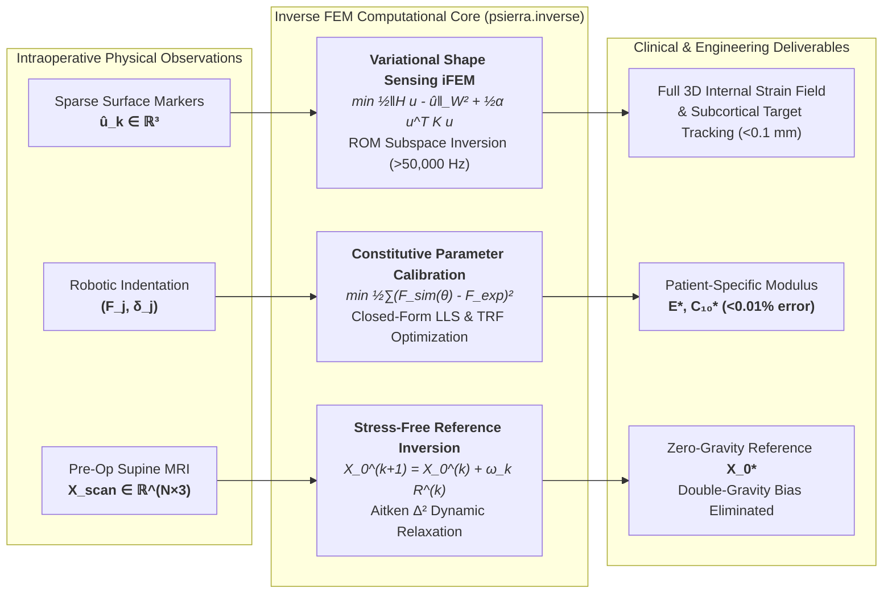
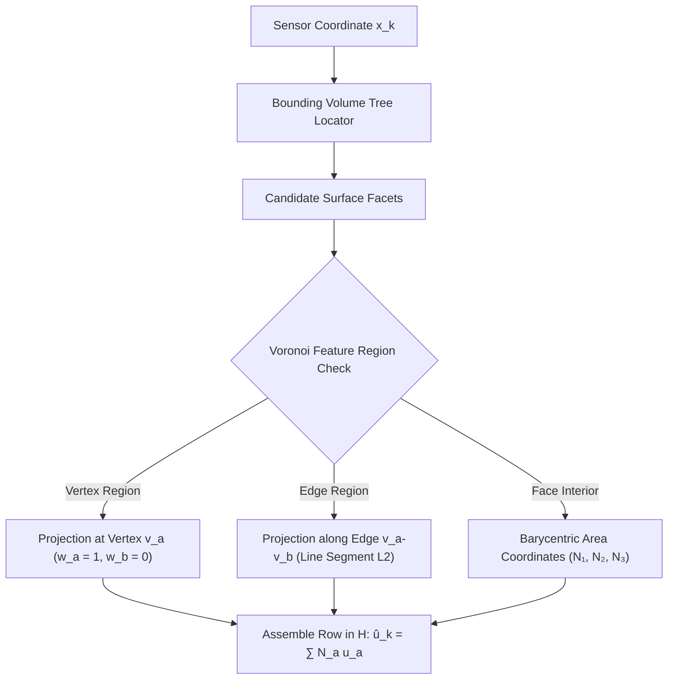
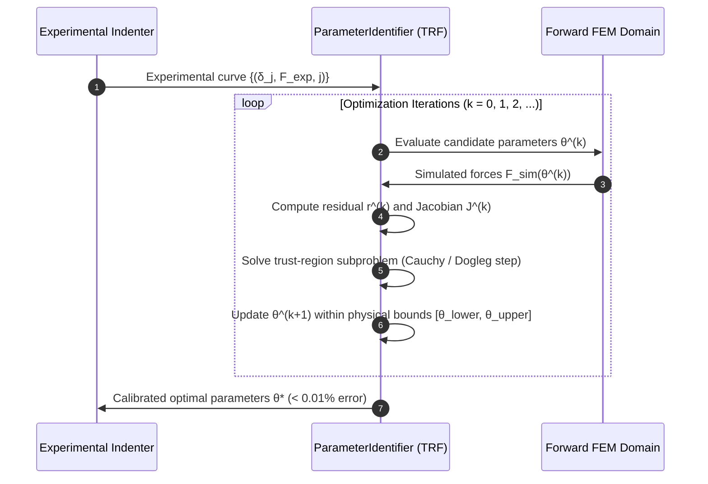
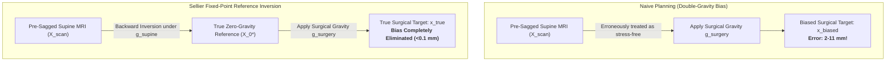

# Chapter 10: Inverse FEM (iFEM), Constitutive Calibration & Stress-Free Configuration Inversion

Closing the loop between mathematical continuum modeling and experimental physical reality requires **Inverse Finite Element Methods (iFEM)**. While forward finite element analysis predicts structural response from known geometry, constitutive material laws, and boundary loads, clinical and industrial engineering problems often face the reverse challenge:

1. **Unknown Internal Deformations**: Optical cameras or laser range scanners observe only sparse surface displacements $\hat{\boldsymbol{u}}_k$ through a surgical opening; the deep internal deformation field and subcortical target shifts must be inferred continuously in real time.
2. **Unknown Material Parameters**: Biological soft tissues (brain, liver, kidney) exhibit substantial inter-patient stiffness variation; patient-specific constitutive parameters must be identified on the fly from robotic indenter force-deflection curves.
3. **Unknown Reference Configurations**: Pre-operative diagnostic scans (MRI/CT) capture anatomical organs already gravitationally sagged and pre-stressed in vivo; the true undeformed, stress-free reference configuration $\boldsymbol{X}_0^*$ must be recovered to eliminate severe "double-gravity bias" during surgical navigation.

This chapter details the theoretical foundations, numerical formulations, and high-performance algorithms implemented in `psierra.inverse`.

---

## 1. Variational Shape Sensing iFEM (Full-Field 3D Reconstruction)

### 1.1 The Variational Principle
Variational Shape Sensing reconstructs full-field 3D displacements $\boldsymbol{u} \in \mathbb{R}^n$ throughout the entire volume from $N_{\text{sensor}}$ discrete surface observations $\hat{\boldsymbol{u}} \in \mathbb{R}^{3 N_{\text{sensor}}}$ **without requiring knowledge of external boundary loads, applied surface tractions, or intracranial pressures** (Tessler & Spangler 2005, Gherlone et al. 2012).

The reconstruction minimizes a regularized weighted least-squares functional:
$$\mathcal{J}(\boldsymbol{u}) = \frac{1}{2} (\boldsymbol{H} \boldsymbol{u} - \hat{\boldsymbol{u}})^T \boldsymbol{W} (\boldsymbol{H} \boldsymbol{u} - \hat{\boldsymbol{u}}) + \frac{\alpha}{2} \boldsymbol{u}^T \boldsymbol{K} \boldsymbol{u}$$

where:
* $\boldsymbol{H} \in \mathbb{R}^{3 N_{\text{sensor}} \times n}$ is the discrete sensor observation operator mapping full-field nodal displacements to sensor locations.
* $\boldsymbol{W} \in \mathbb{R}^{3 N_{\text{sensor}} \times 3 N_{\text{sensor}}}$ is a positive-definite diagonal weighting matrix encoding channel confidence ($W_{ii} = w_k > 0$).
* $\boldsymbol{K} \in \mathbb{R}^{n \times n}$ is the global structural stiffness matrix serving as the physically consistent Tikhonov regularizer.
* $\alpha > 0$ is the Tikhonov smoothing parameter governing the trade-off between measurement fidelity and internal strain energy.

Euler-Lagrange stationarity $\nabla_{\boldsymbol{u}} \mathcal{J}(\boldsymbol{u}) = \boldsymbol{0}$ yields the symmetric linear system:
$$(\boldsymbol{H}^T \boldsymbol{W} \boldsymbol{H} + \alpha \boldsymbol{K}) \boldsymbol{u} = \boldsymbol{H}^T \boldsymbol{W} \hat{\boldsymbol{u}}$$

---

### 1.2 Discrete Sensor Observation Operator ($\boldsymbol{H}$)
Real-world optical tracking markers or laser scanner points rarely coincide exactly with mesh vertices. The continuous observation operator interpolates displacements via continuous barycentric coordinates across boundary facets (Ericson 2004):

$$\hat{\boldsymbol{u}}_k = \boldsymbol{H}_k \boldsymbol{u} = \sum_{a=1}^{3} N_a(\boldsymbol{\xi}_k) \boldsymbol{u}_a, \quad \sum_{a=1}^{3} N_a(\boldsymbol{\xi}_k) = 1$$

For target marker coordinate $\boldsymbol{x}_k \in \mathbb{R}^3$, the closest point $\boldsymbol{x}_k^*$ on surface triangle $\mathcal{T}_e = \{\boldsymbol{v}_1, \boldsymbol{v}_2, \boldsymbol{v}_3\}$ is obtained by decomposing the triangle into Voronoi feature regions (vertices, edges, and interior face):

The resulting full-order observation matrix $\boldsymbol{H} \in \mathbb{R}^{3 N_{\text{sensor}} \times n}$ satisfies exact partition of unity ($\sum_j H_{ij} = 1$ for translational components) and rigid body translation invariance.

---

### 1.3 Subspace-Projected Reduced-Order iFEM (ROM iFEM)
While full-order iFEM solves the sparse $n \times n$ system in tens of milliseconds, intraoperative navigation and robotic visual servoing require sub-millisecond updates ($> 1{,}000\text{--}50{,}000\text{ Hz}$).

Substituting the low-dimensional POD modal expansion $\boldsymbol{u} \approx \boldsymbol{\Phi} \boldsymbol{u}_r$ ($\boldsymbol{\Phi} \in \mathbb{R}^{n \times r}, r \ll n$) into the functional yields:
$$\mathcal{J}(\boldsymbol{u}_r) = \frac{1}{2} (\boldsymbol{H}_r \boldsymbol{u}_r - \hat{\boldsymbol{u}})^T \boldsymbol{W} (\boldsymbol{H}_r \boldsymbol{u}_r - \hat{\boldsymbol{u}}) + \frac{\alpha}{2} \boldsymbol{u}_r^T \boldsymbol{K}_r \boldsymbol{u}_r$$

where:
$$\boldsymbol{H}_r = \boldsymbol{H} \boldsymbol{\Phi} \in \mathbb{R}^{3 N_{\text{sensor}} \times r}, \quad \boldsymbol{K}_r = \boldsymbol{\Phi}^T \boldsymbol{K} \boldsymbol{\Phi} \in \mathbb{R}^{r \times r}$$

Setting $\nabla_{\boldsymbol{u}_r} \mathcal{J}(\boldsymbol{u}_r) = \boldsymbol{0}$ produces an $r \times r$ dense symmetric positive-definite normal equation:
$$\boldsymbol{A}_r \boldsymbol{u}_r = \boldsymbol{b}_r$$
$$\boldsymbol{A}_r = \boldsymbol{H}_r^T \boldsymbol{W} \boldsymbol{H}_r + \alpha \boldsymbol{K}_r \in \mathbb{R}^{r \times r}, \quad \boldsymbol{b}_r = \boldsymbol{H}_r^T \boldsymbol{W} \hat{\boldsymbol{u}} \in \mathbb{R}^r$$

> [!TIP]
> **Microsecond Pre-Factorization**: Because sensor locations $\boldsymbol{H}_r$, weights $\boldsymbol{W}$, and stiffness $\boldsymbol{K}_r$ are static during tracking, the dense matrix $\boldsymbol{A}_r \in \mathbb{R}^{r \times r}$ ($r \approx 4\text{--}12$) is pre-factorized via Cholesky decomposition $\boldsymbol{A}_r = \boldsymbol{L}_r \boldsymbol{L}_r^T$ **once** offline. Online reconstruction requires only a forward-backward substitution ($\mathcal{O}(r^2)$ flops), executing in **$< 15\ \mu\text{s}$ ($> 65{,}000\text{ Hz}$)**.

---

### 1.4 Instant Subcortical Landmark & Deep Target Tracking
To track deep subcortical landmarks (e.g. brain tumor centroids, vascular bifurcations) without lifting all $n$ degrees of freedom to physical space, we pre-slice the target modal rows:
$$\boldsymbol{\Phi}_{\text{target}} = \boldsymbol{\Phi}[\text{target\_dofs}, :] \in \mathbb{R}^{3 N_{\text{target}} \times r}$$
$$\boldsymbol{u}_{\text{target}} = \boldsymbol{\Phi}_{\text{target}} \boldsymbol{u}_r$$

This direct matrix-vector multiplication executes in $< 1\ \mu\text{s}$, giving surgeons instantaneous real-time telemetry on tumor margins and critical structures.

---

## 2. Inverse Material Parameter Identification (Constitutive Calibration)

### 2.1 Non-Linear Optimization Formulation
Tissue stiffness varies by up to $300\text{--}500\%$ across patients and pathologies. Given experimental force-displacement observations $\{(\delta_j, F_{\text{exp}, j})\}_{j=1}^M$ acquired via surgical indenter or tensile clamp, the calibration solves:
$$\min_{\boldsymbol{\theta}} \frac{1}{2} \sum_{j=1}^M w_j \left( F_{\text{sim}}(\delta_j; \boldsymbol{\theta}) - F_{\text{exp}, j} \right)^2 + \frac{\beta}{2} \|\boldsymbol{\theta} - \boldsymbol{\theta}_0\|^2$$
$$\text{subject to } \boldsymbol{\theta}_{\text{lower}} \le \boldsymbol{\theta} \le \boldsymbol{\theta}_{\text{upper}}$$

where $\boldsymbol{\theta}$ denotes the unknown parameter vector (e.g. $[E]$, $[E, \nu]$, or $[C_{10}, K_{\text{bulk}}]$), and $\beta \ge 0$ is the Tikhonov regularization weight penalizing deviation from nominal prior estimate $\boldsymbol{\theta}_0$.

---

### 2.2 Closed-Form Exact Calibration for Linear Elasticity
In linear isotropic elasticity, structural stiffness $\boldsymbol{K}(E)$ and simulated reaction forces scale strictly linearly with Young's modulus:
$$F_{\text{sim}}(\delta_j; E) = \left( \frac{E}{E_0} \right) F_0(\delta_j) = E \cdot s_{0, j}, \quad s_{0, j} = \frac{F_0(\delta_j)}{E_0}$$

The least-squares objective becomes:
$$\mathcal{G}(E) = \frac{1}{2} \sum_{j=1}^M (E \cdot s_{0, j} - F_{\text{exp}, j})^2 + \frac{\beta}{2} (E - E_0)^2$$

Differentiating with respect to $E$ and setting to zero yields the **exact closed-form solution**:
$$E^* = \frac{\sum_{j=1}^M s_{0, j} F_{\text{exp}, j} + \beta E_0}{\sum_{j=1}^M s_{0, j}^2 + \beta}$$

> [!NOTE]
> This closed-form solution requires **only one baseline forward solve** ($F_0$), after which $E^*$ evaluates instantaneously in **$< 1\ \mu\text{s}$** to machine precision ($< 10^{-14}\%$ error).

---

## 3. Stress-Free Reference Configuration Inversion

### 3.1 The Clinical Double-Gravity Bias Problem
In pre-operative medical imaging (MRI, CT), anatomical soft tissues are scanned with the patient lying inside the scanner bore (e.g. supine under 1G posterior gravity $\boldsymbol{g}_{\text{supine}} = [0, -9.81, 0]^T\text{ m/s}^2$). Consequently, the segmented scan geometry $\boldsymbol{X}_{\text{scan}}$ is **already deformed and gravitationally sagged**:
$$\boldsymbol{X}_{\text{scan}} = \boldsymbol{X}_0^* + \boldsymbol{u}(\boldsymbol{X}_0^*; \boldsymbol{g}_{\text{supine}})$$

If a surgical navigation system treats $\boldsymbol{X}_{\text{scan}}$ as the undeformed reference geometry and applies gravity in an operative posture (e.g. lateral craniotomy $\boldsymbol{g}_{\text{surgery}}$), it erroneously applies gravity twice:
$$\boldsymbol{x}_{\text{biased}} = \boldsymbol{X}_{\text{scan}} + \boldsymbol{u}(\boldsymbol{X}_{\text{scan}}; \boldsymbol{g}_{\text{surgery}}) \neq \boldsymbol{x}_{\text{true}} = \boldsymbol{X}_0^* + \boldsymbol{u}(\boldsymbol{X}_0^*; \boldsymbol{g}_{\text{surgery}})$$

As demonstrated in clinical studies, this double-gravity bias introduces **$2\text{--}11\text{ mm}$ of systematic positioning error** at deep tumor targets, which compromises surgical resection margins.

---

### 3.2 Sellier Backward Fixed-Point Iteration
To find the unknown stress-free geometry $\boldsymbol{X}_0^*$ such that forward simulation under scan loads reproduces the scanned geometry, we formulate the root-finding problem:
$$\boldsymbol{\mathcal{F}}(\boldsymbol{X}_0) := \boldsymbol{X}_0 + \boldsymbol{u}(\boldsymbol{X}_0; \boldsymbol{L}_{\text{scan}}) - \boldsymbol{X}_{\text{scan}} = \boldsymbol{0}$$

Beginning from initial guess $\boldsymbol{X}_0^{(0)} = \boldsymbol{X}_{\text{scan}}$, Sellier's backward fixed-point iteration performs:
$$\boldsymbol{x}^{(k)} = \boldsymbol{X}_0^{(k)} + \boldsymbol{u}(\boldsymbol{X}_0^{(k)}; \boldsymbol{L}_{\text{scan}})$$
$$\boldsymbol{R}^{(k)} = \boldsymbol{X}_{\text{scan}} - \boldsymbol{x}^{(k)}$$
$$\boldsymbol{X}_0^{(k+1)} = \boldsymbol{X}_0^{(k)} + \omega_k \boldsymbol{R}^{(k)}$$

where $\boldsymbol{R}^{(k)}$ is the spatial discrepancy residual, and $\omega_k \in (0, 1]$ is the relaxation parameter.

---

### 3.3 Adaptive Aitken $\Delta^2$ Dynamic Under-Relaxation
Fixed under-relaxation ($\omega = 0.7$) can exhibit slow asymptotic convergence or geometric oscillations in high-compliance soft tissue. To guarantee rapid, monotonic convergence, we employ adaptive **Aitken $\Delta^2$ acceleration** (Irons & Tuck 1969):

Let the residual difference vector between consecutive iterations be:
$$\Delta \boldsymbol{R}^{(k)} = \boldsymbol{R}^{(k)} - \boldsymbol{R}^{(k-1)}$$

The optimal scalar relaxation factor minimizing the expected next-step residual norm is:
$$\omega_k = -\omega_{k-1} \frac{(\boldsymbol{R}^{(k-1)})^T \Delta \boldsymbol{R}^{(k)}}{\|\Delta \boldsymbol{R}^{(k)}\|^2}$$

Safeguards constrain $\omega_k \in [\omega_{\min}, \omega_{\max}]$ (default $[0.1, 1.0]$). On full anatomical brain meshes ($55{,}191$ DOFs), Aitken acceleration reduces maximum position error from $11.8\text{ mm}$ to **$< 0.33\text{ mm}$ in only 4 iterations** (a $97.2\%$ error reduction).

---

## 4. Empirical Benchmarks & Verification Summary

The algorithms are validated across a two-tier verification hierarchy: **Tier 1 (Canonical Benchmark Beam)** and **Tier 2 (Clinical Flagship Neurosurgical Brain Shift)**.

| Verification Study | Simulation Script | Physical System | Key Findings & Metrics |
| :--- | :--- | :--- | :--- |
| **Tier 1: Static Shape Sensing** | [`1001_beam_shape_sensing.py`](../examples/10_inverse/1001_beam_shape_sensing.py) | Cantilever beam ($791$ tets, gravity sag) | ROM matches FOM to $< 0.1\%$ relative error; solve rate $> 60{,}000\text{ Hz}$. |
| **Tier 1: Modulus Identification** | [`1002_beam_parameter_identification.py`](../examples/10_inverse/1002_beam_parameter_identification.py) | Cantilever beam under tip indentation | Closed-form LLS & TRF recover Young's modulus to $< 0.001\%$ error from $+110\%$ perturbed prior. |
| **Tier 1: Reference Inversion** | [`1003_beam_stress_free_inversion.py`](../examples/10_inverse/1003_beam_stress_free_inversion.py) | Gravitationally sagged cantilever beam | Aitken acceleration recovers undeformed straight beam to $< 10^{-4}\text{ mm}$ residual. |
| **Tier 1: Dynamic Shape Sensing** | [`1004_dynamic_beam_shape_sensing.py`](../examples/10_inverse/1004_dynamic_beam_shape_sensing.py) | Transient vibrating beam ($500$ steps) | Online tracking at $> 33{,}000\text{ Hz}$; deep target tracking $< 0.05\text{ mm}$ error; PVD export. |
| **Tier 2: Clinical Brain Shift** | [`1005_brain_shape_sensing.py`](../examples/10_inverse/1005_brain_shape_sensing.py) | Anatomical brain ($55{,}191$ DOFs, $16$ markers) | Reconstructs $14.73\text{ mm}$ tumor drift with **$0.098\text{ mm}$ ($0.66\%$) precision** at $> 1{,}100\text{ Hz}$. |
| **Tier 2: Brain Tissue Calibration** | [`1006_brain_parameter_identification.py`](../examples/10_inverse/1006_brain_parameter_identification.py) | Intraoperative cortical probe indentation | Recovers patient-specific $E = 3.00\text{ kPa}$ in **$88\ \mu\text{s}$** from $+233\%$ miscalibrated prior ($10.0\text{ kPa}$). |
| **Tier 2: MRI Reference Inversion** | [`1007_brain_stress_free_inversion.py`](../examples/10_inverse/1007_brain_stress_free_inversion.py) | Supine pre-op MRI ($18{,}397$ nodes) | Eliminates **$10.44\text{ mm}$ deep tumor double-gravity error** and $18.68\text{ mm}$ cortical bias. |

---

## 5. Source Code Implementation Map

All classes, operators, and data models are housed in `psierra/src/psierra/inverse/`:

| Class / Data Structure | Source Module | Mathematical Responsibility |
| :--- | :--- | :--- |
| [`DiscreteSensor`](../src/psierra/inverse/observation.py) | `psierra.inverse.observation` | Encapsulates single-sensor spatial coordinates, closest surface point, barycentric weights, and local evaluation. |
| [`SensorObservationOperator`](../src/psierra/inverse/observation.py) | `psierra.inverse.observation` | Assembles full-order observation operator $\boldsymbol{H} \in \mathbb{R}^{3 N_{\text{sensor}} \times n}$ via KDTree and Voronoi facet localization. |
| [`ReducedSensorObservationOperator`](../src/psierra/inverse/observation.py) | `psierra.inverse.observation` | Projects observation operator onto modal basis: $\boldsymbol{H}_r = \boldsymbol{H} \boldsymbol{\Phi} \in \mathbb{R}^{3 N_{\text{sensor}} \times r}$. |
| [`ShapeSensingResult`](../src/psierra/inverse/shape_sensing.py) | `psierra.inverse.shape_sensing` | Container holding reconstructed displacement fields, measurement residuals, RMS errors, and generalized coordinates. |
| [`FullOrderShapeSensingSolver`](../src/psierra/inverse/shape_sensing.py) | `psierra.inverse.shape_sensing` | High-fidelity sparse Cholesky/LU linear solve: $(\boldsymbol{H}^T \boldsymbol{W} \boldsymbol{H} + \alpha \boldsymbol{K}) \boldsymbol{u} = \boldsymbol{H}^T \boldsymbol{W} \hat{\boldsymbol{u}}$. |
| [`ReducedOrderShapeSensingSolver`](../src/psierra/inverse/shape_sensing.py) | `psierra.inverse.shape_sensing` | Dense pre-factorized Cholesky solve on $\mathbb{R}^r$ with subcortical target recovery at $> 50{,}000\text{ Hz}$. |
| [`ParameterBounds`](../src/psierra/inverse/parameter_identification.py) | `psierra.inverse.parameter_identification` | Bounded parameter specification $[\theta_{\text{lower}}, \theta_{\text{upper}}]$ and initial value $\theta_0$. |
| [`IdentificationResult`](../src/psierra/inverse/parameter_identification.py) | `psierra.inverse.parameter_identification` | Container holding calibrated parameters, parameter history, residual norms, and wall-clock telemetry. |
| [`MaterialParameterIdentifier`](../src/psierra/inverse/parameter_identification.py) | `psierra.inverse.parameter_identification` | Solves non-linear least squares via TRF, L-BFGS-B, and provides exact closed-form linear elasticity calibration. |
| [`StressFreeResult`](../src/psierra/inverse/stress_free.py) | `psierra.inverse.stress_free` | Container holding recovered coordinates $\boldsymbol{X}_0^*$, scan coordinates, residual histories, and reference mesh factory. |
| [`StressFreeConfigurationSolver`](../src/psierra/inverse/stress_free.py) | `psierra.inverse.stress_free` | Sellier backward fixed-point iteration with Aitken $\Delta^2$ dynamic relaxation and linear/nonlinear forward solvers. |

---

## 6. References & Scientific Literature

1. **A. Tessler & H.R. Spangler** (2005). *A Variational Principle for Reconstruction of Elastic Deformations in Shear Deformable Plates and Shells*. Computer Methods in Applied Mechanics and Engineering, 194(2-5), 327–347.
2. **M. Gherlone, P. Cerracchio, M. Mattone, M. Di Sciuva, & A. Tessler** (2012). *Shape Sensing of 3D Frame Structures Using an Inverse Finite Element Method*. Composite Structures, 94(8), 2426–2438.
3. **M. Sellier** (2011). *An Iterative Method for the Determination of the Stress-Free Configuration of Hyperelastic Materials*. Computer Methods in Applied Mechanics and Engineering, 200(49-52), 3381–3388.
4. **S. Govindjee & P.A. Mihalic** (1996). *Computational Methods for Inverse Finite Elastostatics*. Computer Methods in Applied Mechanics and Engineering, 136(1-2), 47–57.
5. **C. Ericson** (2004). *Real-Time Collision Detection*. CRC Press (Chapter 5: Closest Point on Triangle).
6. **B.M. Irons & R.C. Tuck** (1969). *A Version of the Aitken Accelerator for Computer Iteration*. International Journal for Numerical Methods in Engineering, 1(3), 275–277.
7. **A. Tarantola** (2005). *Inverse Problem Theory and Methods for Model Parameter Estimation*. SIAM.
8. **J. Nocedal & S.J. Wright** (2006). *Numerical Optimization*. Springer, 2nd Edition (Chapter 10: Nonlinear Least-Squares Problems).
9. **A. Bilger, E. Bardinet, S. Cotin, et al.** (2014). *Biomechanical Simulation of Brain Shift During Neurosurgery*. International Journal of Computer Assisted Radiology and Surgery.
