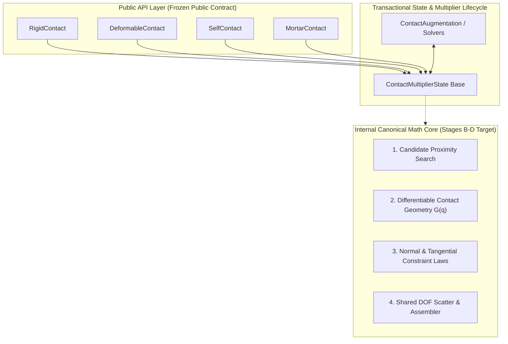
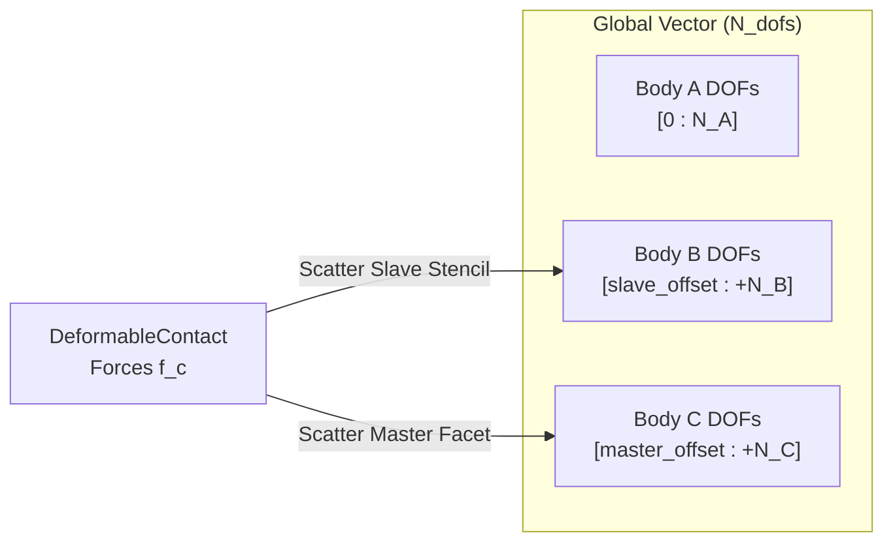
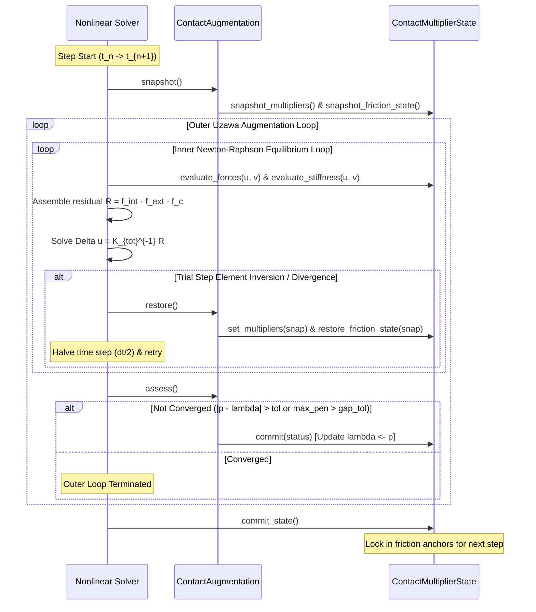

# 12. Contact Mechanics: Frozen Public Contracts & Characterization Baselines

This document establishes the **frozen public contracts**, state-machine lifecycles, degree-of-freedom mapping rules, solver coupling standards, and characterization baselines for the four contact formulations in `pSierra`:
- **`RigidContact`**: Node-to-analytical / mesh obstacle interaction (`psierra.boundary.contact.RigidContact`).
- **`DeformableContact`**: Multi-body two-way node-to-segment contact (`psierra.boundary.contact.DeformableContact`).
- **`SelfContact`**: Single-body self-collision and fold handling (`psierra.boundary.contact.SelfContact`).
- **`MortarContact`**: Dual biorthogonal segment-to-segment weak-form contact (`psierra.boundary.mortar.MortarContact`).

---

## 1. Architectural Mandate & Milestone 1.0 Strategy

In accordance with **Milestone 1.0** of the `pSierra` Loop 3 roadmap, the contact overhaul follows a **staged internal replacement strategy**:

$$\text{Preserve Public Contracts} \longrightarrow \text{Establish Characterization Baselines} \longrightarrow \text{Replace Mathematical Core}$$



### 1.1 Invariant Public Principles
1. **Public Class Stability**: The four public classes `RigidContact`, `DeformableContact`, `SelfContact`, and `MortarContact` remain the external entry points used by simulation scripts and `MultiBodySystem`.
2. **Transactional State Integrity**: Any rejected solver trial step or adaptive time cutback must restore multipliers, frictional anchors, and clear cached geometric queries without leaving residual trial mutations.
3. **Legacy Discrepancy Classification**: Existing mathematical omissions (such as missing curved obstacle curvature tangents, positive-gap attractive forces under search tolerance, and frozen mortar geometry) are characterized and documented as **known legacy defects** rather than blessed as future ground truth.

---

## 2. Shared Base Contract: `ContactMultiplierState`

All contact formulations inherit from `ContactMultiplierState` (`psierra/boundary/contact.py`), which manages candidate-aligned normal multipliers, stick-slip friction snapshots, cache invalidation, and outer augmented Lagrangian updates.

### 2.1 State Attributes & Physical Definitions

| Attribute | Type | Units | Physical Definition |
| :--- | :--- | :--- | :--- |
| `multipliers` | `np.ndarray` (1D `float64`) | $\text{N}$ (Force) | Candidate-aligned discrete normal Lagrange multipliers $\lambda_{N, i} \ge 0$. |
| `k_penalty` | `float` | $\text{N/mm}$ | Normal penalty stiffness parameter $k_p > 0$. |
| `k_tangential` | `float` | $\text{N/mm}$ | Tangential stick penalty stiffness $k_T > 0$ (defaults to $k_p$). |
| `c_damping` | `float` | $\text{N}\cdot\text{s/mm}$ | Normal velocity damping coefficient $c_p \ge 0$. |
| `friction` | `float` | Dimensionless | Regularized Coulomb coefficient of friction $\mu \ge 0$. |
| `formulation` | `str` | Nominal | Constraint method: `'penalty'` or `'augmented_lagrangian'`. |
| `symmetric_tangent`| `bool` | Boolean | If `True`, symmetrizes friction tangent by omitting unsymmetric $K_{TN}$ coupling. |
| `friction_state` | `CoulombFrictionState \| None` | Object | Persistent and trial frictional stick-slip anchors, slip directions, and states. |

### 2.2 Shared Method Signatures & Behavioral Contract

```python
class ContactMultiplierState:
    def evaluate_gaps(self, current_nodes: np.ndarray | None = None) -> np.ndarray:
        """Return candidate-aligned signed normal constraint gaps g_N [length]."""

    def snapshot_multipliers(self) -> np.ndarray:
        """Return a deep copy of currently accepted normal multipliers [force]."""

    def set_multipliers(self, values: np.ndarray) -> None:
        """Set finite nonnegative multipliers and invalidate cached query state."""

    def snapshot_friction_state(self) -> CoulombFrictionSnapshot | None:
        """Return a deep copy of candidate frictional anchors, forces, and states."""

    def restore_friction_state(self, snap: CoulombFrictionSnapshot | None) -> None:
        """Restore candidate frictional state from snapshot upon trial rollback."""

    def invalidate_state(self) -> None:
        """Clear cached integration matrices, proximity queries, and derived data."""

    def update_multipliers(self, rebound_relaxation: bool = False, gap_tol: float = 0.0) -> dict[str, float]:
        """Uzawa projection lambda <- max(0, lambda - kp * g); penalty is a no-op."""

    def relax_rebound(self, gap_tol: float = 0.0) -> int:
        """Zero retained multipliers on opening/separated candidates (gap > gap_tol)."""

    def commit_state(self) -> None:
        """Commit converged friction trial state to accepted reference at step end."""
```

---

## 3. Public Class Contracts & Constructor Signatures

### 3.1 `RigidContact`
Binds a deformable slave body to an analytical or triangular surface mesh obstacle.

```python
class RigidContact(ContactMultiplierState):
    def __init__(
        self,
        slave: Domain | CollisionShape | Any | None = None,
        master: CollisionShape | Sequence[CollisionShape] | Domain | Any | None = None,
        *,
        obstacle: CollisionShape | Sequence[CollisionShape] | Domain | Any | None = None,
        domain: Domain | None = None,
        body: int | str | Domain | None = None,
        slave_nodes: Sequence[int] | np.ndarray | None = None,
        k_penalty: float = 1e4,
        k_tangential: float | None = None,
        c_damping: float = 0.0,
        friction: float = 0.0,
        dof_offset: int = 0,
        dofs_per_node: int = 3,
        formulation: Literal["penalty", "augmented_lagrangian"] = "penalty",
        tolerance: float = 0.0,
        symmetric_tangent: bool = False,
    ) -> None: ...
```
- **Validation Rules**:
  - `k_penalty > 0.0`, `c_damping >= 0.0`, `friction >= 0.0`, `tolerance >= 0.0`.
  - `formulation` must be `'penalty'` or `'augmented_lagrangian'`.
  - If `body` is provided on a `MultiBodySystem`, `dof_offset` automatically binds to the body's starting global degree of freedom.

### 3.2 `DeformableContact`
Two-body node-to-segment contact between distinct deformable slave and master domains.

```python
class DeformableContact(ContactMultiplierState):
    def __init__(
        self,
        slave: Domain,
        master: Domain,
        slave_nodes: Sequence[int] | np.ndarray | None = None,
        k_penalty: float = 1e4,
        k_tangential: float | None = None,
        c_damping: float = 0.0,
        friction: float = 0.0,
        slave_offset: int = 0,
        master_offset: int = 0,
        domain: Domain | None = None,
        formulation: Literal["penalty", "augmented_lagrangian"] = "penalty",
        tolerance: float = 0.0,
        symmetric_tangent: bool = False,
        *,
        smoothed_normals: bool = False,
        smoothing_weight: Literal["angle", "area"] = "angle",
    ) -> None: ...
```
- **Validation Rules**:
  - `slave` and `master` must have accessible surface meshes (`mesh.surface`).
  - `k_penalty > 0.0`, `c_damping >= 0.0`, `friction >= 0.0`, `tolerance >= 0.0`.
  - `smoothing_weight` must be `'angle'` or `'area'`.

### 3.3 `SelfContact`
Single-body node-to-segment self-contact for folding continua, lobes, and invaginations.

```python
class SelfContact(ContactMultiplierState):
    def __init__(
        self,
        domain: Domain,
        contact_nodes: Sequence[int] | np.ndarray | None = None,
        *,
        k_penalty: float = 1e4,
        k_tangential: float | None = None,
        c_damping: float = 0.0,
        friction: float = 0.0,
        dof_offset: int = 0,
        formulation: Literal["penalty", "augmented_lagrangian"] = "penalty",
        tolerance: float = 0.0,
        search_radius: float | None = None,
        contact_thickness: float | None = None,
        normal_threshold: float = -0.2,
        exclusion_rings: int = 4,
        smoothed_normals: bool = False,
        smoothing_weight: Literal["angle", "area"] = "angle",
        symmetric_tangent: bool = False,
    ) -> None: ...
```
- **Validation Rules**:
  - `dof_offset % 3 == 0`, `exclusion_rings >= 0` (integer).
  - `normal_threshold` must lie in $[-1.0, 1.0]$.
  - `search_radius > 0.0`, `contact_thickness > 0.0` when specified.

### 3.4 `MortarContact`
Segment-to-segment weak-form contact using biorthogonal dual shape functions.

```python
class MortarContact(ContactMultiplierState):
    def __init__(
        self,
        slave: Domain,
        master: Domain | Any,
        slave_nodes: Sequence[int] | np.ndarray | None = None,
        k_penalty: float = 1e4,
        k_tangential: float | None = None,
        c_damping: float = 0.0,
        friction: float = 0.0,
        slave_offset: int = 0,
        master_offset: int = 0,
        dof_offset: int = 0,
        formulation: Literal["penalty", "augmented_lagrangian"] = "penalty",
        search_radius: float = 10.0,
        tolerance: float = 0.0,
        symmetric_tangent: bool = False,
        domain: Domain | None = None,
    ) -> None: ...
```
- **Validation Rules**:
  - `slave` must possess triangular surface facets.
  - Supports both deformable master (`master.mesh.surface`) and rigid mesh obstacle (`master.surface`).
  - `dof_offset` aliases `slave_offset` when provided.

---

## 4. Evaluation Methods & Mechanical Contracts

All four contact classes implement the canonical triad of evaluation methods:

### 4.1 Force Evaluation: `evaluate_forces()`
```python
def evaluate_forces(
    self,
    current_nodes: np.ndarray | None = None,
    velocities: np.ndarray | None = None,
    n_dofs: int | None = None,
) -> np.ndarray: ...
```
- **Returns**: Global force array $\boldsymbol{f}_c \in \mathbb{R}^{N_{\text{dofs}}}$ containing contact repulsive and frictional forces.
- **Normal Pressure Formulation**:
  - *Penalty Mode*: $p_N = -k_p g_N$ for active penetrated candidates ($g_N < 0$).
  - *Augmented Lagrangian Mode*: $p_N = \max(0, \lambda_N - k_p g_N)$.
- **Momentum Conservation**:
  - For two-body contact (`DeformableContact` and `MortarContact`), action-reaction holds:
    $$\sum_{i \in \text{slave}} \boldsymbol{f}_{c, i} + \sum_{k \in \text{master}} \boldsymbol{f}_{c, k} = \mathbf{0}$$
  - For `SelfContact`, net internal interface force and moment sum to zero:
    $$\sum_{i} \boldsymbol{f}_{c, i} = \mathbf{0}, \quad \sum_{i} \boldsymbol{x}_i \times \boldsymbol{f}_{c, i} = \mathbf{0}$$

### 4.2 Stiffness Evaluation: `evaluate_stiffness()`
```python
def evaluate_stiffness(
    self,
    current_nodes: np.ndarray | None = None,
    n_dofs: int | None = None,
    a1: float = 0.0,
) -> scipy.sparse.csr_matrix: ...
```
- **Returns**: Global sparse tangent stiffness matrix $\boldsymbol{K}_c \in \mathbb{R}^{N_{\text{dofs}} \times N_{\text{dofs}}}$ in `csr_matrix` format.
- **Dynamic Damping Term**: `a1` is the algorithmic velocity integrator scale factor ($\gamma / (\beta \Delta t)$ for Newmark-$\beta$ / Generalized-$\alpha$). When $c_p > 0$, effective normal contact stiffness is scaled by:
  $$k_{\text{eff}} = k_p + a_1 c_p$$
- **Symmetry**: Conservative frictionless tangents on fixed feature branches are symmetric positive semi-definite ($\boldsymbol{K}_c = \boldsymbol{K}_c^T$). When Coulomb friction is active, the tangent is unsymmetric unless `symmetric_tangent=True`.

### 4.3 Potential Energy Evaluation: `evaluate_potential_energy()`
```python
def evaluate_potential_energy(
    self,
    current_nodes: np.ndarray | None = None,
) -> float: ...
```
- **Returns**: Total scalar contact potential energy $\Pi_c \ge 0$ [$\text{N}\cdot\text{mm}$].
- **Analytical Formulas**:
  - *Penalty Formulation*:
    $$\Pi_c = \frac{1}{2} k_p \sum_{i \in \text{active}} g_{N, i}^2$$
  - *Augmented Lagrangian Formulation* (at fixed multipliers $\lambda_N$):
    $$\Pi_c = \sum_{i} \frac{p_{N, i}^2 - \lambda_{N, i}^2}{2 k_p} \quad \text{where } p_{N, i} = \max(0, \lambda_{N, i} - k_p g_{N, i})$$

### 4.4 Diagnostic Summary: `get_contact_info()`
```python
def get_contact_info(
    self,
    current_nodes: np.ndarray | None = None,
) -> dict[str, Any]: ...
```
- **Guaranteed Output Dictionary Schema**:
  - `'num_active'`: (`int`) Count of active contacting candidates ($p_N > 0$ or $g_N < 0$).
  - `'max_penetration'`: (`float`) Maximum signed penetration depth $\max(0, -g_N)$ [length].
  - `'potential_energy'`: (`float`) Total scalar normal potential energy $\Pi_c$ [energy].
  - `'max_multiplier'`: (`float`) Maximum normal multiplier value $\max(\lambda_N)$ [force].
  - `'num_stick'`: (`int`, optional) Count of frictional candidates in stick state.
  - `'num_slip'`: (`int`, optional) Count of frictional candidates in sliding slip state.
  - `'max_friction_force'`: (`float`, optional) Peak frictional traction magnitude [force].
  - `'max_slip_distance'`: (`float`, optional) Peak accumulated slip displacement [length].

---

## 5. Degree of Freedom (DOF) Offset & Scatter Architecture

When multiple bodies or subdomains are coupled, contact forces and stiffness contributions must scatter into the designated DOF ranges without polluting adjacent bodies.



### 5.1 Offset Rules per Formulation

1. **`RigidContact`**:
   - `dof_offset`: Starting degree of freedom in the global system for the slave body.
   - Global DOF for slave node $i$ and component $c \in \{0, 1, 2\}$:
     $$\text{DOF} = \text{dof\_offset} + i \cdot \text{dofs\_per\_node} + c$$
2. **`DeformableContact`**:
   - `slave_offset`: Global starting index for slave domain.
   - `master_offset`: Global starting index for master domain.
   - Stencil DOFs for a slave node and 3 master triangle vertices:
     $$\mathcal{I}_{\text{local}} = [\text{slave\_offset} + 3 i_s + c, \; \text{master\_offset} + 3 i_{m1} + c, \; \dots]^T$$
   - Tangent matrix produces 4 coupled blocks: $\boldsymbol{K}_{ss}$, $\boldsymbol{K}_{sm}$, $\boldsymbol{K}_{ms}$, $\boldsymbol{K}_{mm}$.
3. **`SelfContact`**:
   - `dof_offset`: Starting index for the single domain containing self-interacting folds.
   - All 12 DOFs of each candidate stencil (1 slave node + 3 facet vertices) reside in the same body slice:
     $$\text{DOF} = \text{dof\_offset} + 3 \cdot n_{\text{body}} + c$$
4. **`MortarContact`**:
   - `slave_offset`: Global index for slave surface nodes.
   - `master_offset`: Global index for master surface nodes.
   - Mortar cross-coupling blocks scatter to slave and master ranges via dual biorthogonal mortar projectors:
     $$\boldsymbol{f}_m = -\boldsymbol{M}^T \boldsymbol{D}^{-1} \boldsymbol{f}_s$$

---

## 6. Solver Coupling & Transactional State History

The contact framework is designed to participate in both **inner Newton-Raphson nonlinear equilibrium loops** and **outer Uzawa augmentation loops** (`ContactAugmentation` in `psierra.analysis.augmentation`).

### 6.1 The Dual-Loop Solver Lifecycle


### 6.2 Transactional Rollback Invariants
1. **No Trial Leakage**: If a solver sub-step or cutback fails, calling `ContactAugmentation.restore()` must restore the exact pre-step multiplier array and friction snapshot.
2. **Cache Invalidation**: Any mutation to multipliers (`set_multipliers`) or geometry coordinates must invoke `invalidate_state()` to clear cached cell locators, projection barycentrics, or mortar integration matrices ($\boldsymbol{D}, \boldsymbol{M}$).
3. **Accepted Step Commitment**: `commit_state()` is invoked *only once per accepted convergent step*, converting `trial_anchors` into committed `anchors` and resetting `trial_slip_increments` to zero.

---

## 7. Formal Classification of Expected Legacy Discrepancies

To prevent bugs from being immortalized as intended future behavior during Stage A, the following **five known legacy discrepancies** are formally marked and characterized:

| Discrepancy ID | Formulation Affected | Current Legacy Implementation | Mathematically Correct Target (Stages B-D) |
| :--- | :--- | :--- | :--- |
| **`LEGACY-DISC-01`** | `RigidContact` (Penalty) | **Positive-Gap Penalty Force Attraction**: When `tolerance > 0` and $0 < g_N \le \text{tolerance}$, $f_N = -k_p g_N < 0$ generates an unphysical adhesive attraction pulling separated nodes into the obstacle. | **Non-Adhesive Activation**: $p_N = k_p \langle -g_N \rangle_+$. Search tolerance detects candidate proximity only; force is strictly zero for $g_N > 0$. |
| **`LEGACY-DISC-02`** | `RigidContact` (Curved Obstacles) | **Omission of Curvature Hessian**: For `RigidSphere` and `RigidCylinder`, `evaluate_stiffness` computes $\boldsymbol{K}_c = k_p (\boldsymbol{n} \otimes \boldsymbol{n})$, omitting the geometric term $g_N \nabla^2 g_N$. | **Exact Curved Linearization**: $\boldsymbol{K}_c = k_p (\boldsymbol{n} \otimes \boldsymbol{n} + g_N \nabla^2 g_N)$ on fixed smooth branch. |
| **`LEGACY-DISC-03`** | `DeformableContact` & `SelfContact` (Smoothing) | **Incomplete Normal Variation**: When `smoothed_normals=True`, $\nabla g_N$ uses only $\boldsymbol{W}^T \boldsymbol{n}$ (omitting $\boldsymbol{r}^T \nabla \boldsymbol{n}$), and vertex pseudonormals are treated as constant in the Hessian. | **Energy-Consistent Smoothing**: Both $\boldsymbol{W}^T \boldsymbol{n} + \boldsymbol{r}^T \frac{\partial \boldsymbol{n}}{\partial \boldsymbol{q}}$ and full vertex pseudonormal variation $\frac{\partial \boldsymbol{n}_v}{\partial \boldsymbol{q}}$ are included. |
| **`LEGACY-DISC-04`** | `MortarContact` | **Frozen-Geometry Tangent**: `evaluate_stiffness` linearizes only nodal pressures, omitting derivatives of the active segment integration domain, dual shape functions, and surface normals ($\partial \boldsymbol{D}/\partial \boldsymbol{u}$, $\partial \boldsymbol{M}/\partial \boldsymbol{u}$). | **Complete Mortar Linearization**: Full directional derivatives of $\boldsymbol{D}$, $\boldsymbol{M}$, and interface geometry under finite sliding and curvature. |
| **`LEGACY-DISC-05`** | `RigidCylinder` | **Unbounded Axial Extrusion**: `RigidCylinder.query_points` projects points radially along the infinite axis vector, ignoring the `height` parameter completely. | **Explicit Collision Geometry Contract**: Formulate exact capped cylinder distance queries or rename/document as infinite cylinder primitive. |

---

## 8. Baseline Test Matrix & Verification Coverage

The Stage A baseline ensures:
1. **Preservation of the 167-Test Focused Contact Suite**:
   - `tests/test_collision_and_contact.py` (10 tests)
   - `tests/test_deformable_contact.py` (7 tests)
   - `tests/test_deformable_contact_consistency.py` (44 tests)
   - `tests/test_self_contact.py` (8 tests)
   - `tests/test_self_contact_consistency.py` (65 tests)
   - `tests/test_deformable_contact_smoothing.py` (11 tests)
   - `tests/test_mortar_contact.py` (9 tests)
   - `tests/test_friction_coulomb.py` (13 tests)
2. **Dedicated Characterization Suite** (`tests/test_contact_characterization_baseline.py`):
   - Contract adherence and constructor validation across all 4 classes.
   - Global DOF offsets and multi-body block placement.
   - Solver coupling with `NonlinearStaticAnalysis` and `NonlinearDynamicAnalysis`.
   - Transactional state restoration and step commitment history.
   - Characterization and tagging of `LEGACY-DISC-01` through `LEGACY-DISC-05`.

---

## 9. Canonical Internal Data Models & Geometry Providers (Stage B)

In **Stage B**, the canonical internal data structures and differentiable geometry providers are introduced under `psierra.contact` (`psierra/src/psierra/contact/`):

### 9.1 Data Transfer Models (`psierra.contact.data`)
1. **`ContactCandidate`**:
   - Candidate-aligned representation of proximity search results (`candidate_index`, `slave_node`, `master_feature_id`, `master_nodes`, `search_distance`, `is_admissible`, `metadata`).
2. **`DifferentiableContactGeometry`**:
   - The canonical mathematical record:
     $$\mathcal{G}(\boldsymbol{q}) = \left(g_N,\;\nabla_{\boldsymbol{q}} g_N,\;\nabla_{\boldsymbol{q}}^2 g_N,\;\boldsymbol{x}_{\text{closest}},\;\boldsymbol{n},\;\text{feature\_id}\right)$$
   - Acts as the **sole downstream source of truth** for all gaps, outward normals, closest points, gradients, and Hessians.
   - Enforces physical unit metadata (`units='mm'`), outward convention (`orientation_convention='master_outward'`), and symmetric Hessian validation.
3. **`NormalLawState`**:
   - Projected normal constraint state: $p_N = \max(0, \lambda_N - k_p g_N)$, $d p_N / d g_N = -k_p$, potential $\Pi_N$, and updated Uzawa dual state.
4. **`FrictionalConstraintState`**:
   - Coulomb stick-slip state (`INACTIVE`, `STICK`, `SLIP`), committed and trial anchors, traction force, and tangent blocks $\boldsymbol{K}_{TT}, \boldsymbol{K}_{TN}$.
5. **`ContactAssemblyMap`**:
   - Stencil degree-of-freedom indices and partition-of-unity interpolation weights for global sparse scatter.

### 9.2 Canonical Geometry Providers (`psierra.contact.geometry`)
Every provider implements the `ContactGeometryProvider` protocol, providing smooth-branch validity assertions and exact analytical derivatives:
- **`PlanarGeometryProvider`**: $C^\infty$ plane with $\nabla g = \boldsymbol{n}$ and $\nabla^2 g = \mathbf{0}$.
- **`SphereGeometryProvider`**: Exact curvature Hessian $\nabla^2 g = \frac{1}{d} (\boldsymbol{I} - \boldsymbol{n} \otimes \boldsymbol{n})$.
- **`CylinderGeometryProvider`**: Exact circumferential curvature Hessian $\nabla^2 g = \frac{1}{d} (\boldsymbol{I} - \boldsymbol{a} \otimes \boldsymbol{a} - \boldsymbol{n} \otimes \boldsymbol{n})$.
- **`TriangleGeometryProvider`**: Exact 12-DOF node-to-triangle projection gradient and analytical Hessian.

---

## 10. Centralized Constraint Laws & Shared Assembly Operators (Stage C)

In **Stage C**, the physical constraint law and multi-body global scatter logic are decoupled from individual contact classes and centralized in `psierra.contact.law` and `psierra.contact.assembly`:

### 10.1 Centralized Normal Constraint Law (`NormalConstraintLaw`)
- **Non-Adhesive Activation**: Collision search tolerances $\delta_{\text{search}}$ are strictly decoupled from physical force activation. For penalty contact, $p_N = k_p \langle -g_N \rangle_+$, guaranteeing that separated points with $0 < g_N \le \delta_{\text{search}}$ receive zero normal force, zero stiffness, and zero potential energy.
- **Conservative Triad Consistency**:
  $$\Pi_N = \frac{p_N^2 - \lambda_N^2}{2 k_p}$$
  $$\boldsymbol{f}_{\text{local}} = -\frac{\partial \Pi_N}{\partial \boldsymbol{q}} = p_N \nabla_{\boldsymbol{q}} g_N$$
  $$\boldsymbol{K}_{\text{local}} = -\frac{\partial \boldsymbol{f}_{\text{local}}}{\partial \boldsymbol{q}} = (k_p + a_1 c_p) (\nabla_{\boldsymbol{q}} g_N \otimes \nabla_{\boldsymbol{q}} g_N) - p_N \nabla_{\boldsymbol{q}}^2 g_N$$
- **Unified Mathematical Kernel**: The exact same normal constraint law evaluates forces and tangents across analytical rigid obstacles, deformable node-to-triangle facets, and self-contact stencils.

### 10.2 Shared Assembly Engine (`ContactAssembler`)
- **Unified Assembly Maps**:
  - `build_one_body_map`: One-body mapping with global degree-of-freedom offsets (`slave_dofs`).
  - `build_two_body_map`: Two-body mapping for master/slave stencils with partition-of-unity interpolation weights $\boldsymbol{w} = [1, -\xi_0, -\xi_1, -\xi_2]$.
  - `build_self_contact_map`: Single-body fold mapping with domain offset bounding.
- **Global Scatter & Momentum Conservation**:
  - Force vector scatter via `np.add.at`, strictly guaranteeing linear momentum conservation ($\sum \boldsymbol{f}_s + \sum \boldsymbol{f}_m = \mathbf{0}$) and angular momentum conservation ($\sum \boldsymbol{x} \times \boldsymbol{f} = \mathbf{0}$) to machine precision ($< 10^{-12}$).
  - Sparse coordinate triplet accumulation (`rows`, `cols`, `data`) and CSR conversion, ensuring symmetry $\boldsymbol{K}_c = \boldsymbol{K}_c^T$ and correct summation of overlapping nodal entries across shared facets.


