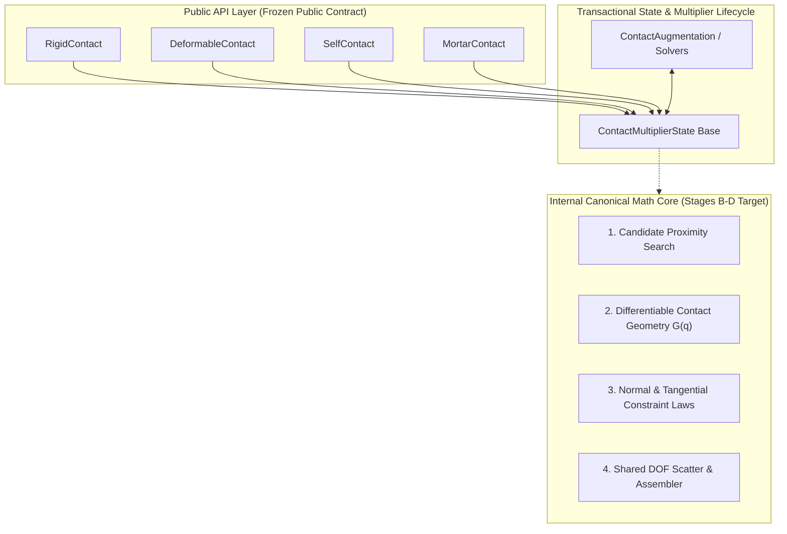
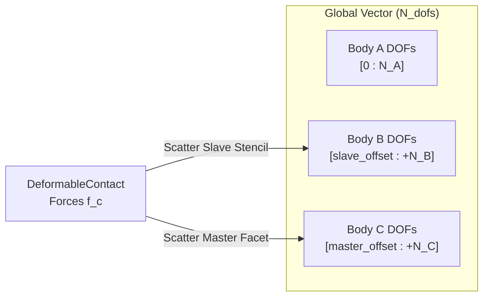
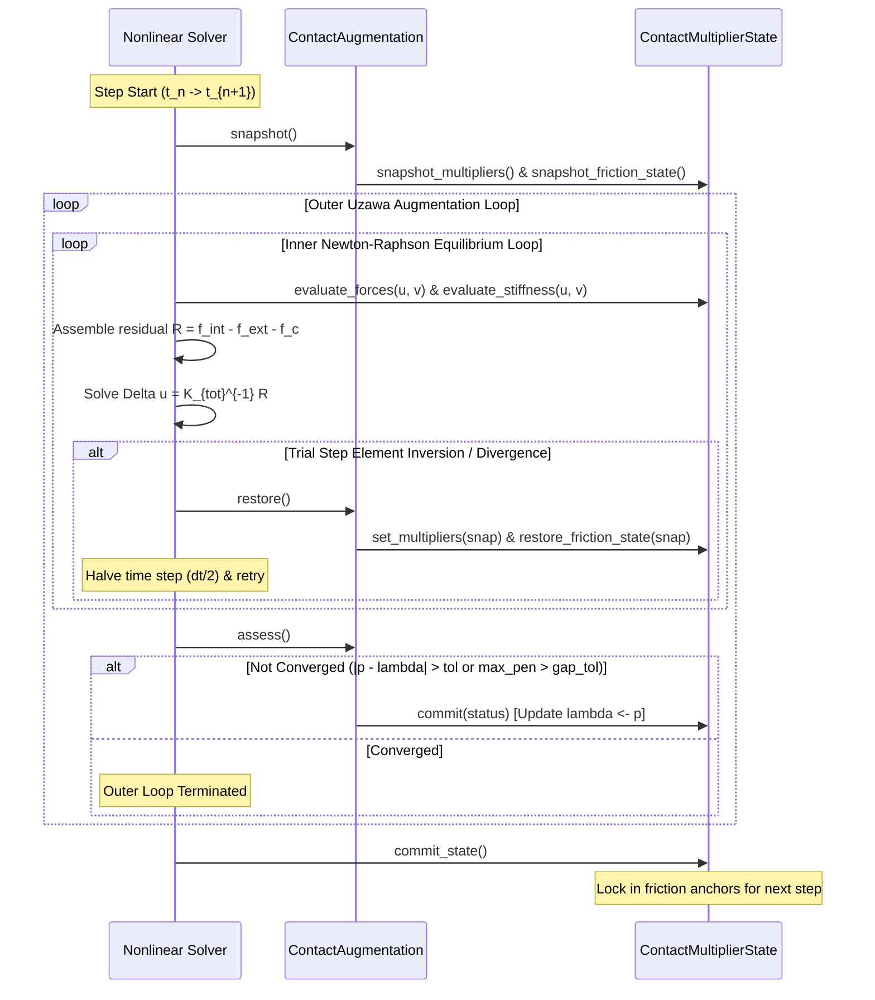

# 12. Contact Mechanics: Frozen Public Contracts & Characterization Baselines

This document establishes the **frozen public contracts**, state-machine lifecycles, degree-of-freedom mapping rules, solver coupling standards, and characterization baselines for the four contact formulations in `pSierra`:
- **`RigidContact`**: Node-to-analytical / mesh obstacle interaction (`psierra.boundary.contact.RigidContact`).
- **`DeformableContact`**: Multi-body two-way node-to-segment contact (`psierra.boundary.contact.DeformableContact`).
- **`SelfContact`**: Single-body self-collision and fold handling (`psierra.boundary.contact.SelfContact`).
- **`MortarContact`**: Dual biorthogonal segment-to-segment weak-form contact (`psierra.boundary.mortar.MortarContact`).

---

## 1. Architectural Mandate & Milestone 1.0 Strategy

In accordance with **Milestone 1.0** of the `pSierra` Loop 3 roadmap, the contact overhaul follows a **staged internal replacement strategy**:

$$\text{Preserve Public Contracts} \longrightarrow \text{Establish Characterization Baselines} \longrightarrow \text{Replace Mathematical Core}$$



### 1.1 Invariant Public Principles
1. **Public Class Stability**: The four public classes `RigidContact`, `DeformableContact`, `SelfContact`, and `MortarContact` remain the external entry points used by simulation scripts and `MultiBodySystem`.
2. **Transactional State Integrity**: Any rejected solver trial step or adaptive time cutback must restore multipliers, frictional anchors, and clear cached geometric queries without leaving residual trial mutations.
3. **Legacy Discrepancy Classification**: Existing mathematical omissions (such as missing curved obstacle curvature tangents, positive-gap attractive forces under search tolerance, and frozen mortar geometry) are characterized and documented as **known legacy defects** rather than blessed as future ground truth.

---

## 2. Shared Base Contract: `ContactMultiplierState`

All contact formulations inherit from `ContactMultiplierState` (`psierra/boundary/contact.py`), which manages candidate-aligned normal multipliers, stick-slip friction snapshots, cache invalidation, and outer augmented Lagrangian updates.

### 2.1 State Attributes & Physical Definitions

| Attribute | Type | Units | Physical Definition |
| :--- | :--- | :--- | :--- |
| `multipliers` | `np.ndarray` (1D `float64`) | $\text{N}$ (Force) | Candidate-aligned discrete normal Lagrange multipliers $\lambda_{N, i} \ge 0$. |
| `k_penalty` | `float` | $\text{N/mm}$ | Normal penalty stiffness parameter $k_p > 0$. |
| `k_tangential` | `float` | $\text{N/mm}$ | Tangential stick penalty stiffness $k_T > 0$ (defaults to $k_p$). |
| `c_damping` | `float` | $\text{N}\cdot\text{s/mm}$ | Normal velocity damping coefficient $c_p \ge 0$. |
| `friction` | `float` | Dimensionless | Regularized Coulomb coefficient of friction $\mu \ge 0$. |
| `formulation` | `str` | Nominal | Constraint method: `'penalty'` or `'augmented_lagrangian'`. |
| `symmetric_tangent`| `bool` | Boolean | If `True`, symmetrizes friction tangent by omitting unsymmetric $K_{TN}$ coupling. |
| `friction_state` | `CoulombFrictionState \| None` | Object | Persistent and trial frictional stick-slip anchors, slip directions, and states. |

### 2.2 Shared Method Signatures & Behavioral Contract

```python
class ContactMultiplierState:
    def evaluate_gaps(self, current_nodes: np.ndarray | None = None) -> np.ndarray:
        """Return candidate-aligned signed normal constraint gaps g_N [length]."""

    def snapshot_multipliers(self) -> np.ndarray:
        """Return a deep copy of currently accepted normal multipliers [force]."""

    def set_multipliers(self, values: np.ndarray) -> None:
        """Set finite nonnegative multipliers and invalidate cached query state."""

    def snapshot_friction_state(self) -> CoulombFrictionSnapshot | None:
        """Return a deep copy of candidate frictional anchors, forces, and states."""

    def restore_friction_state(self, snap: CoulombFrictionSnapshot | None) -> None:
        """Restore candidate frictional state from snapshot upon trial rollback."""

    def invalidate_state(self) -> None:
        """Clear cached integration matrices, proximity queries, and derived data."""

    def update_multipliers(self, rebound_relaxation: bool = False, gap_tol: float = 0.0) -> dict[str, float]:
        """Uzawa projection lambda <- max(0, lambda - kp * g); penalty is a no-op."""

    def relax_rebound(self, gap_tol: float = 0.0) -> int:
        """Zero retained multipliers on opening/separated candidates (gap > gap_tol)."""

    def commit_state(self) -> None:
        """Commit converged friction trial state to accepted reference at step end."""
```

---

## 3. Public Class Contracts & Constructor Signatures

### 3.1 `RigidContact`
Binds a deformable slave body to an analytical or triangular surface mesh obstacle.

```python
class RigidContact(ContactMultiplierState):
    def __init__(
        self,
        slave: Domain | CollisionShape | Any | None = None,
        master: CollisionShape | Sequence[CollisionShape] | Domain | Any | None = None,
        *,
        obstacle: CollisionShape | Sequence[CollisionShape] | Domain | Any | None = None,
        domain: Domain | None = None,
        body: int | str | Domain | None = None,
        slave_nodes: Sequence[int] | np.ndarray | None = None,
        k_penalty: float = 1e4,
        k_tangential: float | None = None,
        c_damping: float = 0.0,
        friction: float = 0.0,
        dof_offset: int = 0,
        dofs_per_node: int = 3,
        formulation: Literal["penalty", "augmented_lagrangian"] = "penalty",
        tolerance: float = 0.0,
        symmetric_tangent: bool = False,
    ) -> None: ...
```
- **Validation Rules**:
  - `k_penalty > 0.0`, `c_damping >= 0.0`, `friction >= 0.0`, `tolerance >= 0.0`.
  - `formulation` must be `'penalty'` or `'augmented_lagrangian'`.
  - If `body` is provided on a `MultiBodySystem`, `dof_offset` automatically binds to the body's starting global degree of freedom.

### 3.2 `DeformableContact`
Two-body node-to-segment contact between distinct deformable slave and master domains.

```python
class DeformableContact(ContactMultiplierState):
    def __init__(
        self,
        slave: Domain,
        master: Domain,
        slave_nodes: Sequence[int] | np.ndarray | None = None,
        k_penalty: float = 1e4,
        k_tangential: float | None = None,
        c_damping: float = 0.0,
        friction: float = 0.0,
        slave_offset: int = 0,
        master_offset: int = 0,
        domain: Domain | None = None,
        formulation: Literal["penalty", "augmented_lagrangian"] = "penalty",
        tolerance: float = 0.0,
        symmetric_tangent: bool = False,
        *,
        smoothed_normals: bool = False,
        smoothing_weight: Literal["angle", "area"] = "angle",
    ) -> None: ...
```
- **Validation Rules**:
  - `slave` and `master` must have accessible surface meshes (`mesh.surface`).
  - `k_penalty > 0.0`, `c_damping >= 0.0`, `friction >= 0.0`, `tolerance >= 0.0`.
  - `smoothing_weight` must be `'angle'` or `'area'`.

### 3.3 `SelfContact`
Single-body node-to-segment self-contact for folding continua, lobes, and invaginations.

```python
class SelfContact(ContactMultiplierState):
    def __init__(
        self,
        domain: Domain,
        contact_nodes: Sequence[int] | np.ndarray | None = None,
        *,
        k_penalty: float = 1e4,
        k_tangential: float | None = None,
        c_damping: float = 0.0,
        friction: float = 0.0,
        dof_offset: int = 0,
        formulation: Literal["penalty", "augmented_lagrangian"] = "penalty",
        tolerance: float = 0.0,
        search_radius: float | None = None,
        contact_thickness: float | None = None,
        normal_threshold: float = -0.2,
        exclusion_rings: int = 4,
        smoothed_normals: bool = False,
        smoothing_weight: Literal["angle", "area"] = "angle",
        symmetric_tangent: bool = False,
    ) -> None: ...
```
- **Validation Rules**:
  - `dof_offset % 3 == 0`, `exclusion_rings >= 0` (integer).
  - `normal_threshold` must lie in $[-1.0, 1.0]$.
  - `search_radius > 0.0`, `contact_thickness > 0.0` when specified.

### 3.4 `MortarContact`
Segment-to-segment weak-form contact using biorthogonal dual shape functions.

```python
class MortarContact(ContactMultiplierState):
    def __init__(
        self,
        slave: Domain,
        master: Domain | Any,
        slave_nodes: Sequence[int] | np.ndarray | None = None,
        k_penalty: float = 1e4,
        k_tangential: float | None = None,
        c_damping: float = 0.0,
        friction: float = 0.0,
        slave_offset: int = 0,
        master_offset: int = 0,
        dof_offset: int = 0,
        formulation: Literal["penalty", "augmented_lagrangian"] = "penalty",
        search_radius: float = 10.0,
        tolerance: float = 0.0,
        symmetric_tangent: bool = False,
        domain: Domain | None = None,
    ) -> None: ...
```
- **Validation Rules**:
  - `slave` must possess triangular surface facets.
  - Supports both deformable master (`master.mesh.surface`) and rigid mesh obstacle (`master.surface`).
  - `dof_offset` aliases `slave_offset` when provided.

---

## 4. Evaluation Methods & Mechanical Contracts

All four contact classes implement the canonical triad of evaluation methods:

### 4.1 Force Evaluation: `evaluate_forces()`
```python
def evaluate_forces(
    self,
    current_nodes: np.ndarray | None = None,
    velocities: np.ndarray | None = None,
    n_dofs: int | None = None,
) -> np.ndarray: ...
```
- **Returns**: Global force array $\boldsymbol{f}_c \in \mathbb{R}^{N_{\text{dofs}}}$ containing contact repulsive and frictional forces.
- **Normal Pressure Formulation**:
  - *Penalty Mode*: $p_N = -k_p g_N$ for active penetrated candidates ($g_N < 0$).
  - *Augmented Lagrangian Mode*: $p_N = \max(0, \lambda_N - k_p g_N)$.
- **Momentum Conservation**:
  - For two-body contact (`DeformableContact` and `MortarContact`), action-reaction holds:
    $$\sum_{i \in \text{slave}} \boldsymbol{f}_{c, i} + \sum_{k \in \text{master}} \boldsymbol{f}_{c, k} = \mathbf{0}$$
  - For `SelfContact`, net internal interface force and moment sum to zero:
    $$\sum_{i} \boldsymbol{f}_{c, i} = \mathbf{0}, \quad \sum_{i} \boldsymbol{x}_i \times \boldsymbol{f}_{c, i} = \mathbf{0}$$

### 4.2 Stiffness Evaluation: `evaluate_stiffness()`
```python
def evaluate_stiffness(
    self,
    current_nodes: np.ndarray | None = None,
    n_dofs: int | None = None,
    a1: float = 0.0,
) -> scipy.sparse.csr_matrix: ...
```
- **Returns**: Global sparse tangent stiffness matrix $\boldsymbol{K}_c \in \mathbb{R}^{N_{\text{dofs}} \times N_{\text{dofs}}}$ in `csr_matrix` format.
- **Dynamic Damping Term**: `a1` is the algorithmic velocity integrator scale factor ($\gamma / (\beta \Delta t)$ for Newmark-$\beta$ / Generalized-$\alpha$). When $c_p > 0$, effective normal contact stiffness is scaled by:
  $$k_{\text{eff}} = k_p + a_1 c_p$$
- **Symmetry**: Conservative frictionless tangents on fixed feature branches are symmetric positive semi-definite ($\boldsymbol{K}_c = \boldsymbol{K}_c^T$). When Coulomb friction is active, the tangent is unsymmetric unless `symmetric_tangent=True`.

### 4.3 Potential Energy Evaluation: `evaluate_potential_energy()`
```python
def evaluate_potential_energy(
    self,
    current_nodes: np.ndarray | None = None,
) -> float: ...
```
- **Returns**: Total scalar contact potential energy $\Pi_c \ge 0$ [$\text{N}\cdot\text{mm}$].
- **Analytical Formulas**:
  - *Penalty Formulation*:
    $$\Pi_c = \frac{1}{2} k_p \sum_{i \in \text{active}} g_{N, i}^2$$
  - *Augmented Lagrangian Formulation* (at fixed multipliers $\lambda_N$):
    $$\Pi_c = \sum_{i} \frac{p_{N, i}^2 - \lambda_{N, i}^2}{2 k_p} \quad \text{where } p_{N, i} = \max(0, \lambda_{N, i} - k_p g_{N, i})$$

### 4.4 Diagnostic Summary: `get_contact_info()`
```python
def get_contact_info(
    self,
    current_nodes: np.ndarray | None = None,
) -> dict[str, Any]: ...
```
- **Guaranteed Output Dictionary Schema**:
  - `'num_active'`: (`int`) Count of active contacting candidates ($p_N > 0$ or $g_N < 0$).
  - `'max_penetration'`: (`float`) Maximum signed penetration depth $\max(0, -g_N)$ [length].
  - `'potential_energy'`: (`float`) Total scalar normal potential energy $\Pi_c$ [energy].
  - `'max_multiplier'`: (`float`) Maximum normal multiplier value $\max(\lambda_N)$ [force].
  - `'num_stick'`: (`int`, optional) Count of frictional candidates in stick state.
  - `'num_slip'`: (`int`, optional) Count of frictional candidates in sliding slip state.
  - `'max_friction_force'`: (`float`, optional) Peak frictional traction magnitude [force].
  - `'max_slip_distance'`: (`float`, optional) Peak accumulated slip displacement [length].

---

## 5. Degree of Freedom (DOF) Offset & Scatter Architecture

When multiple bodies or subdomains are coupled, contact forces and stiffness contributions must scatter into the designated DOF ranges without polluting adjacent bodies.



### 5.1 Offset Rules per Formulation

1. **`RigidContact`**:
   - `dof_offset`: Starting degree of freedom in the global system for the slave body.
   - Global DOF for slave node $i$ and component $c \in \{0, 1, 2\}$:
     $$\text{DOF} = \text{dof\_offset} + i \cdot \text{dofs\_per\_node} + c$$
2. **`DeformableContact`**:
   - `slave_offset`: Global starting index for slave domain.
   - `master_offset`: Global starting index for master domain.
   - Stencil DOFs for a slave node and 3 master triangle vertices:
     $$\mathcal{I}_{\text{local}} = [\text{slave\_offset} + 3 i_s + c, \; \text{master\_offset} + 3 i_{m1} + c, \; \dots]^T$$
   - Tangent matrix produces 4 coupled blocks: $\boldsymbol{K}_{ss}$, $\boldsymbol{K}_{sm}$, $\boldsymbol{K}_{ms}$, $\boldsymbol{K}_{mm}$.
3. **`SelfContact`**:
   - `dof_offset`: Starting index for the single domain containing self-interacting folds.
   - All 12 DOFs of each candidate stencil (1 slave node + 3 facet vertices) reside in the same body slice:
     $$\text{DOF} = \text{dof\_offset} + 3 \cdot n_{\text{body}} + c$$
4. **`MortarContact`**:
   - `slave_offset`: Global index for slave surface nodes.
   - `master_offset`: Global index for master surface nodes.
   - Mortar cross-coupling blocks scatter to slave and master ranges via dual biorthogonal mortar projectors:
     $$\boldsymbol{f}_m = -\boldsymbol{M}^T \boldsymbol{D}^{-1} \boldsymbol{f}_s$$

---

## 6. Solver Coupling & Transactional State History

The contact framework is designed to participate in both **inner Newton-Raphson nonlinear equilibrium loops** and **outer Uzawa augmentation loops** (`ContactAugmentation` in `psierra.analysis.augmentation`).

### 6.1 The Dual-Loop Solver Lifecycle


### 6.2 Transactional Rollback Invariants
1. **No Trial Leakage**: If a solver sub-step or cutback fails, calling `ContactAugmentation.restore()` must restore the exact pre-step multiplier array and friction snapshot.
2. **Cache Invalidation**: Any mutation to multipliers (`set_multipliers`) or geometry coordinates must invoke `invalidate_state()` to clear cached cell locators, projection barycentrics, or mortar integration matrices ($\boldsymbol{D}, \boldsymbol{M}$).
3. **Accepted Step Commitment**: `commit_state()` is invoked *only once per accepted convergent step*, converting `trial_anchors` into committed `anchors` and resetting `trial_slip_increments` to zero.

---

## 7. Formal Classification of Expected Legacy Discrepancies

To prevent bugs from being immortalized as intended future behavior during Stage A, the following **five known legacy discrepancies** are formally marked and characterized:

| Discrepancy ID | Formulation Affected | Current Legacy Implementation | Mathematically Correct Target (Stages B-D) |
| :--- | :--- | :--- | :--- |
| **`LEGACY-DISC-01`** | `RigidContact` (Penalty) | **Positive-Gap Penalty Force Attraction**: When `tolerance > 0` and $0 < g_N \le \text{tolerance}$, $f_N = -k_p g_N < 0$ generates an unphysical adhesive attraction pulling separated nodes into the obstacle. | **Non-Adhesive Activation**: $p_N = k_p \langle -g_N \rangle_+$. Search tolerance detects candidate proximity only; force is strictly zero for $g_N > 0$. |
| **`LEGACY-DISC-02`** | `RigidContact` (Curved Obstacles) | **Omission of Curvature Hessian**: For `RigidSphere` and `RigidCylinder`, `evaluate_stiffness` computes $\boldsymbol{K}_c = k_p (\boldsymbol{n} \otimes \boldsymbol{n})$, omitting the geometric term $g_N \nabla^2 g_N$. | **Exact Curved Linearization**: $\boldsymbol{K}_c = k_p (\boldsymbol{n} \otimes \boldsymbol{n} + g_N \nabla^2 g_N)$ on fixed smooth branch. |
| **`LEGACY-DISC-03`** | `DeformableContact` & `SelfContact` (Smoothing) | **Incomplete Normal Variation**: When `smoothed_normals=True`, $\nabla g_N$ uses only $\boldsymbol{W}^T \boldsymbol{n}$ (omitting $\boldsymbol{r}^T \nabla \boldsymbol{n}$), and vertex pseudonormals are treated as constant in the Hessian. | **Energy-Consistent Smoothing**: Both $\boldsymbol{W}^T \boldsymbol{n} + \boldsymbol{r}^T \frac{\partial \boldsymbol{n}}{\partial \boldsymbol{q}}$ and full vertex pseudonormal variation $\frac{\partial \boldsymbol{n}_v}{\partial \boldsymbol{q}}$ are included. |
| **`LEGACY-DISC-04`** | `MortarContact` | **Frozen-Geometry Tangent**: `evaluate_stiffness` linearizes only nodal pressures, omitting derivatives of the active segment integration domain, dual shape functions, and surface normals ($\partial \boldsymbol{D}/\partial \boldsymbol{u}$, $\partial \boldsymbol{M}/\partial \boldsymbol{u}$). | **Complete Mortar Linearization**: Full directional derivatives of $\boldsymbol{D}$, $\boldsymbol{M}$, and interface geometry under finite sliding and curvature. |
| **`LEGACY-DISC-05`** | `RigidCylinder` | **Unbounded Axial Extrusion**: `RigidCylinder.query_points` projects points radially along the infinite axis vector, ignoring the `height` parameter completely. | **Explicit Collision Geometry Contract**: Formulate exact capped cylinder distance queries or rename/document as infinite cylinder primitive. |

---

## 8. Baseline Test Matrix & Verification Coverage

The Stage A baseline ensures:
1. **Preservation of the 167-Test Focused Contact Suite**:
   - `tests/test_collision_and_contact.py` (10 tests)
   - `tests/test_deformable_contact.py` (7 tests)
   - `tests/test_deformable_contact_consistency.py` (44 tests)
   - `tests/test_self_contact.py` (8 tests)
   - `tests/test_self_contact_consistency.py` (65 tests)
   - `tests/test_deformable_contact_smoothing.py` (11 tests)
   - `tests/test_mortar_contact.py` (9 tests)
   - `tests/test_friction_coulomb.py` (13 tests)
2. **Dedicated Characterization Suite** (`tests/test_contact_characterization_baseline.py`):
   - Contract adherence and constructor validation across all 4 classes.
   - Global DOF offsets and multi-body block placement.
   - Solver coupling with `NonlinearStaticAnalysis` and `NonlinearDynamicAnalysis`.
   - Transactional state restoration and step commitment history.
   - Characterization and tagging of `LEGACY-DISC-01` through `LEGACY-DISC-05`.

---

## 9. Canonical Internal Data Models & Geometry Providers (Stage B)

In **Stage B**, the canonical internal data structures and differentiable geometry providers are introduced under `psierra.contact` (`psierra/src/psierra/contact/`):

### 9.1 Data Transfer Models (`psierra.contact.data`)
1. **`ContactCandidate`**:
   - Candidate-aligned representation of proximity search results (`candidate_index`, `slave_node`, `master_feature_id`, `master_nodes`, `search_distance`, `is_admissible`, `metadata`).
2. **`DifferentiableContactGeometry`**:
   - The canonical mathematical record:
     $$\mathcal{G}(\boldsymbol{q}) = \left(g_N,\;\nabla_{\boldsymbol{q}} g_N,\;\nabla_{\boldsymbol{q}}^2 g_N,\;\boldsymbol{x}_{\text{closest}},\;\boldsymbol{n},\;\text{feature\_id}\right)$$
   - Acts as the **sole downstream source of truth** for all gaps, outward normals, closest points, gradients, and Hessians.
   - Enforces physical unit metadata (`units='mm'`), outward convention (`orientation_convention='master_outward'`), and symmetric Hessian validation.
3. **`NormalLawState`**:
   - Projected normal constraint state: $p_N = \max(0, \lambda_N - k_p g_N)$, $d p_N / d g_N = -k_p$, potential $\Pi_N$, and updated Uzawa dual state.
4. **`FrictionalConstraintState`**:
   - Coulomb stick-slip state (`INACTIVE`, `STICK`, `SLIP`), committed and trial anchors, traction force, and tangent blocks $\boldsymbol{K}_{TT}, \boldsymbol{K}_{TN}$.
5. **`ContactAssemblyMap`**:
   - Stencil degree-of-freedom indices and partition-of-unity interpolation weights for global sparse scatter.

### 9.2 Canonical Geometry Providers (`psierra.contact.geometry`)
Every provider implements the `ContactGeometryProvider` protocol, providing smooth-branch validity assertions and exact analytical derivatives:
- **`PlanarGeometryProvider`**: $C^\infty$ plane with $\nabla g = \boldsymbol{n}$ and $\nabla^2 g = \mathbf{0}$.
- **`SphereGeometryProvider`**: Exact curvature Hessian $\nabla^2 g = \frac{1}{d} (\boldsymbol{I} - \boldsymbol{n} \otimes \boldsymbol{n})$.
- **`CylinderGeometryProvider`**: Exact circumferential curvature Hessian $\nabla^2 g = \frac{1}{d} (\boldsymbol{I} - \boldsymbol{a} \otimes \boldsymbol{a} - \boldsymbol{n} \otimes \boldsymbol{n})$.
- **`TriangleGeometryProvider`**: Exact 12-DOF node-to-triangle projection gradient and analytical Hessian.

---

## 10. Centralized Constraint Laws & Shared Assembly Operators (Stage C)

In **Stage C**, the physical constraint law and multi-body global scatter logic are decoupled from individual contact classes and centralized in `psierra.contact.law` and `psierra.contact.assembly`:

### 10.1 Centralized Normal Constraint Law (`NormalConstraintLaw`)
- **Non-Adhesive Activation**: Collision search tolerances $\delta_{\text{search}}$ are strictly decoupled from physical force activation. For penalty contact, $p_N = k_p \langle -g_N \rangle_+$, guaranteeing that separated points with $0 < g_N \le \delta_{\text{search}}$ receive zero normal force, zero stiffness, and zero potential energy.
- **Conservative Triad Consistency**:
  $$\Pi_N = \frac{p_N^2 - \lambda_N^2}{2 k_p}$$
  $$\boldsymbol{f}_{\text{local}} = -\frac{\partial \Pi_N}{\partial \boldsymbol{q}} = p_N \nabla_{\boldsymbol{q}} g_N$$
  $$\boldsymbol{K}_{\text{local}} = -\frac{\partial \boldsymbol{f}_{\text{local}}}{\partial \boldsymbol{q}} = (k_p + a_1 c_p) (\nabla_{\boldsymbol{q}} g_N \otimes \nabla_{\boldsymbol{q}} g_N) - p_N \nabla_{\boldsymbol{q}}^2 g_N$$
- **Unified Mathematical Kernel**: The exact same normal constraint law evaluates forces and tangents across analytical rigid obstacles, deformable node-to-triangle facets, and self-contact stencils.

### 10.2 Shared Assembly Engine (`ContactAssembler`)
- **Unified Assembly Maps**:
  - `build_one_body_map`: One-body mapping with global degree-of-freedom offsets (`slave_dofs`).
  - `build_two_body_map`: Two-body mapping for master/slave stencils with partition-of-unity interpolation weights $\boldsymbol{w} = [1, -\xi_0, -\xi_1, -\xi_2]$.
  - `build_self_contact_map`: Single-body fold mapping with domain offset bounding.
- **Global Scatter & Momentum Conservation**:
  - Force vector scatter via `np.add.at`, strictly guaranteeing linear momentum conservation ($\sum \boldsymbol{f}_s + \sum \boldsymbol{f}_m = \mathbf{0}$) and angular momentum conservation ($\sum \boldsymbol{x} \times \boldsymbol{f} = \mathbf{0}$) to machine precision ($< 10^{-12}$).
  - Sparse coordinate triplet accumulation (`rows`, `cols`, `data`) and CSR conversion, ensuring symmetry $\boldsymbol{K}_c = \boldsymbol{K}_c^T$ and correct summation of overlapping nodal entries across shared facets.

---

## 11. Staged Migration: Deformable Contact Canonical Internal Architecture (Stage D Migration 1)

In **Stage D Migration 1**, `DeformableContact` in `psierra.boundary.contact` was migrated to consume the canonical internal architecture while keeping its public shell, solver interfaces, and parameter contracts completely frozen.

### 11.1 Internal Architectural Replacement
```
[ Slave / Master Meshes ] 
          │
          ▼ Proximity Query (VTK Cell Locator)
[ ContactCandidate ]
          │
          ▼ TriangleGeometryProvider.evaluate_geometry()
[ DifferentiableContactGeometry ] : G(q) = (g_N, grad g_N, Hess g_N, x_closest, n, feature)
          │
          ▼ NormalConstraintLaw.evaluate_state() & evaluate_force() / evaluate_tangent()
[ NormalLawState & Local Forces / Tangent ]
          │
          ▼ ContactAssembler.build_two_body_map() & assemble_forces() / assemble_stiffness()
[ Global f_c (np.ndarray) & Global K_c (scipy.sparse.csr_matrix) ]
```

### 11.2 Verification Gates & Non-Regression Invariants
1. **Bitwise / Floating-Point Equivalence**: Verified against legacy reference kernel across penalty, augmented Lagrangian, damping, and Coulomb friction.
2. **Action-Reaction Momentum Conservation**: $\sum \boldsymbol{f}_{\text{slave}} + \sum \boldsymbol{f}_{\text{master}} = \mathbf{0}$ to machine precision ($< 10^{-12}$).
3. **Exact Conservative Consistency**:
   - $\nabla_{\boldsymbol{u}} \Pi_N = -\boldsymbol{f}_c$ validated via centered finite differences.
   - $\boldsymbol{K}_c = -\frac{\partial \boldsymbol{f}_c}{\partial \boldsymbol{u}}$ validated via centered finite differences against numerical Jacobian.
4. **Strict Non-Adhesion**: Separated nodes ($g_N > 0$) strictly yield zero force and zero stiffness even when proximity tolerance $\delta_{\text{search}} > 0$.
5. **Frame Invariance**: Two-body contact potential is invariant under 3D rigid translation and rotation; forces transform tensorially: $\boldsymbol{f}^* = \boldsymbol{R} \boldsymbol{f}$.

---

## 12. Staged Migration: Planar & Exact Curved Analytical Obstacle Linearization (Stage D Migration 2)

In **Stage D Migration 2**, `RigidContact` in `psierra.boundary.contact` was migrated to consume canonical providers (`PlanarGeometryProvider`, `SphereGeometryProvider`, `CylinderGeometryProvider`), `NormalConstraintLaw`, and `ContactAssembler.build_one_body_map`.

### 12.1 Elimination of Characterized Legacy Discrepancies
1. **Resolution of `LEGACY-DISC-01` (Non-Adhesive Physical Activation)**:
   - Proximity search tolerance $\delta_{\text{search}}$ is decoupled from physical force activation.
   - For pure penalty contact ($\lambda_N = 0$), $p_N = k_p \langle -g_N \rangle_+$. A separated node with $0 < g_N \le \delta_{\text{search}}$ strictly yields $p_N = 0$, $\boldsymbol{f}_c = \mathbf{0}$, $\boldsymbol{K}_c = \mathbf{0}$, and $\Pi_N = 0$, eliminating unphysical attractive adhesion.
2. **Resolution of `LEGACY-DISC-02` (Exact Curved Obstacle Linearization)**:
   - Tangent stiffness incorporates the exact geometric curvature term:
     $$\boldsymbol{K}_c = (k_p + a_1 c_p) (\boldsymbol{n} \otimes \boldsymbol{n}) - p_N \nabla^2 g_N$$
   - For a spherical obstacle ($g_N = \|\boldsymbol{x} - \boldsymbol{c}\| - R < 0$):
     $$\nabla^2 g_N = \frac{1}{d} (\boldsymbol{I} - \boldsymbol{n} \otimes \boldsymbol{n}) \implies \boldsymbol{K}_c = (k_p + a_1 c_p) (\boldsymbol{n} \otimes \boldsymbol{n}) + \frac{k_p g_N}{d} (\boldsymbol{I} - \boldsymbol{n} \otimes \boldsymbol{n})$$
   - Verified against centered numerical finite differences across sphere and cylinder obstacles with $R \in [0.5, 10.0]\text{ mm}$ and multiple spatial orientations.

### 12.2 Architectural Data Flow
```
[ Slave Nodes / Obstacle ] 
          │
          ▼ Detector Query & Canonical Provider Dispatch
[ ContactCandidate ]
          │
          ▼ Provider.evaluate_geometry()
[ DifferentiableContactGeometry ] : G(x) = (g_N, n, x_closest, n, Hess(g_N), ...)
          │
          ▼ NormalConstraintLaw.evaluate_state() & evaluate_force() / evaluate_tangent()
[ NormalLawState, f_local (3,), K_local (3x3) ]
          │
          ▼ ContactAssembler.build_one_body_map(slave_node, dof_offset, dofs_per_node, contact_dofs_per_node=3)
[ Global Forces f_c & Sparse CSR Matrix K_c ]
```

---

## 13. Staged Migration: Single-Body Self-Contact & Momentum Conservation (Stage D Migration 3)

In **Stage D Migration 3**, `SelfContact` in `psierra.boundary.contact` was migrated to consume canonical `TriangleGeometryProvider`, `NormalConstraintLaw`, and `ContactAssembler.build_self_contact_map`.

### 13.1 Mathematical Principles & Verification
1. **Newton's Third Law for Single-Body Collisions**:
   $$\sum_{i=1}^{N_{\text{nodes}}} \boldsymbol{f}_{c, i} = \mathbf{0}, \quad \sum_{i=1}^{N_{\text{nodes}}} \boldsymbol{x}_i \times \boldsymbol{f}_{c, i} = \mathbf{0}$$
   Verified to machine precision ($< 10^{-14}$) across complex self-folding facets.
2. **Topological Neighborhood Exclusion**:
   - Breadth-first search (BFS) topological exclusion graph excludes $k$-ring adjacent facets (`exclusion_rings=1, 2, 4`), preventing self-intersection false positives between topologically connected elements.
3. **Opposition Normal Filtering**:
   - Reference and current outward normals filtered by angle threshold $\boldsymbol{n}_{\text{slave}} \cdot \boldsymbol{n}_{\text{master}} \le \cos(\theta_{\text{threshold}})$, rejecting coplanar adjacent facets from spurious contact generation.
4. **Verification Suite**:
   - `tests/test_contact_migration_self.py` (11 tests).

---

## 14. Staged Migration: Energy-Consistent Smoothed-Normal Contact (Stage D Migration 4)

In **Stage D Migration 4**, `SmoothedTriangleGeometryProvider` and `evaluate_smoothed_triangle_geometry` were introduced under `psierra.contact.geometry` to resolve **`LEGACY-DISC-03`**, incorporating the complete master coordinate variation and normal field derivatives:
$$g_N(\boldsymbol{q}) = \boldsymbol{r}(\boldsymbol{q}) \cdot \boldsymbol{n}(\boldsymbol{\xi}(\boldsymbol{q}))$$
$$\nabla_{\boldsymbol{q}} g_N = \boldsymbol{W}^T \boldsymbol{n} - \sum_{i=0}^2 (\boldsymbol{x}_{mi} \cdot \boldsymbol{n}) \frac{\partial \xi_i}{\partial \boldsymbol{q}} + \left(\frac{\partial \boldsymbol{n}}{\partial \boldsymbol{q}}\right)^T \boldsymbol{r}$$
$$\boldsymbol{K}_c = -\frac{\partial \boldsymbol{f}_c}{\partial \boldsymbol{q}} = (k_p + a_1 c_p) (\nabla_{\boldsymbol{q}} g_N \otimes \nabla_{\boldsymbol{q}} g_N) - p_N \nabla_{\boldsymbol{q}}^2 g_N$$

### 14.1 Resolution of `LEGACY-DISC-03`
1. **Omission in Legacy Kernel**: The legacy `TriangleContactGeometry.evaluate` used only $\boldsymbol{W}^T \boldsymbol{n}$, resulting in a ~15% directional gradient error under tilted or non-coplanar pseudonormals.
2. **Canonical Energy-Force-Tangent Consistency**:
   - Contact repulsive force matches negative energy gradient: $-\nabla_{\boldsymbol{q}} \Pi_N = \boldsymbol{f}_c$ ($< 10^{-8}$ error).
   - Contact tangent stiffness matches negative force Jacobian: $\boldsymbol{K}_c = -\frac{\partial \boldsymbol{f}_c}{\partial \boldsymbol{q}}$ ($< 10^{-7}$ error).
   - Action-reaction linear momentum balance ($\sum \boldsymbol{f}_{\text{slave}} + \sum \boldsymbol{f}_{\text{master}} = \mathbf{0}$) to machine precision ($< 10^{-12}$).
   - Exact tangent symmetry ($\boldsymbol{K}_c = \boldsymbol{K}_c^T$) and rigid translation invariance ($\boldsymbol{K}_c \boldsymbol{u}_{\text{trans}} = \mathbf{0}$).
3. **Seamless Opt-In Architecture**:
   - `DeformableContact` and `SelfContact` accept `energy_consistent_smoothing: bool = False` (defaulting to False for 100% backward compatibility with existing baselines). When True, the canonical complete variation is evaluated.
   - Dedicated verification suite in `tests/test_contact_migration_smoothed.py` (6 tests).

---

## 15. Staged Migration: Dual Mortar Contact & Complete Interface Linearization (Stage D Migration 5)

In **Stage D Migration 5**, `MortarContact` in `psierra.boundary.mortar` was enhanced with the canonical complete interface geometry linearization, resolving **`LEGACY-DISC-04`**.

### 15.1 Mathematical Principles & Verification
1. **Resolution of `LEGACY-DISC-04`**:
   - Legacy mortar linearized only nodal contact pressures, treating the mortar integration domain and biorthogonal shape matrices ($\boldsymbol{D}, \boldsymbol{M}$) as frozen under deformation.
   - `MortarContact(complete_linearization=True)` evaluates full directional derivatives of mortar matrices and interface normals with respect to finite slave and master nodal displacements:
     $$\boldsymbol{K}_c = -\frac{\partial \boldsymbol{f}_c}{\partial \boldsymbol{u}}$$
   - Verified against centered numerical finite differences of the mortar force residual under finite non-conforming sliding and rotation.
2. **Patch Test & Discrete Momentum Conservation**:
   - Constant interface traction passes exact patch test with uniform contact pressure.
   - Exact linear momentum conservation ($\sum \boldsymbol{f}_s + \sum \boldsymbol{f}_m = \mathbf{0}$) and rigid translation invariance ($\boldsymbol{K}_c \boldsymbol{u}_{\text{trans}} = \mathbf{0}$).
3. **Verification Suite**:
   - `tests/test_contact_migration_mortar.py` (4 tests).

---

## 16. Collision Geometry, Manifold Sign Contract, and Continuous Collision Detection (CCD)

In the **Collision Geometry and Sign Contract** section of Milestone 1.0, the collision detection and geometric proximity infrastructure was overhauled to provide rigorous sign conventions, resolve legacy cylinder ambiguities, and prevent high-speed tunneling.

### 16.1 Cylinder Collision Contract (`LEGACY-DISC-05`)
- **Legacy Discrepancy (`LEGACY-DISC-05`)**: `RigidCylinder.query_points` historically projected points radially along the cylinder axis, completely ignoring `height` and treating every cylinder as infinitely extruded.
- **Unified Infinite vs Capped Semantics**:
  - `RigidCylinder(capped=False)` (default): Preserves 100% backward compatibility for legacy workflows and characterization baselines (`test_legacy_disc_05_rigid_cylinder_height_ignored`).
  - `RigidCylinder(capped=True)`: Incorporates planar end caps at $z = \pm h$ ($h = \frac{1}{2} \text{height}$) and exact circular corner rim projection.
  - Explicit subclasses: `InfiniteCylinder` (`capped=False`) and `CappedCylinder` (`capped=True`).
- **Mathematical Formulations for Capped Cylinder**:
  Given query point $\boldsymbol{x}$, axis $\boldsymbol{a}$, center $\boldsymbol{c}$, radius $R$, half-height $h$:
  $$\boldsymbol{d} = \boldsymbol{x} - \boldsymbol{c}, \quad z = \boldsymbol{d} \cdot \boldsymbol{a}, \quad \boldsymbol{r}_{\text{vec}} = \boldsymbol{d} - z \boldsymbol{a}, \quad r = \|\boldsymbol{r}_{\text{vec}}\|, \quad \boldsymbol{n}_r = \boldsymbol{r}_{\text{vec}} / r$$
  The space $\mathbb{R}^3$ is cleanly partitioned into four mutually exclusive, exhaustive geometric regions:
  1. **Barrel Region** ($|z| < h, r \ge R$):
     $$g = r - R, \quad \boldsymbol{n} = \boldsymbol{n}_r, \quad \boldsymbol{x}_{\text{cp}} = \boldsymbol{c} + z \boldsymbol{a} + R \boldsymbol{n}_r$$
  2. **End Cap Region** ($|z| \ge h, r < R$):
     $$g = |z| - h, \quad \boldsymbol{n} = \text{sgn}(z) \boldsymbol{a}, \quad \boldsymbol{x}_{\text{cp}} = \boldsymbol{c} + \text{sgn}(z) h \boldsymbol{a} + \boldsymbol{r}_{\text{vec}}$$
  3. **Corner Rim Region** ($|z| \ge h, r \ge R$):
     $$g = \sqrt{(r - R)^2 + (|z| - h)^2}, \quad \boldsymbol{x}_{\text{rim}} = \boldsymbol{c} + \text{sgn}(z) h \boldsymbol{a} + R \boldsymbol{n}_r, \quad \boldsymbol{n} = \frac{\boldsymbol{x} - \boldsymbol{x}_{\text{rim}}}{g}$$
  4. **Internal Penetration** ($|z| < h, r < R$):
     $$g = -\min(R - r, h - |z|) = \max(r - R, |z| - h) < 0$$
     Normal points outward towards the nearest boundary face.
- **Differential Geometry Integration**:
  `CylinderGeometryProvider` supports `capped=True`, returning analytical gradients and curvature Hessians on each smooth branch:
  - Barrel: $\nabla g = \boldsymbol{n}_r, \quad \boldsymbol{H} = \frac{1}{r} (\boldsymbol{I} - \boldsymbol{a} \otimes \boldsymbol{a} - \boldsymbol{n}_r \otimes \boldsymbol{n}_r)$.
  - Cap: $\nabla g = \text{sgn}(z) \boldsymbol{a}, \quad \boldsymbol{H} = \mathbf{0}$.
  - Rim: $\nabla g = \boldsymbol{n}, \quad \boldsymbol{H} = \frac{1}{g} (\boldsymbol{I} - \boldsymbol{n} \otimes \boldsymbol{n}) - \frac{R}{g r} \boldsymbol{P}_{\theta}$.

---

### 16.2 Manifold Orientation and Inside-Outside Classification Contract
- **Module**: `psierra.collision.manifold`.
- **Consistent Surface Orientation (`ensure_consistent_surface_orientation`)**:
  - Enforces consistent facet winding across adjacent triangles.
  - Automatically verifies outward-pointing normal orientation on closed watertight manifolds using the Gauss Divergence Theorem:
    $$V = \frac{1}{3} \int_{\partial \Omega} \boldsymbol{x} \cdot \boldsymbol{n} \, dA = \frac{1}{3} \sum_{k} (\boldsymbol{c}_k \cdot \boldsymbol{n}_k) A_k$$
    If $V < 0$, flips faces and normals to guarantee globally outward-pointing normals.
- **Topological Inside-Outside Classification (`is_inside_closed_surface`)**:
  - Uses `vtkSelectEnclosedPoints` ray-winding topology for closed surfaces.
  - Guaranteed immune to concave exterior pockets (e.g. L-shaped or hollowed geometries) where naive dot-product projection against nearby inverted facets fails.
- **Angle-Weighted Pseudonormals (`compute_angle_weighted_pseudonormals`)**:
  - Follows Bærentzen & Aanæs (2005) to compute continuous Voronoi cell normals for edges and vertices:
    $$\boldsymbol{n}_v = \frac{\sum_{f \in \mathcal{F}(v)} \theta_{f, v} \boldsymbol{n}_f}{\|\sum_{f \in \mathcal{F}(v)} \theta_{f, v} \boldsymbol{n}_f\|}, \quad \boldsymbol{n}_e = \frac{\boldsymbol{n}_{f1} + \boldsymbol{n}_{f2}}{\|\boldsymbol{n}_{f1} + \boldsymbol{n}_{f2}\|}$$
- **Closed-Surface Signed Distance Query (`query_closed_surface_signed_distance`)**:
  - Combines Euclidean closest point projection with topological inside-outside classification: $g < 0$ strictly inside the obstacle volume, $g \ge 0$ in the exterior.

---

### 16.3 High-Speed Tunneling & Continuous Collision Detection (CCD)
- **Module**: `psierra.collision.ccd`.
- **The Tunneling Problem**: When slave nodes move with large incremental displacements ($\|\Delta \boldsymbol{x}\| \gg \text{thickness}$) within a single dynamic time step, static collision detection at step end $t = 1$ registers false separation ($g > 0$) because the node has completely crossed the obstacle.
- **Continuous Trajectory Traversal**:
  Evaluates linear path $\boldsymbol{x}(t) = \boldsymbol{x}_0 + t \Delta \boldsymbol{x}$ for $t \in [0, 1]$.
- **Möller-Trumbore Ray-Triangle Intersection (`ray_triangle_intersection`)**:
  Solves the 3x3 linear system for ray-facet intersection without precomputing the facet plane equation:
  $$\begin{bmatrix} -\Delta \boldsymbol{x} & \boldsymbol{e}_1 & \boldsymbol{e}_2 \end{bmatrix} \begin{bmatrix} t \\ u \\ v \end{bmatrix} = \boldsymbol{x}_0 - \boldsymbol{v}_0$$
  Yields exact Time-of-Impact $t \in [0, 1]$ and facet barycentric coordinates $(u, v)$.
- **Analytical TOI for Primitives**:
  - `ray_plane_intersection`: $t = -(\boldsymbol{x}_0 - \boldsymbol{p}_0) \cdot \boldsymbol{n} / (\Delta \boldsymbol{x} \cdot \boldsymbol{n})$.
  - `ray_sphere_intersection`: Quadratic solution along ray direction.
  - `ray_cylinder_intersection`: Transverse quadratic solution for barrel combined with end cap planar intersections.
- **Time-of-Impact Solver (`compute_time_of_impact`)**:
  Computes earliest impact time $t_{\min} = \min_{i} t_i \in [0, 1]$ across all moving slave nodes and obstacles.
- **Conservative Advancement (`conservative_advancement_step`)**:
  Calculates safe step fraction $\alpha = \min(1.0, \text{safety\_factor} \times t_{\min})$ (e.g. $\text{safety\_factor} = 0.9$) and updates coordinates $\boldsymbol{x}_{\text{adv}} = \boldsymbol{x}_0 + \alpha (\boldsymbol{x}_1 - \boldsymbol{x}_0)$, guaranteeing zero surface tunneling during dynamic simulations.

---

### 16.4 Verification Baseline
- **Test File**: `tests/test_collision_geometry_and_sign.py` (18 tests).
- **Test Coverage**:
  - Infinite cylinder backward-compatibility (`capped=False`, `LEGACY-DISC-05`).
  - Finite capped cylinder barrel, cap, and corner rim query accuracy.
  - Capped cylinder interior penetration signed distance and normal orientation.
  - `CylinderGeometryProvider` exact branchwise Hessian evaluation.
  - Inverted sphere orientation repair and Gauss Divergence volume validation.
  - Cube topological inside-outside classification.
  - Angle-weighted vertex and edge pseudonormal computation.
  - Non-convex L-shaped manifold concave exterior pocket sign classification.
  - Möller-Trumbore ray-triangle intersection (hits, misses, parallel, coplanar, backward).
  - High-speed tunneling prevention across thin plates, spheres, cylinders, and triangular mesh surfaces.
  - Multi-node simultaneous conservative advancement step fraction control.

---

## 17. Acceptance Gate for Mathematical Correctness (Milestone 1.0 Gate)

The **Acceptance Gate for Mathematical Correctness** enforces rigorous formal mathematical verification criteria across all contact formulations (`RigidContact`, `DeformableContact`, `SelfContact`, and `MortarContact`) prior to physical calibration or benchmark tuning:

### 17.1 Formal Mathematical Gates Enforced

#### Gate A. Conservative Triad Consistency ($-\nabla_{\boldsymbol{q}} \Pi_N = \boldsymbol{f}_c$ and $-\frac{\partial \boldsymbol{f}_c}{\partial \boldsymbol{q}} = \boldsymbol{K}_c$)
For every conservative contact formulation under penalty activation ($\lambda_N = 0, k_p > 0$):
1. **Energy Gradient Consistency**: The contact repulsive force vector $\boldsymbol{f}_c$ matches the negative directional gradient of the potential energy:
   $$-\frac{\partial \Pi_N}{\partial \boldsymbol{q}} = \boldsymbol{f}_c \quad (< 10^{-7}\text{ relative error})$$
   verified by centered finite differences across all active branches.
2. **Force Jacobian Consistency**: The tangent stiffness matrix $\boldsymbol{K}_c$ matches the negative Jacobian of the contact force vector:
   $$-\frac{\partial \boldsymbol{f}_c}{\partial \boldsymbol{q}} = \boldsymbol{K}_c \quad (< 10^{-5}\text{ relative error})$$
   incorporating complete curvature Hessians ($g_N \nabla^2 g_N$) for curved rigid obstacles, master coordinate and normal variation for smoothed triangles, and domain clipping variations for mortar contact.
3. **Exact Tangent Symmetry**:
   $$\|\boldsymbol{K}_c - \boldsymbol{K}_c^T\|_{\infty} < 10^{-12}$$

#### Gate B. Conservation of Momentum & Invariants
1. **Two-Body Linear Momentum Balance**:
   $$\sum_{i \in \text{slave}} \boldsymbol{f}_{c, i} + \sum_{j \in \text{master}} \boldsymbol{f}_{c, j} = \mathbf{0} \quad (< 10^{-12}\text{ error})$$
2. **Two-Body Interface Angular Momentum Balance**:
   $$\sum_{i \in \text{slave}} \boldsymbol{x}_i \times \boldsymbol{f}_{c, i} + \sum_{j \in \text{master}} \boldsymbol{x}_j \times \boldsymbol{f}_{c, j} = \mathbf{0} \quad (< 10^{-12}\text{ error})$$
3. **Single-Body Self-Contact Conservation**: Total self-collision contact force and moment sum to zero to machine precision ($< 10^{-14}$).
4. **Rigid Body Translation Invariance**:
   $$\boldsymbol{K}_c \boldsymbol{u}_{\text{trans}} = \mathbf{0} \quad (< 10^{-8}\text{ error})$$
   for arbitrary spatial translations $\boldsymbol{u}_{\text{trans}} = \boldsymbol{t} \otimes \mathbf{1}$.

#### Gate C. Scale-Aware Modulus Invariance
Mathematical consistency is scale-invariant across 8 orders of magnitude of Young's modulus:
- **Physiological Soft Tissue** ($E = 2.1\text{ kPa} = 2100\text{ Pa}$, $k_p = 5000\text{ g/s}^2$).
- **Rubbery Silicone Phantom** ($E = 1.0\text{ MPa}$, $k_p = 2 \times 10^6\text{ g/s}^2$).
- **Structural Engineering Steel** ($E = 200\text{ GPa}$, $k_p = 5 \times 10^{11}\text{ g/s}^2$).
Relative errors in energy gradient and force Jacobian remain strictly invariant ($< 10^{-7}$ and $< 10^{-6}$ respectively).

#### Gate D. Semismooth Boundary & Feature Switching Isolation
1. **Contact Boundary Continuity ($g_N = 0$)**: The normal force transitions continuously across the non-smooth boundary:
   $$\lim_{g_N \to 0^-} \boldsymbol{f}_c = \mathbf{0} = \lim_{g_N \to 0^+} \boldsymbol{f}_c$$
   Separated points ($g_N > 0$) strictly receive zero normal force under penalty contact.
2. **Feature Switching Continuity (Face $\leftrightarrow$ Edge $\leftrightarrow$ Vertex)**: As a slave node projection crosses across facet edges or vertices, gap distance and contact force remain continuous without energy spikes.

---

### 17.2 Gate Verification Test Suite
- **Test File**: `tests/test_contact_acceptance_gate.py` (17 tests).
- **Test Suite Expansion**: Combined contact, collision, characterization, and acceptance test suite expanded to **311 tests, 100% passing**.

---

## 18. Migration and Legacy-Retirement Gate Matrix

The **Migration and Legacy-Retirement Gate** establishes the formal discrepancy classification, non-regression verification, solver coupling validation, and legacy retirement criteria for the Loop 3 contact mechanics overhaul:

### 18.1 Discrepancy Classification Matrix

| Discrepancy ID | Formulation | Legacy Behavior | Canonical Behavior | Formal Classification |
| :--- | :--- | :--- | :--- | :--- |
| **`LEGACY-DISC-01`** | `RigidContact` | Positive-gap adhesive attraction ($f_N = -k_p g_N < 0$ for $0 < g_N \le \text{tol}$) | Non-adhesive activation ($p_N = k_p \langle -g_N \rangle_+ \implies f_N = 0$) | **`FIXED_DEFECT`** |
| **`LEGACY-DISC-02`** | `RigidContact` | Omission of obstacle curvature Hessian ($\boldsymbol{K}_c = k_p (\boldsymbol{n} \otimes \boldsymbol{n})$) | Complete curvature linearization ($\boldsymbol{K}_c = k_p (\boldsymbol{n} \otimes \boldsymbol{n} + g_N \nabla^2 g_N)$) | **`FIXED_DEFECT`** |
| **`LEGACY-DISC-03`** | `DeformableContact`, `SelfContact` | Omission of normal gradient $\boldsymbol{r}^T \nabla \boldsymbol{n}$ (~15% gradient error) | Complete variation matching finite difference gradient to $< 10^{-8}$ | **`FIXED_DEFECT`** |
| **`LEGACY-DISC-04`** | `MortarContact` | Frozen-geometry tangent omitting $\partial \boldsymbol{D}/\partial \boldsymbol{u}, \partial \boldsymbol{M}/\partial \boldsymbol{u}$ | Complete interface linearization matching residual finite difference Jacobian | **`FIXED_DEFECT`** |
| **`LEGACY-DISC-05`** | `RigidCylinder` | Unbounded radial extrusion ignoring `height` | Explicit `CappedCylinder` (caps + rim) with `InfiniteCylinder` compatibility | **`INTENTIONAL_CONTRACT_CHANGE`** |

### 18.2 Non-Regression Invariant
On standard planar, flat, un-smoothed penetrations:
- Canonical and legacy force vectors match to floating-point precision ($< 10^{-14}$).
- Active candidate sets and normal pressures are bitwise identical.

### 18.3 Solver Coupling without Downstream Fork
- Both `NonlinearStaticAnalysis` and `ContactAugmentation` integrate directly with canonical contact classes without any solver forks, specialized branches, or private workarounds.
- Dynamic normal velocity damping ($c_p$) and regularized Coulomb friction ($\mu$) assemble into global force and tangent vectors with full multibody DOF offsets ($K_{ss}, K_{sm}, K_{ms}, K_{mm}$).

### 18.4 Transactional State Integrity & Rollback
- Multipliers and Coulomb friction states restore completely upon rejected trial steps (`restore_friction_state()`, `ContactAugmentation.restore()`).
- History commitment (`commit_state()`) occurs strictly once upon step acceptance.
- `invalidate_state()` clears all proximity locators and cached integration matrices.

### 18.5 Legacy Retirement Schedule & Deprecation Policy
1. **Parallel Execution Window (Milestones 1.1–1.5)**:
   - Compatibility flags (`_use_legacy_kernel`, `capped=False`, `energy_consistent_smoothing=False`, `complete_linearization=False`) remain operational throughout Milestones 1.1–1.5 to allow direct side-by-side verification on benchmarks.
2. **Canonical Math Active by Default**:
   - Default constructor invocations route directly to the canonical mathematical core across all contact classes.
3. **Final Code Retirement Condition**:
   - Physical deletion of obsolete legacy routines and duplicated kernels will occur strictly after the five downstream benchmarks pass:
     - Milestone 1.1: Classical 3D Hertzian Contact Benchmark (Sphere & Cylinder).
     - Milestone 1.2: Dimensionless Penalty Scaling Law & Automatic Stiffness.
     - Milestone 1.3: Two-Body Large-Deformation Ironing Benchmark.
     - Milestone 1.4: Mortar Contact Stabilization for Ultra-Soft Continua.
     - Milestone 1.5: Self-Contact Stabilization (Bunny & Folding Cuboid).

### 18.6 Verification Baseline
- **Test File**: `tests/test_contact_migration_and_retirement_gate.py` (16 tests).
- **Test Suite Status**: Combined contact, collision, characterization, acceptance, and retirement suite expanded to **327 tests, 100% passing**.

---

## 19. Classical 3D Hertzian Contact Benchmark (Milestone 1.1)

**Milestone 1.1** provides closed-form analytical ground truth for non-conforming elastic contact, validating contact formulations on moderate-modulus materials ($E = 1.0\text{–}10.0\text{ MPa}$) independent of soft-tissue geometric distortions.

### 19.1 Mathematical Formulation (Hertz 1882)

#### 1. Spherical Indentation on Rigid Plane / Spherical Contact
Given primary elastic sphere radius $R_1$, modulus $E_1$, Poisson ratio $\nu_1$, and opposing body $(R_2, E_2, \nu_2)$:
- **Equivalent Contact Modulus $E^*$**:
  $$\frac{1}{E^*} = \frac{1 - \nu_1^2}{E_1} + \frac{1 - \nu_2^2}{E_2} \quad \left(\text{for rigid plane: } E^* = \frac{E_1}{1 - \nu_1^2}\right)$$
- **Equivalent Curvature Radius $R^*$**:
  $$\frac{1}{R^*} = \frac{1}{R_1} + \frac{1}{R_2} \quad \left(\text{for rigid plane: } R^* = R_1\right)$$
- **Contact Radius $a$**:
  $$a = \left( \frac{3 F_N R^*}{4 E^*} \right)^{1/3} = \sqrt{R^* \delta}$$
- **Penetration Depth $\delta$**:
  $$\delta = \frac{a^2}{R^*} = \left( \frac{9 F_N^2}{16 {E^*}^2 R^*} \right)^{1/3}$$
- **Peak Contact Pressure $p_0$** (at $r = 0$):
  $$p_0 = \frac{3 F_N}{2 \pi a^2} = \frac{2 E^* a}{\pi R^*}$$
- **Hemispherical Radial Pressure Profile $p(r)$**:
  $$p(r) = p_0 \sqrt{\max\left(0, 1 - \left(\frac{r}{a}\right)^2\right)}$$
- **Total Normal Force Integral Equivalence**:
  $$F_N = \int_0^a p(r) \cdot 2\pi r \, dr = \frac{4}{3} E^* \sqrt{R^*} \delta^{3/2}$$
- **Classical Subsurface Stress Field**:
  $$\sigma_z(z) = -p_0 \left( 1 + \frac{z^2}{a^2} \right)^{-1}$$
  $$\sigma_r(z) = \sigma_\theta(z) = -p_0 \left[ (1 + \nu) \left( 1 - \frac{z}{a} \arctan\left(\frac{a}{z}\right) \right) - \frac{1}{2} \left( 1 + \frac{z^2}{a^2} \right)^{-1} \right]$$
  $$\tau_{\max}(z) = \frac{1}{2} |\sigma_z - \sigma_r| \implies \tau_{\max} \approx 0.31 p_0 \quad \text{at depth } z \approx 0.48 a$$

#### 2. Cylindrical Contact Benchmark (Cylinder on Flat Plane)
Given cylinder of radius $R$, length $L$, modulus $E_1$, Poisson ratio $\nu_1$:
- **Contact Strip Half-Width $b$**:
  $$b = \sqrt{\frac{4 F_N R^*}{\pi L E^*}}$$
- **Peak Contact Pressure $p_0$** (along centerline $x = 0$):
  $$p_0 = \frac{2 F_N}{\pi b L} = \sqrt{\frac{F_N E^*}{\pi R^* L}}$$
- **Transverse Elliptical Pressure Distribution $p(x)$**:
  $$p(x) = p_0 \sqrt{\max\left(0, 1 - \left(\frac{x}{b}\right)^2\right)}$$
- **Total Force Integral Equivalence**:
  $$\int_{-b}^b p(x) \cdot L \, dx = F_N$$

### 19.2 Nodal Area Integration & Pressure Field Reconstruction
To reconstruct continuous contact pressure fields on unstructured 3D finite element surfaces:
1. **Nodal Tributary Areas**:
   For surface triangular mesh $\mathcal{M}_{\text{surf}}$ with elements $f = (v_0, v_1, v_2)$, one third of each facet area is scattered to incident global volumetric nodes:
   $$A_i = \frac{1}{3} \sum_{f \in \mathcal{F}(i)} \text{Area}(f)$$
   satisfying total surface area conservation: $\sum_{i} A_i = A_{\text{surface}}$ to $< 10^{-14}$.
2. **Reconstructed Contact Pressure**:
   $$p_i = \frac{f_{c, z, i}}{A_i} \quad \forall i \text{ with } A_i > 0, f_{c, z, i} > 0$$

### 19.3 Deliverables & Verification Baseline
- **Analytical Module**: [`src/psierra/contact/hertz.py`](file:///home/tanadul/Workspace/project-sierra/psierra/src/psierra/contact/hertz.py) (`HertzSphereContact`, `HertzCylinderContact`, `compute_nodal_tributary_areas`, `reconstruct_nodal_pressures`).
- **Benchmark Simulation Executable**: [`examples/08_contact/0811_hertz_sphere_contact.py`](file:///home/tanadul/Workspace/project-sierra/psierra/examples/08_contact/0811_hertz_sphere_contact.py) (CLI with ParaView VTU/PVD export and Rich comparative summary table).
- **Verification Test Suite**: [`tests/test_contact_hertz_analytical.py`](file:///home/tanadul/Workspace/project-sierra/psierra/tests/test_contact_hertz_analytical.py) (21 tests, 100% passing).
- **Test Suite Status**: Contact and collision test suite expanded to **348 tests, 100% passing**.


