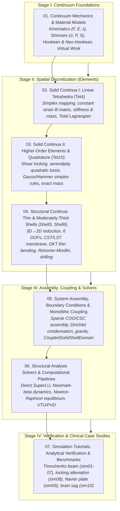

# pSierra Theoretical Foundations & Technical Documentation

Welcome to the theoretical documentation and educational guides for **`pSierra`**, a high-performance 3D Finite Element Method (FEM) simulation engine in modern Python.

This documentation bridges the mathematical foundations of continuum mechanics, numerical algorithms, and source code implementation. Every mathematical symbol, equation, and tensor operation is linked 1:1 with corresponding methods and docstrings in `psierra/src/psierra/`.

---

## Documentation Roadmap & Pedagogical Learning Path

---

## Detailed Curriculum Guides

### 1. [Continuum Mechanics & Constitutive Models](01_continuum_mechanics_and_materials.md)
- Kinematics of deformation: small-strain tensor $\boldsymbol{\varepsilon}$, deformation gradient $\boldsymbol{F}$, right Cauchy-Green tensor $\boldsymbol{C}$, and Green-Lagrange strain $\boldsymbol{E}$.
- Stress tensors: Cauchy stress $\boldsymbol{\sigma}$, First Piola-Kirchhoff $\boldsymbol{P}$, and Second Piola-Kirchhoff $\boldsymbol{S}$.
- Constitutive equations:
  - Linear isotropic elasticity (Hooke's law in 6x6 Voigt notation).
  - Compressible Neo-Hookean hyperelasticity with logarithmic volume penalty $K \ln(J)^2$.
  - 4th-order material tangent elasticity tensor $\mathbb{C} = 2 \frac{\partial \boldsymbol{S}}{\partial \boldsymbol{C}}$.
- Principle of Virtual Displacements (weak form).
- Implementation map: [`Hookean`](../src/psierra/material/hookean.py) and [`NeoHookean`](../src/psierra/material/neohookean.py).

### 2. [Solid Continua I: Linear Tetrahedral Elements (`Tet4`)](02_solid_continua_linear_tet4.md)
- Variational principle of virtual work and isoparametric mapping.
- 4-node constant-strain tetrahedron (`Tet4`): volume evaluation, linear shape functions $N_a(\boldsymbol{X})$, and gradient matrix $\boldsymbol{H}$.
- Small-strain formulation: linear strain-displacement matrix $\boldsymbol{B}_L$, element stiffness $\boldsymbol{k}_e = (\boldsymbol{B}_L^T \boldsymbol{C} \boldsymbol{B}_L) V_e$, and consistent mass matrix $\boldsymbol{m}_e$.
- Large-strain Total Lagrangian (TL) formulation:
  - Non-linear strain-displacement matrix $\boldsymbol{B}(\boldsymbol{u}) = \boldsymbol{B}_L + \boldsymbol{B}_{NL}(\boldsymbol{u})$.
  - Material tangent stiffness $\boldsymbol{k}_{mat} = (\boldsymbol{B}^T \boldsymbol{C} \boldsymbol{B}) V_e$.
  - Geometric initial-stress stiffness $\boldsymbol{k}_{geo} = (\boldsymbol{G}^T \hat{\boldsymbol{S}} \boldsymbol{G}) V_e$.
  - Internal force vector $\boldsymbol{f}_{int} = (\boldsymbol{B}^T \boldsymbol{S}_{voigt}) V_e$.
- Implementation map: [`Tet4`](../src/psierra/element/tet4.py).

### 3. [Solid Continua II: Higher-Order Elements & Simplex Quadrature (`Tet10`)](03_solid_continua_quadratic_tet10_and_quadrature.md)
- Mechanics of artificial shear locking and volumetric locking in linear simplex elements.
- 10-node quadratic tetrahedron (`Tet10`): serendipity quadratic shape functions, barycentric area coordinates $(L_1, L_2, L_3, L_4)$, and Jacobian spatial mapping.
- Numerical quadrature infrastructure over master simplices: 4-point Keast/Hammer and 5-point Hammer cubature rules.
- Total Lagrangian tangent stiffness formulation ($\boldsymbol{k}_{mat} + \boldsymbol{k}_{geo}$) integrated via numerical Gauss rules.
- Exact analytical consistent mass matrix integration using Eisenhower/Hammer closed-form volume formulas.
- Implementation map: [`Tet10`](../src/psierra/element/tet10.py), [`TetrahedronQuadrature`](../src/psierra/element/quadrature.py).

### 4. [Structural Continua: Thin & Moderately Thick Shell Elements (`Shell3`, `Shell6`)](04_structural_shells_thin_and_thick.md)
- Biomechanical dimensional reduction ($3D \to 2D$) for thin anatomical membranes (dura mater, pericardium, organ capsules).
- 6 degrees of freedom per node $[u, v, w, \theta_x, \theta_y, \theta_z]$ and local surface coordinate triad $(\boldsymbol{t}_1, \boldsymbol{t}_2, \boldsymbol{n})$.
- Membrane action: Constant Strain Triangle (CST) and Linear Strain Triangle (LST).
- Plate bending action:
  - Discrete Kirchhoff Triangle (`DKT` in `Shell3`): thin-plate bending with discrete Kirchhoff constraints, free of shear locking.
  - Reissner-Mindlin plate bending (`Shell6`): shear deformable formulation with shear correction factor $\kappa = 5/6$.
- Hughes-Brezzi artificial drilling DOF stabilization ($\alpha_{drill} G t A$).
- Implementation map: [`Shell3`](../src/psierra/element/shell3.py), [`Shell6`](../src/psierra/element/shell6.py), [`ShellDomain`](../src/psierra/domain/shell.py).

### 5. [System Assembly, Boundary Conditions & Monolithic Domain Coupling](05_system_assembly_boundaries_and_domain_coupling.md)
- Triplet Coordinate (COO) assembly strategy for global stiffness $\boldsymbol{K}$ and mass $\boldsymbol{M}$.
- Boundary condition management:
  - Partitioning degrees of freedom into free ($\mathcal{F}$) and prescribed ($\mathcal{P}$) subsets.
  - Static condensation of non-homogeneous Dirichlet supports: $\boldsymbol{K}_{ff}\boldsymbol{u}_f = \boldsymbol{f}_f - \boldsymbol{K}_{fp}\boldsymbol{u}_p$.
  - Support reaction force recovery: $\boldsymbol{R} = \boldsymbol{K}\boldsymbol{u} - \boldsymbol{f}_{ext}$.
- Body force integration: consistent mass-matrix based gravity $\boldsymbol{f}_{grav} = \boldsymbol{M}\boldsymbol{g}$.
- **Monolithic kinematic solid-shell coupling** (`CoupledSolidShellDomain`): exact $C^0$ interface displacement continuity, unified sparsity assembly, and multi-field visualization.
- Implementation map: [`Domain`](../src/psierra/domain/base.py), [`SolidDomain`](../src/psierra/domain/solid.py), [`ShellDomain`](../src/psierra/domain/shell.py), [`CoupledSolidShellDomain`](../src/psierra/domain/coupled.py), [`DirichletManager`](../src/psierra/boundary/dirichlet.py).

### 6. [Structural Analysis Solvers & Computational Pipelines](06_solvers_and_analysis_pipelines.md)
- **Linear Static Analysis**: direct sparse SuperLU factorization for $\boldsymbol{K}_{ff} \boldsymbol{u}_f = \boldsymbol{f}_{eff}$.
- **Linear Dynamic Analysis**: Rayleigh damping $\boldsymbol{C} = \alpha \boldsymbol{M} + \beta \boldsymbol{K}$, implicit Newmark-$\beta$ time integration, and pre-factorization of effective stiffness matrix $\boldsymbol{K}_{eff}$.
- **Nonlinear Static Analysis**: incremental Newton-Raphson iterations, out-of-balance residual $\boldsymbol{R} = \lambda \boldsymbol{f}_{ext} - \boldsymbol{f}_{int}(\boldsymbol{u})$, and backtracking line search guarding against element inversion ($\det(\boldsymbol{F}) \le 0$).
- **Nonlinear Dynamic Analysis**: implicit Newmark-$\beta$ integration coupled with inner Newton-Raphson equilibrium iterations.
- **ParaView Data Exchange**: `.pvd` XML collection generation linking `.vtu` snapshots.
- Implementation map: [`LinearStaticAnalysis`](../src/psierra/analysis/linear_static.py), [`LinearDynamicAnalysis`](../src/psierra/analysis/linear_dynamic.py), [`NonlinearStaticAnalysis`](../src/psierra/analysis/nonlinear_static.py), [`NonlinearDynamicAnalysis`](../src/psierra/analysis/nonlinear_dynamic.py), [`PvdCollectionWriter`](../src/psierra/exchange/pvd.py).

### 7. [Simulation Tutorials, Analytical Verification & Benchmarks](07_simulation_tutorials_and_verification.md)
- Verification against Euler-Bernoulli & Timoshenko beam theory.
- Detailed walkthroughs of all 10 simulation examples (`sim01` through `sim10`).
- Verification tables: static equilibrium balance, energy conservation, dynamic oscillation, hyperelastic large deformation, shear locking alleviation, Navier plate bending, and coupled gravity sag mitigation.
- Post-processing and ParaView visualization instructions for `.vtu` and `.pvd` workflows.

---

## Theoretical Bibliography & Reference Literature

1. **K.J. Bathe**, *Finite Element Procedures*, Prentice Hall, 2nd Edition, 2014.
2. **J. Bonet & R.D. Wood**, *Nonlinear Continuum Mechanics for Finite Element Analysis*, Cambridge University Press, 2nd Edition, 2008.
3. **T. Belytschko, W.K. Liu, B. Moran, & K.I. Elkhodary**, *Nonlinear Finite Elements for Continua and Structures*, Wiley, 2nd Edition, 2014.
4. **O.C. Zienkiewicz, R.L. Taylor, & J.Z. Zhu**, *The Finite Element Method: Its Basis and Fundamentals*, Butterworth-Heinemann, 7th Edition, 2013.
5. **G.A. Holzapfel**, *Nonlinear Solid Mechanics: A Continuum Approach for Engineering*, John Wiley & Sons, 2000.
6. **N.M. Newmark**, *A Method of Computation for Structural Dynamics*, Journal of the Engineering Mechanics Division, ASCE, 85:67-94, 1959.
7. **J.L. Batoz, K.J. Bathe, & L.W. Ho**, *A Study of Three-Node Triangular Plate Bending Elements*, International Journal for Numerical Methods in Engineering, 15:1771-1812, 1980.
8. **T.J.R. Hughes & F. Brezzi**, *On Drilling Degrees of Freedom*, Computer Methods in Applied Mechanics and Engineering, 72:105-121, 1989.
9. **D.A. Dunavant**, *High Degree Efficient Symmetrical Gaussian Quadrature Rules for the Triangle*, International Journal for Numerical Methods in Engineering, 21:1129-1148, 1985.
10. **P.C. Hammer, O.J. Marlowe, & A.H. Stroud**, *Numerical Integration over Simplexes and Cones*, Mathematical Tables and Other Aids to Computation, 10:130-137, 1956.

