# pSierra Theoretical Foundations & Technical Documentation

Welcome to the theoretical documentation and educational guides for **`pSierra`**, a high-performance 3D Finite Element Method (FEM) simulation engine in modern Python.

This documentation bridges the mathematical foundations of continuum mechanics, numerical algorithms, and source code implementation. Every mathematical symbol, equation, and tensor operation is linked 1:1 with corresponding methods and docstrings in `psierra/src/psierra/`.

---

## Documentation Roadmap & Pedagogical Learning Path

```mermaid
flowchart TD
    subgraph Stage1["Stage I: Continuum Foundations"]
        D01["01. Continuum Mechanics & Material Models<br/><i>Kinematics (F, E, ε), Stresses (σ, P, S), Hookean & Neo-Hookean, Virtual Work</i>"]
    end

    subgraph Stage2["Stage II: Spatial Discretization (Elements)"]
        D02["02. Solid Continua I: Linear Tetrahedra (Tet4)<br/><i>Simplex mapping, constant strain B-matrix, stiffness & mass, Total Lagrangian</i>"]
        D03["03. Solid Continua II: Higher-Order Elements & Quadrature (Tet10)<br/><i>Shear locking, serendipity quadratic basis, Gauss/Hammer simplex rules, exact mass</i>"]
        D04["04. Structural Continua: Thin & Moderately Thick Shells (Shell3, Shell6)<br/><i>3D→2D reduction, 6 DOFs, CST/LST membrane, DKT thin bending, Reissner-Mindlin, drilling</i>"]
    end

    subgraph Stage3["Stage III: Assembly, Coupling & Solvers"]
        D05["05. System Assembly, Boundary Conditions & Monolithic Coupling<br/><i>Sparse COO/CSC assembly, Dirichlet condensation, gravity, CoupledSolidShellDomain</i>"]
        D06["06. Structural Analysis Solvers & Computational Pipelines<br/><i>Direct SuperLU, Generalized-alpha dynamics (spectral radius), Newton-Raphson equilibrium, VTU/PVD</i>"]
    end

    subgraph Stage4["Stage IV: Verification, Clinical Digital Twins & Real-Time MOR"]
        D07["07. Simulation Tutorials, Analytical Verification & Benchmarks<br/><i>Timoshenko beam (sim01-07), locking alleviation (sim08), Navier plate (sim09), brain sag (sim10)</i>"]
        D08["08. Model Order Reduction (POD-Galerkin) & Real-Time Dynamics<br/><i>Displacement snapshots, thin SVD, .npz auto-cache, dense Cholesky solver (>20,000 Hz), surface sub-basis</i>"]
        D09["09. Energy-Conserving Hyper-Reduction (ECSW)<br/><i>Nonlinear lifting bottleneck, cubature sub-mesh RID, exact tangent symmetry & SPD, NNLS training</i>"]
    end

    subgraph Stage5["Stage V: Inverse FEM & Clinical Parameter Inversion"]
        D10["10. Inverse FEM, Constitutive Calibration & Stress-Free Inversion<br/><i>Variational shape sensing (FOM/ROM >50,000 Hz), closed-form LLS & TRF identification, Sellier Aitken inversion</i>"]
    end

    subgraph Stage6["Stage VI: Biomechanical Continua & Clinical Digital Twins"]
        D11["11. Biomechanical Continua, Locking Alleviation & Dynamic Relaxation<br/><i>Tet4Fbar (nu -> 0.5), Flory split, nodal dilatation averaging, consistent tangent K_T</i>"]
    end

    Stage1 --> Stage2
    Stage2 --> Stage3
    Stage3 --> Stage4
    Stage4 --> Stage5
    Stage5 --> Stage6

    D01 --> D02
    D02 --> D03
    D03 --> D04
    D04 --> D05
    D05 --> D06
    D06 --> D07
    D07 --> D08
    D08 --> D09
    D09 --> D10
    D10 --> D11
```

---

## Detailed Curriculum Guides

### 1. [Continuum Mechanics & Constitutive Models](01_continuum_mechanics_and_materials.md)
- Kinematics of deformation: small-strain tensor $\boldsymbol{\varepsilon}$, deformation gradient $\boldsymbol{F}$, right Cauchy-Green tensor $\boldsymbol{C}$, and Green-Lagrange strain $\boldsymbol{E}$.
- Stress tensors: Cauchy stress $\boldsymbol{\sigma}$, First Piola-Kirchhoff $\boldsymbol{P}$, and Second Piola-Kirchhoff $\boldsymbol{S}$.
- Constitutive equations:
  - Linear isotropic elasticity (Hooke's law in 6x6 Voigt notation).
  - Compressible Neo-Hookean hyperelasticity with logarithmic volume penalty $K \ln(J)^2$.
  - 4th-order material tangent elasticity tensor $\mathbb{C} = 2 \frac{\partial \boldsymbol{S}}{\partial \boldsymbol{C}}$.
- Principle of Virtual Displacements (weak form).
- Implementation map: [`Hookean`](../src/psierra/material/hookean.py) and [`NeoHookean`](../src/psierra/material/neohookean.py).

### 2. [Solid Continua I: Linear Tetrahedral Elements (`Tet4`, `CorotationalTet4`)](02_solid_continua_linear_tet4.md)
- Variational principle of virtual work and isoparametric mapping.
- 4-node constant-strain tetrahedron (`Tet4`): volume evaluation, linear shape functions $N_a(\boldsymbol{X})$, and gradient matrix $\boldsymbol{H}$.
- Small-strain formulation: linear strain-displacement matrix $\boldsymbol{B}_L$, element stiffness $\boldsymbol{k}_e = (\boldsymbol{B}_L^T \boldsymbol{C} \boldsymbol{B}_L) V_e$, and consistent mass matrix $\boldsymbol{m}_e$.
- Large-strain Total Lagrangian (TL) formulation:
  - Non-linear strain-displacement matrix $\boldsymbol{B}(\boldsymbol{u}) = \boldsymbol{B}_L + \boldsymbol{B}_{NL}(\boldsymbol{u})$.
  - Material tangent stiffness $\boldsymbol{k}_{mat} = (\boldsymbol{B}^T \boldsymbol{C} \boldsymbol{B}) V_e$.
  - Geometric initial-stress stiffness $\boldsymbol{k}_{geo} = (\boldsymbol{G}^T \hat{\boldsymbol{S}} \boldsymbol{G}) V_e$.
  - Internal force vector $\boldsymbol{f}_{int} = (\boldsymbol{B}^T \boldsymbol{S}_{voigt}) V_e$.
- **Corotational Formulation (`CorotationalTet4`)**:
  - Elimination of artificial volume expansion (ballooning) under large rigid-body rotations.
  - SVD polar decomposition $\boldsymbol{F} = \boldsymbol{R} \boldsymbol{U}$, unrotated local displacement $\boldsymbol{u}_l = \boldsymbol{R}^T \boldsymbol{x} - \boldsymbol{X}$.
  - Warped tangent stiffness $\boldsymbol{K}_{tan} = \boldsymbol{\mathcal{R}} \boldsymbol{K}_0 \boldsymbol{\mathcal{R}}^T$ with unconditional symmetry and positive semi-definiteness.
- Implementation map: [`Tet4`](../src/psierra/element/tet4.py), [`CorotationalTet4`](../src/psierra/element/corotational_tet4.py).

### 3. [Solid Continua II: Higher-Order Elements & Simplex Quadrature (`Tet10`)](03_solid_continua_quadratic_tet10_and_quadrature.md)
- Mechanics of artificial shear locking and volumetric locking in linear simplex elements.
- 10-node quadratic tetrahedron (`Tet10`): serendipity quadratic shape functions, barycentric area coordinates $(L_1, L_2, L_3, L_4)$, and Jacobian spatial mapping.
- Numerical quadrature infrastructure over master simplices: 4-point Keast/Hammer and 5-point Hammer cubature rules.
- Total Lagrangian tangent stiffness formulation ($\boldsymbol{k}_{mat} + \boldsymbol{k}_{geo}$) integrated via numerical Gauss rules.
- Exact analytical consistent mass matrix integration using Eisenhower/Hammer closed-form volume formulas.
- Implementation map: [`Tet10`](../src/psierra/element/tet10.py), [`TetrahedronQuadrature`](../src/psierra/element/quadrature.py).

### 4. [Structural Continua: Thin & Moderately Thick Shell Elements (`Shell3`, `CorotationalShell3`, `Shell6`)](04_structural_shells_thin_and_thick.md)
- Biomechanical dimensional reduction ($3D \to 2D$) for thin anatomical membranes (dura mater, pericardium, organ capsules).
- 6 degrees of freedom per node $[u, v, w, \theta_x, \theta_y, \theta_z]$ and local surface coordinate triad $(\boldsymbol{t}_1, \boldsymbol{t}_2, \boldsymbol{n})$.
- Membrane action: Constant Strain Triangle (CST) and Linear Strain Triangle (LST).
- Plate bending action:
  - Discrete Kirchhoff Triangle (`DKT` in `Shell3`): thin-plate bending with discrete Kirchhoff constraints, free of shear locking.
  - Reissner-Mindlin plate bending (`Shell6`): shear deformable formulation with shear correction factor $\kappa = 5/6$.
- Hughes-Brezzi artificial drilling DOF stabilization ($\alpha_{drill} G t A$).
- **Corotational Formulation (`CorotationalShell3`)**:
  - Filters out finite rigid-body rotations via local corotating frame $\boldsymbol{R} \in \mathrm{SO}(3)$.
  - Eliminates geometric distortion, preserving 6 zero eigenvalues for rigid body modes and unconditional tangent symmetry.
- Implementation map: [`Shell3`](../src/psierra/element/shell3.py), [`CorotationalShell3`](../src/psierra/element/corotational_shell3.py), [`Shell6`](../src/psierra/element/shell6.py), [`ShellDomain`](../src/psierra/domain/shell.py).

### 5. [System Assembly, Boundary Conditions & Monolithic Domain Coupling](05_system_assembly_boundaries_and_domain_coupling.md)
- Triplet Coordinate (COO) assembly strategy for global stiffness $\boldsymbol{K}$ and mass $\boldsymbol{M}$.
- Boundary condition management:
  - Partitioning degrees of freedom into free ($\mathcal{F}$) and prescribed ($\mathcal{P}$) subsets.
  - Static condensation of non-homogeneous Dirichlet supports: $\boldsymbol{K}_{ff}\boldsymbol{u}_f = \boldsymbol{f}_f - \boldsymbol{K}_{fp}\boldsymbol{u}_p$.
  - Support reaction force recovery: $\boldsymbol{R} = \boldsymbol{K}\boldsymbol{u} - \boldsymbol{f}_{ext}$.
- Body force integration: consistent mass-matrix based gravity $\boldsymbol{f}_{grav} = \boldsymbol{M}\boldsymbol{g}$.
- **Monolithic kinematic solid-shell coupling** (`CoupledSolidShellDomain`):
  - Exact $C^0$ interface displacement continuity.
  - Unified multi-domain `.vtu` state export with `Domain ID` labeling (`0=Solid`, `1=Shell`), enabling instant ParaView Threshold filtering without separate files.
- Implementation map: [`Domain`](../src/psierra/domain/base.py), [`SolidDomain`](../src/psierra/domain/solid.py), [`ShellDomain`](../src/psierra/domain/shell.py), [`CoupledSolidShellDomain`](../src/psierra/domain/coupled.py), [`DirichletManager`](../src/psierra/boundary/dirichlet.py).

### 6. [Structural Analysis Solvers & Computational Pipelines](06_solvers_and_analysis_pipelines.md)
- **Linear Static Analysis**: direct sparse SuperLU factorization for $\boldsymbol{K}_{ff} \boldsymbol{u}_f = \boldsymbol{f}_{eff}$.
- **Linear Dynamic Analysis**: Rayleigh damping $\boldsymbol{C} = \alpha \boldsymbol{M} + \beta \boldsymbol{K}$, implicit Generalized-$\alpha$ time integration with controllable high-frequency spectral radius $\rho_\infty$, and pre-factorization of effective stiffness matrix $\boldsymbol{K}_{eff}$.
- **Nonlinear Static Analysis**: incremental Newton-Raphson iterations, out-of-balance residual $\boldsymbol{R} = \lambda \boldsymbol{f}_{ext} - \boldsymbol{f}_{int}(\boldsymbol{u})$, and 16-trial backtracking line search guarding against element inversion ($\det(\boldsymbol{F}) \le 0$).
- **Nonlinear Dynamic Analysis**: implicit Generalized-$\alpha$ integration coupled with inner Newton-Raphson equilibrium iterations and high-frequency noise dissipation.
- **Interactive Dynamic Simulation**: real-time simulation ($>12,000\text{ Hz}$ physics, $60+\text{ FPS}$) with online Generalized-$\alpha$, perturbation handling, and in-place VTK grid buffer mutation.
- **Master Map of All Analysis Cases (Section 8)**: complete synthesis mapping problem physics, governing equations, discrete algebra, solver strategy, code classes, and canonical examples across all analysis pipelines.
- Implementation map: [`LinearStaticAnalysis`](../src/psierra/analysis/linear_static.py), [`LinearDynamicAnalysis`](../src/psierra/analysis/linear_dynamic.py), [`NonlinearStaticAnalysis`](../src/psierra/analysis/nonlinear_static.py), [`NonlinearDynamicAnalysis`](../src/psierra/analysis/nonlinear_dynamic.py), [`InteractiveDynamicSimulation`](../src/psierra/analysis/interactive_dynamic.py), [`PvdWriter`](../src/psierra/exchange/pvd.py).

### 7. [Simulation Tutorials, Analytical Verification & Benchmarks](07_simulation_tutorials_and_verification.md)
- Verification against Euler-Bernoulli & Timoshenko beam theory and Navier analytical thin-plate series.
- Comprehensive walkthroughs across all categorized examples:
  - `01_basics` (`0101`, `0102`): element-level unit checks and constitutive response.
  - `02_linear_static` (`0201`–`0204`): tip shear bending, consistent mass gravity, DKT/Reissner plate bending, and monolithic solid-shell coupling.
  - `03_linear_dynamic` (`0301`, `0302`): transient gravity step oscillation and impulse wave propagation.
  - `04_nonlinear_static` (`0401`–`0404`): Saint Venant-Kirchhoff, Total Lagrangian Neo-Hookean, Corotational finite rotation, and Updated Lagrangian.
  - `05_nonlinear_dynamic` (`0501`–`0504`): finite-strain transient dynamics with Generalized-$\alpha$ noise filtering.
  - `06_interactive` (`0601`, `0602`): real-time online cantilever impulse and pure torsional twisting pipelines.
  - `07_benchmarks` (`0701`–`0706`): shear locking alleviation, 4-way kinematic formulation equivalence, 4-way hyperelastic constitutive comparison, spectral radius $\rho_\infty$ filtering, severe $180^\circ$ axial torsion (Poynting effect & cross-sectional warping), and quadratic Tet10 bending compliance.
  - `08_contact` (`0801`–`0806`): static/dynamic rigid floor impact, deformable-on-deformable contact, and Stanford Bunny / cuboid self-contact.
  - `09_mor` (`0901`, `0902`): POD-Galerkin dynamic cantilever beam and real-time interactive neurosurgical brain-shift telemetry.
- Post-processing and ParaView 3D visualization workflows with `.vtu` (static single and variant) and `.pvd` (dynamic time-series) standards.

### 8. [Model Order Reduction & POD-Galerkin Dynamics](08_model_order_reduction_pod_galerkin.md)
- **Mathematical Foundations**:
  - Full-order dynamic structural system $\boldsymbol{M}\ddot{\boldsymbol{u}} + \boldsymbol{C}\dot{\boldsymbol{u}} + \boldsymbol{K}\boldsymbol{u} = \boldsymbol{F}(t)$ and Dirichlet partitioning.
  - Displacement snapshot matrix $\boldsymbol{S} = [\boldsymbol{u}_1, \dots, \boldsymbol{u}_m] \in \mathbb{R}^{n \times m}$ and economic/thin Singular Value Decomposition (SVD).
  - Cumulative singular value energy spectrum truncation $E(r) = \frac{\sum_{i=1}^r \sigma_i^2}{\sum_{i=1}^m \sigma_i^2} \ge \eta$ (default $\eta \ge 0.999$).
  - Orthonormal reduced basis matrix $\boldsymbol{\Phi} \in \mathbb{R}^{n \times r}$ with $\boldsymbol{\Phi}^T \boldsymbol{\Phi} = \boldsymbol{I}_r$.
  - Exact Galerkin projection: $\boldsymbol{K}_r = \boldsymbol{\Phi}_f^T \boldsymbol{K}_{ff} \boldsymbol{\Phi}_f$, $\boldsymbol{M}_r = \boldsymbol{\Phi}_f^T \boldsymbol{M}_{ff} \boldsymbol{\Phi}_f$, $\boldsymbol{C}_r = \boldsymbol{\Phi}_f^T \boldsymbol{C}_{ff} \boldsymbol{\Phi}_f$, and $\boldsymbol{f}_r = \boldsymbol{\Phi}_f^T \boldsymbol{f}_f$.
  - Preserved symmetry and positive-definiteness: $\lambda_{\min}(\boldsymbol{K}_r) > 0, \lambda_{\min}(\boldsymbol{M}_r) > 0$.
- **Real-Time Dynamic Solver**:
  - Generalized-$\alpha$ dynamic stepping on the dense $r \times r$ dynamical system with single Cholesky pre-factorization of $\boldsymbol{K}_{\text{eff}, r}$.
  - Initial acceleration consistency from dynamic equilibrium: $\boldsymbol{M}_r \boldsymbol{a}_{r, 0} = \boldsymbol{f}_r - \boldsymbol{K}_r \boldsymbol{u}_0 - \boldsymbol{C}_r \boldsymbol{v}_0$.
  - Online execution times $< 0.05\text{ ms}$ per step ($> 20{,}000\text{--}50{,}000\text{ Hz}$).
- **Surface Sub-Basis Reconstruction**:
  - Row-slicing $\boldsymbol{\Phi}_{\text{surf}} = \boldsymbol{\Phi}[\text{surface\_dofs}, :]$ eliminating the $\mathcal{O}(N)$ full-mesh lifting bottleneck during 3D visualization.
  - Instantaneous 3D surface point buffer updates in microseconds.
- **Compressed `.npz` Auto-Caching**:
  - Automatic `SnapshotManager.get_or_compute(cache_path, ...)` loading cached snapshots in $< 10\text{ ms}$.
- Implementation map: [`SnapshotManager`](../src/psierra/reduction/snapshots.py), [`PODBasis`](../src/psierra/reduction/basis.py), [`SurfacePODBasis`](../src/psierra/reduction/basis.py), [`ReducedLinearModel`](../src/psierra/reduction/model.py), [`ReducedLinearDynamicSolver`](../src/psierra/reduction/solver.py).

### 9. [Energy-Conserving Sampling and Weighting (ECSW) Hyper-Reduction](09_energy_conserving_hyper_reduction_ecsw.md)
- **The Nonlinear Lifting Bottleneck**: Iterating over all $N_e$ elements every Newton-Raphson iteration destroys real-time performance in nonlinear projection-based ROM.
- **Cubature Approximation**: Approximating reduced internal virtual work over a tiny sub-mesh RID ($|\tilde{\mathcal{E}}| \ll N_e$) with strictly positive weights $w_e > 0$:
  $$\boldsymbol{f}_{r, \text{int}}(\boldsymbol{u}_r) \approx \sum_{e \in \tilde{\mathcal{E}}} w_e \boldsymbol{\Phi}_e^T \boldsymbol{f}_{\text{int}, e}(\boldsymbol{\Phi}_e \boldsymbol{u}_r)$$
- **Guaranteed Variational Properties**:
  - Exact tangent stiffness symmetry $\boldsymbol{K}_{r, t} = \boldsymbol{K}_{r, t}^T$ to machine precision.
  - Strict positive-definiteness preserving numerical stability and energy conservation.
- **Sparse Non-Negative Least Squares (NNLS)**: Greedy column selection with active-set Lawson-Hanson solver.
- **Hyper-Reduced Rigid Contact**: Sub-basis surface projection, vectorized gap evaluation against analytical obstacles, rank-1 symmetric tangent stiffness updates, and Uzawa Augmented Lagrangian multipliers.
- Implementation map: [`ECSWTrainer`](../src/psierra/hyperreduction/ecsw.py), [`HyperReducedECSWModel`](../src/psierra/hyperreduction/model.py), [`HyperReducedDEIMModel`](../src/psierra/hyperreduction/deim.py), [`HyperReducedStaticSolver`](../src/psierra/hyperreduction/solver.py), [`HyperReducedDynamicSolver`](../src/psierra/hyperreduction/solver.py), [`HyperReducedRigidContact`](../src/psierra/hyperreduction/contact.py).

### 10. [Inverse FEM (iFEM), Constitutive Calibration & Stress-Free Inversion](10_inverse_fem_and_parameter_identification.md)
- **Variational Shape Sensing iFEM**:
  - Tessler & Spangler regularized weighted least-squares functional balancing discrete measurement discrepancy vs. internal strain energy: $\min \frac{1}{2}\|\boldsymbol{H}\boldsymbol{u} - \hat{\boldsymbol{u}}\|_{\boldsymbol{W}}^2 + \frac{\alpha}{2}\boldsymbol{u}^T\boldsymbol{K}\boldsymbol{u}$.
  - Continuous barycentric sensor observation operator $\boldsymbol{H} \in \mathbb{R}^{3 N_{\text{sensor}} \times n}$ with exact Voronoi facet projection and partition of unity.
  - Subspace-projected Reduced-Order iFEM (ROM iFEM): Cholesky pre-factorization of dense $r \times r$ normal equations $(\boldsymbol{H}_r^T \boldsymbol{W} \boldsymbol{H}_r + \alpha \boldsymbol{K}_r)$ executing in $< 15\ \mu\text{s}$ ($> 65{,}000\text{ Hz}$).
  - Instant direct subcortical landmark / tumor tracking: $\boldsymbol{u}_{\text{target}} = \boldsymbol{\Phi}_{\text{target}} \boldsymbol{u}_r$ (< 0.1 mm precision).
- **Inverse Material Parameter Identification**:
  - Closed-form exact linear elasticity calibration evaluating in $< 1\ \mu\text{s}$ to machine precision ($< 10^{-14}\%$ error).
  - Trust-Region Reflective (TRF) and L-BFGS-B non-linear optimization with parameter bounds.
- **Stress-Free Reference Configuration Inversion**:
  - Eliminating intraoperative "double-gravity bias" where pre-operative supine MRI scans $\boldsymbol{X}_{\text{scan}}$ are already sagged under in-vivo 1G gravity.
  - Sellier backward fixed-point iteration: $\boldsymbol{X}_0^{(k+1)} = \boldsymbol{X}_0^{(k)} + \omega_k (\boldsymbol{X}_{\text{scan}} - [\boldsymbol{X}_0^{(k)} + \boldsymbol{u}(\boldsymbol{X}_0^{(k)}; \boldsymbol{g}_{\text{supine}})])$.
  - Adaptive Aitken $\Delta^2$ dynamic under-relaxation reducing position residuals to $< 0.33\text{ mm}$ in 4 iterations.
- Implementation map: [`SensorObservationOperator`](../src/psierra/inverse/observation.py), [`ReducedSensorObservationOperator`](../src/psierra/inverse/observation.py), [`FullOrderShapeSensingSolver`](../src/psierra/inverse/shape_sensing.py), [`ReducedOrderShapeSensingSolver`](../src/psierra/inverse/shape_sensing.py), [`MaterialParameterIdentifier`](../src/psierra/inverse/parameter_identification.py), [`StressFreeConfigurationSolver`](../src/psierra/inverse/stress_free.py).

### 11. [Biomechanical Continua, Locking Alleviation & Dynamic Relaxation](11_biomechanical_continua_and_dynamic_relaxation.md)
- Incompressibility regime in soft parenchymal tissues ($\nu \to 0.5$, $K/\mu \approx 500$).
- Volumetric locking alleviation via Flory multiplicative split ($\bar{\boldsymbol{F}} = (\bar{J}/J)^{1/3} \boldsymbol{F}$).
- Average Nodal Dilatation: non-local nodal volume smoothing eliminating volumetric over-constraint.
- Total Lagrangian formulation with consistent material and geometric tangent stiffness matrices $\boldsymbol{K}_T$.
- Implementation map: [`Tet4Fbar`](../src/psierra/element/tet4_fbar.py).

---

## Theoretical Bibliography & Reference Literature

1. **K.J. Bathe**, *Finite Element Procedures*, Prentice Hall, 2nd Edition, 2014.
2. **J. Bonet & R.D. Wood**, *Nonlinear Continuum Mechanics for Finite Element Analysis*, Cambridge University Press, 2nd Edition, 2008.
3. **T. Belytschko, W.K. Liu, B. Moran, & K.I. Elkhodary**, *Nonlinear Finite Elements for Continua and Structures*, Wiley, 2nd Edition, 2014.
4. **O.C. Zienkiewicz, R.L. Taylor, & J.Z. Zhu**, *The Finite Element Method: Its Basis and Fundamentals*, Butterworth-Heinemann, 7th Edition, 2013.
5. **G.A. Holzapfel**, *Nonlinear Solid Mechanics: A Continuum Approach for Engineering*, John Wiley & Sons, 2000.
6. **N.M. Newmark**, *A Method of Computation for Structural Dynamics*, Journal of the Engineering Mechanics Division, ASCE, 85:67-94, 1959.
7. **J. Chung & G.M. Hulbert**, *A Time Integration Algorithm for Structural Dynamics with Improved Numerical Dissipation: The Generalized-$\alpha$ Method*, Journal of Applied Mechanics, 60(2):371-375, 1993.
8. **S. Volkwein**, *Proper Orthogonal Decomposition: Theory and Reduced-Order Modelling*, Lecture Notes, University of Konstanz, 2013.
9. **P. Benner, S. Gugercin, & K. Willcox**, *A Survey of Projection-Based Model Reduction Methods for Parametric Dynamical Systems*, SIAM Review, 57(4):483-531, 2015.
10. **C. Farhat, P. Avery, T. Chapman, & J. Cortial**, *Dimensional Reduction of Nonlinear Finite Element Dynamic Models with Energy-Conserving Mesh Sampling and Weighting (ECSW)*, International Journal for Numerical Methods in Engineering, 98(9):625-662, 2014.
11. **A. Tessler & H.R. Spangler**, *A Variational Principle for Reconstruction of Elastic Deformations in Shear Deformable Plates and Shells*, Computer Methods in Applied Mechanics and Engineering, 194(2-5):327-347, 2005.
12. **M. Gherlone, P. Cerracchio, M. Mattone, M. Di Sciuva, & A. Tessler**, *Shape Sensing of 3D Frame Structures Using an Inverse Finite Element Method*, Composite Structures, 94(8):2426-2438, 2012.
13. **M. Sellier**, *An Iterative Method for the Determination of the Stress-Free Configuration of Hyperelastic Materials*, Computer Methods in Applied Mechanics and Engineering, 200(49-52):3381-3388, 2011.
14. **B.M. Irons & R.C. Tuck**, *A Version of the Aitken Accelerator for Computer Iteration*, International Journal for Numerical Methods in Engineering, 1(3):275-277, 1969.
15. **A. Tarantola**, *Inverse Problem Theory and Methods for Model Parameter Estimation*, SIAM, 2005.
16. **J.L. Batoz, K.J. Bathe, & L.W. Ho**, *A Study of Three-Node Triangular Plate Bending Elements*, International Journal for Numerical Methods in Engineering, 15:1771-1812, 1980.
17. **T.J.R. Hughes & F. Brezzi**, *On Drilling Degrees of Freedom*, Computer Methods in Applied Mechanics and Engineering, 72:105-121, 1989.
18. **D.A. Dunavant**, *High Degree Efficient Symmetrical Gaussian Quadrature Rules for the Triangle*, International Journal for Numerical Methods in Engineering, 21:1129-1148, 1985.
19. **P.C. Hammer, O.J. Marlowe, & A.H. Stroud**, *Numerical Integration over Simplexes and Cones*, Mathematical Tables and Other Aids to Computation, 10:130-137, 1956.

